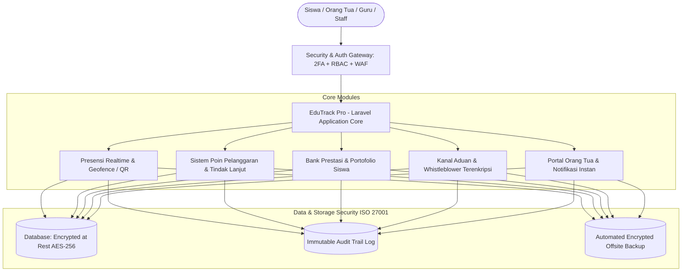
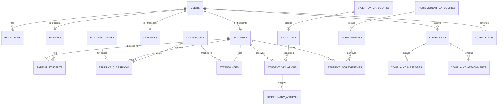
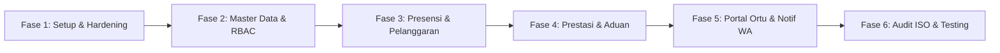

# Master Architectural Plan: Sistem Monitoring Terpadu Sekolah (EduTrack Pro)

Dokumen ini merupakan cetak biru (*blueprint*) dan panduan arsitektur komprehensif untuk pembangunan aplikasi sekolah terintegrasi dengan **Laravel versi terbaru**. Sistem ini dirancang untuk menyatukan pencatatan kehadiran, kedisiplinan (pelanggaran), apresiasi prestasi, kanal aduan/whistleblowing aman, serta pelaporan langsung ke orang tua dalam satu aplikasi terpadu dengan standar keamanan **ISO/IEC 27001** dan **OWASP Top 10**.

---

## 1. Visi Sistem & Ringkasan Kebutuhan

Aplikasi ini bertujuan untuk menciptakan ekosistem sekolah yang transparan, akuntabel, dan aman dengan modul utama:



### Key Functional Requirements:
1. **Presensi Terpadu**: Pencatatan kehadiran harian dan per-mata pelajaran siswa (Hadir, Sakit, Izin, Alpa, Terlambat) melalui QR Code dinamis / RFID / Guru Piket, lengkap dengan geofencing timestamp.
2. **Sistem Pelanggaran & Tata Tertib (Demerit Points)**: Buku tatib digital berjenjang (Ringan, Sedang, Berat) dengan poin akumulasi, otomatisasi penerbitan Surat Peringatan (SP 1, SP 2, SP 3) dan panggilan orang tua.
3. **Kanal Aduan / Whistleblowing System**: Sarana pelaporan aman bagi siswa & orang tua (pencegahan bullying, pungutan liar, fasilitas, dll.) dengan opsi **Anonim** atau **Terbuka**, status penanganan transparan, dan chat terenkripsi dengan Guru BK/Kepala Sekolah.
4. **Bank Prestasi Siswa (Merit Points)**: Pencatatan prestasi akademik & non-akademik berjenjang (Sekolah hingga Internasional) lengkap dengan verifikasi sertifikat, poin apresiasi, dan ekspor portofolio siswa.
5. **Portal & Laporan Orang Tua**: Dashboard ramah mobile khusus orang tua untuk memantau data anak secara terisolasi (presensi harian, grafik pelanggaran vs prestasi, unduh rapor kedisiplinan) dengan notifikasi instan via WhatsApp Gateway & Email.
6. **UI/UX Bersih & Ergonomis**: Tampilan serba putih (*clean white aesthetic*), kontras tinggi, navigasi intuitif, dilengkapi komponen tabel standar industri: *Server-side Pagination*, *Debounced Instant Search*, dan *Multi-criteria Dynamic Filters*.

---

## 2. Kepatuhan Keamanan & Standar Server (ISO/IEC 27001 & OWASP)

Sistem dirancang mengacu pada kontrol keamanan informasi internasional **ISO/IEC 27001:2022** dan **OWASP Top 10 (2021/2026)**.

### A. Kontrol Aplikasi (Application Level)
| Kontrol ISO 27001 | Penerapan pada Laravel Core |
| :--- | :--- |
| **A.9.2 Access Control & Least Privilege** | Menggunakan **Spatie Laravel Permission** dengan granular role: `Superadmin`, `Kepala Sekolah`, `Guru BK`, `Wali Kelas`, `Guru Piket`, `Orang Tua`, `Siswa`. Authorization wajib divalidasi via **Laravel Policies** dan **Form Requests**. |
| **A.9.4 IDOR Prevention** | Penggunaan **UUIDv7** sebagai primary key publik pada model sensitif (`complaints`, `students`, `student_violations`) untuk mencegah scraping/enumerasi ID sekuensial. Semua query orang tua wajib di-*scope* berdasarkan `auth()->user()->parent->students`. |
| **A.10.1 Cryptographic Controls** | Data sensitif (catatan konseling BK, isi aduan anonim, nomor kontak darurat) dienkripsi menggunakan cipher **AES-256-GCM** via Laravel Eloquent Casts (`encrypted`). Password di-hash menggunakan algoritma **Argon2id**. |
| **A.12.4 Logging & Monitoring** | Audit trail otomatis via **Spatie Activitylog** mencatat setiap aktivitas mutasi data (*Who*, *What*, *When*, *Old Value*, *New Value*, *IP Address*, *User-Agent*). Log tidak dapat diubah oleh pengguna biasa (*immutable*). |
| **A.14.2 Secure Development (OWASP)** | Proteksi CSRF token di setiap form stateful, sanitasi output Blade (`{{ }}`) untuk mitigasi XSS, perlindungan SQL Injection via Eloquent Prepared Statements, dan validasi MIME type ketat pada upload dokumen bukti/sertifikat. |
| **A.8.5 Multi-Factor Authentication** | Wajib 2FA (TOTP / Google Authenticator) untuk role struktural (`Superadmin`, `Kepala Sekolah`, `Guru BK`). |
| **Rate Limiting (Anti-Brute Force & DoS)** | Throttle limit di endpoint login (5 attempts/menit) dan pengiriman tiket aduan (3 submissions/jam per IP/user). |

### B. Kontrol Server & Infrastruktur (Server Hardening)
1. **Enkripsi Transit**:
   - Wajib HTTPS dengan TLS 1.3 only, cipher suite modern.
   - Implementasi header **HSTS** (*Strict-Transport-Security: max-age=31536000; includeSubDomains; preload*).
2. **Security Headers Lengkap**:
   - `Content-Security-Policy (CSP)`: Menolak eksekusi inline script tak terpercaya.
   - `X-Frame-Options: DENY`: Mencegah serangan Clickjacking.
   - `X-Content-Type-Options: nosniff`: Mencegah MIME-sniffing exploit.
   - `Referrer-Policy: strict-origin-when-cross-origin`.
   - `Permissions-Policy: camera=(self), geolocation=(self), microphone=()`.
3. **Web Application Firewall (WAF) & Intrusion Prevention**:
   - Integrasi Cloudflare / ModSecurity WAF untuk filtering botnet & DDOS.
   - **Fail2ban** untuk memblokir IP yang gagal autentikasi berulang kali pada SSH dan Laravel Login.
4. **Principle of Least Privilege OS**:
   - Aplikasi berjalan di bawah user non-root (contoh: `www-data` atau `scholl_app_user`).
   - Direktori `storage` dan `bootstrap/cache` memiliki permission ketat (`chmod 775`, `chown` ke user web). Direktori `public` tidak boleh bisa ditulisi file PHP liar.
5. **Cadangan Terenkripsi Otomatis (ISO 27001 A.12.3)**:
   - Automated Daily Snapshot & Database Dump terenkripsi PGP/GPG yang dikirim ke offsite storage (S3 bucket terisolasi) dengan retensi 30 hari (Aturan 3-2-1 Backup).

---

## 3. Tech Stack & Arsitektur Solusi

| Layer | Teknologi Rekomendasi | Alasan Pemilihan |
| :--- | :--- | :--- |
| **Framework Backend** | **Laravel 11 / 12 (PHP 8.3+)** | Keamanan bawaan matang, arsitektur modular, ekosistem ekstensif (Auth, Policies, Queue, Scheduler). |
| **Database Engine** | **PostgreSQL 16 / MySQL 8.0** | ACID compliance tinggi, dukungan JSONB untuk fleksibilitas audit log dan skema kustom kriteria pelanggaran/prestasi. |
| **Frontend & Interaktivitas** | **Laravel Livewire 3 + Alpine.js + Tailwind CSS** | Solusi full-stack reaktif tanpa kompleksitas REST API terpisah. Mendukung *dynamic pagination*, *real-time search debouncing*, dan *modal dialog* yang sangat cepat dan ringan. |
| **Styling & Theme** | **Tailwind CSS (Custom Clean White Palette)** | Menghasilkan UI modern, minimalis, profesional dengan dominasi warna putih polos (`#FFFFFF`), aksen netral abu-abu halus (`#F8FAFC`, `#E2E8F0`), dan tipografi Inter yang bersih. |
| **Cache & Queue Driver** | **Redis 7** | Penanganan queue notifikasi WA/Email, session caching berkecepatan tinggi, dan rate limiting terdistribusi. |
| **Export Engine** | **DomPDF / Snappy & Laravel Excel (Maatwebsite)** | Menghasilkan rapor digital, surat peringatan (SP) ber-QR Code verifikasi, dan rekap kehadiran/pelanggaran format PDF & Excel. |
| **Notifikasi Gateway** | **WhatsApp Webhook API (Fonnte/Wablas/Twilio) + SMTP/Resend** | Komunikasi instan langsung ke perangkat orang tua secara real-time. |

---

## 4. Desain Skema Database (Entity Relationship Blueprint)

Berikut adalah entitas dan relasi database utama untuk memenuhi seluruh kebutuhan sistem:



### Rincian Tabel Utama:

#### 1. Manajemen Akun & Pengguna
- `users`: `id (uuid)`, `name`, `email`, `phone_number`, `password`, `two_factor_secret`, `is_active`, `last_login_at`, `created_at`, `updated_at`.
- `roles` & `permissions`: Dikelola oleh Spatie Permission.
- `teachers`: `id`, `user_id`, `nip`, `gender`, `is_homeroom`, `created_at`.
- `students`: `id (uuid)`, `user_id (nullable)`, `nis`, `nisn`, `full_name`, `gender`, `birth_date`, `address`, `total_demerit_points (default 0)`, `total_merit_points (default 0)`.
- `parents`: `id (uuid)`, `user_id`, `nik`, `full_name`, `whatsapp_number`, `occupation`.
- `parent_students`: `id`, `parent_id`, `student_id`, `relationship_type (ayah, ibu, wali)`, `is_emergency_contact`.

#### 2. Akademik & Kelas
- `academic_years`: `id`, `name (2026/2027)`, `semester (ganjil/genap)`, `is_active`.
- `classrooms`: `id`, `academic_year_id`, `teacher_id (wali kelas)`, `name (X-RPL-1)`, `grade_level (10, 11, 12)`.
- `student_classroom`: `id`, `student_id`, `classroom_id`, `academic_year_id`, `status (aktif/lulus/pindah)`.

#### 3. Presensi & Kehadiran
- `attendances`:
  - `id (uuid)`
  - `student_id`, `classroom_id`, `recorded_by (user_id)`
  - `date`, `check_in_time`, `check_out_time`
  - `status (hadir, sakit, izin, alpa, terlambat)`
  - `late_minutes (default 0)`
  - `proof_attachment (foto surat dokter / izin)`
  - `latitude`, `longitude` (jika presensi mandiri)
  - `notes`

#### 4. Kedisiplinan & Pelanggaran
- `violation_categories`: `id`, `name (Kedisiplinan Waktu, Kerapian, Norma Susila, Anti-Kekerasan/Bullying)`.
- `violations`: `id`, `category_id`, `code`, `title`, `demerit_points (misal: 5, 15, 50)`, `severity (ringan, sedang, berat)`.
- `student_violations`:
  - `id (uuid)`
  - `student_id`, `violation_id`, `reported_by (user_id)`, `handled_by (guru BK user_id)`
  - `occurred_at`, `location`, `description`
  - `evidence_photo_path`
  - `status (diverifikasi, dalam_penanganan, selesai)`
- `disciplinary_actions`:
  - `id (uuid)`
  - `student_violation_id`, `action_type (teguran_lisan, surat_peringatan_1, surat_peringatan_2, surat_peringatan_3, panggilan_ortu, skorsing)`
  - `letter_number`, `letter_pdf_path`, `parent_notified_at`, `parent_signed_at`

#### 5. Prestasi & Apresiasi
- `achievement_categories`: `id`, `name (Sains/Teknologi, Olahraga, Seni & Budaya, Keagamaan, Kepemimpinan)`.
- `student_achievements`:
  - `id (uuid)`
  - `student_id`, `category_id`
  - `title`, `level (sekolah, kecamatan, kota, provinsi, nasional, internasional)`
  - `rank (juara 1, juara 2, juara 3, harapan, partisipan)`
  - `merit_points (misal: 10, 25, 50, 100)`
  - `certificate_path`, `organizer`, `date_achieved`
  - `verified_by (user_id)`, `status (draft, pending_verification, verified)`

#### 6. Aduan & Whistleblowing (Anti-Bullying & Keluhan)
- `complaints`:
  - `id (uuid)`
  - `ticket_number` (format unik: `WB-202611-XXXX`)
  - `user_id (nullable jika is_anonymous = true)`
  - `reporter_type (siswa, orang_tua, umum)`
  - `category (bullying/perundungan, fasilitas, keuangan, pelecehan, akademik)`
  - `title`, `description (encrypted text)`
  - `is_anonymous (boolean)`
  - `status (diajukan, investigasi, tindakan, selesai, ditolak)`
  - `assigned_to (user_id - Guru BK atau Tim Khusus)`
- `complaint_messages`:
  - `id (uuid)`, `complaint_id`, `sender_user_id (nullable jika anonymous)`, `message (encrypted text)`, `created_at`
- `complaint_attachments`:
  - `id (uuid)`, `complaint_id`, `file_path (terenkripsi di disk privat)`, `mime_type`

#### 7. Audit & Kepatuhan ISO
- `activity_log`: Format Spatie lengkap dengan `log_name`, `description`, `subject_type`, `subject_id`, `causer_id`, `properties`, `ip_address`, `user_agent`.

---

## 5. Standar UI/UX: Modern Minimalis "Clean White"

Sesuai permintaan, tampilan mengusung konsep **Clean White Minimalist Professional**:

### A. Palet Warna & Desain Token
- **Background Utama**: Pure White `#FFFFFF` dengan background kontainer sekunder Muted White `#F8FAFC`.
- **Borders & Dividers**: Subtle Slate `#E2E8F0` / `#F1F5F9` (garis tipis 1px yang tegas namun tidak mengganggu mata).
- **Tipografi**:
  - Primary Text: Deep Slate `#0F172A` (tingkat keterbacaan tinggi / AA compliant).
  - Secondary / Label: Muted Slate `#64748B`.
- **Aksen Fungsional (Subtle & Tidak Mencolok)**:
  - Sukses/Hadir/Prestasi: Emerald Green lembut (`bg-emerald-50 text-emerald-700 border-emerald-200`).
  - Peringatan/Terlambat: Amber lembut (`bg-amber-50 text-amber-700 border-amber-200`).
  - Bahaya/Pelanggaran/Alpa: Rose Red lembut (`bg-rose-50 text-rose-700 border-rose-200`).
  - Aksi/Brand: Indigo / Neutral Black (`bg-slate-900 text-white hover:bg-slate-800`).

### B. Komponen Data Table Standar (Operasional Mudah & Cepat)
Semua halaman data (Kehadiran, Pelanggaran, Prestasi, Aduan) wajib memiliki 3 pilar:
1. **Instant Searching (Real-time & Debounced)**:
   - Input search dengan ikon pencarian bersih, debounced 300ms via Livewire (`wire:model.live.debounce.300ms="search"`).
   - Mencari secara multi-kolom (Nama Siswa, NISN, Kelas, Nomor Tiket).
2. **Multi-criteria Filtering**:
   - Filter bar rapi di atas tabel:
     - Dropdown Kelas (Tingkat / Rombel).
     - Dropdown Kategori / Status (Contoh: Hadir/Alpa, Ringan/Berat, Verifikasi/Pending).
     - Date Range Picker (Hari ini, 7 hari terakhir, Bulan ini, Rentang Kustom).
   - Tombol *Reset Filter* satu-klik.
3. **Responsive Server-Side Pagination**:
   - Pilihan jumlah baris per halaman (10, 25, 50, 100 entri).
   - Indikator: "Menampilkan 1 - 25 dari 1.250 data".
   - Navigasi paginasi bersih tanpa reload halaman penuh.

### C. Visual Wireframe Layout Tabel

```
+---------------------------------------------------------------------------------------------------+
|  [Logo] EduTrack Pro    | Dashboard   Presensi   Pelanggaran   Prestasi   Aduan |  (User Profile) v |
+---------------------------------------------------------------------------------------------------+
|  Dashboard > Pelanggaran Siswa                                                    [+ Catat Baru]  |
|                                                                                                   |
|  [ Stat Card 1: Pelanggaran Bulan Ini ] [ Stat Card 2: Menunggu Tindakan ] [ Stat Card 3: SP Aktif ]
|                                                                                                   |
|  +-- CONTROL BAR -------------------------------------------------------------------------------+ |
|  | [🔍 Cari Siswa / NISN / Kasus...]  | [Filter Kelas: Semua v] [Status: Semua v] [Rentang Tanggal v] | [Reset] |
|  +----------------------------------------------------------------------------------------------+ |
|                                                                                                   |
|  +-- CLEAN WHITE TABLE -------------------------------------------------------------------------+ |
|  | [ ] | Tanggal    | NISN / Siswa        | Kelas    | Pelanggaran         | Poin | Status   | Aksi   | |
|  |-----+------------+---------------------+----------+---------------------+------+----------+--------| |
|  | [ ] | 23/11/2026 | 008123 - Ahmad R.   | X-RPL-1  | Terlambat Masuk (3x)| -5   | [Diproses] | [...]  | |
|  | [ ] | 22/11/2026 | 008145 - Siti N.    | XI-MIPA-2| Atribut Seragam     | -5   | [Selesai]  | [...]  | |
|  | [ ] | 20/11/2026 | 007991 - Budi S.    | XII-IPS-1| Merokok di Kantin   | -25  | [SP-1]     | [...]  | |
|  +----------------------------------------------------------------------------------------------+ |
|  Menampilkan 1 - 10 dari 48 pelanggaran                                  < Sebelumnya [1] 2 3 [Berikutnya] >
+---------------------------------------------------------------------------------------------------+
```

---

## 6. Arsitektur Modul Fitur Unggulan

### 1. Modul Presensi & Notifikasi Instan
- **Metode**: Guru kelas atau guru piket dapat melakukan presensi satu kelas sekaligus (Bulk Attendance Mode) dalam hitungan detik. Siswa juga dapat menggunakan barcode scanner di gerbang sekolah.
- **Automasi Notifikasi**: Ketika status presensi diubah menjadi `Alpa` atau `Terlambat > 15 Menit`, sistem secara otomatis memicu job antrean (Laravel Queue) untuk mengirim pesan WhatsApp ke nomor orang tua:
  > *"Bapak/Ibu Orang Tua dari [Nama Siswa], kami informasikan bahwa ananda hari ini tercatat TIDAK HADIR (Alpa) di sekolah. Mohon konfirmasi ke pihak wali kelas jika ananda sakit/berhalangan. Terima kasih."*

### 2. Modul Pelanggaran & Tindak Lanjut Terstruktur
- **Sistem Poin Transparan**: Setiap jenis pelanggaran memiliki skor poin pasti sesuai buku pedoman sekolah.
- **Ambang Peringatan Otomatis (Threshold Automation)**:
  - 20 Poin: Peringatan Lisan & Bimbingan Wali Kelas.
  - 50 Poin: Peringatan Tertulis 1 (SP-1) + Notifikasi resmi ke portal orang tua.
  - 75 Poin: Peringatan Tertulis 2 (SP-2) + Surat Pemanggilan Orang Tua otomatis ter-generate dalam format PDF ber-QR code.
  - 100 Poin: Konferensi Kasus & Pertimbangan Skorsing/Pengembalian ke Orang Tua.

### 3. Modul Prestasi Terintegrasi (Keseimbangan Karakter)
- Mencatat pencapaian siswa untuk membangun portofolio digital yang seimbang (*balance system*).
- Setiap prestasi memberikan poin merit yang dapat dijadikan penilaian rapor karakter, piagam penghargaan, serta apresiasi di dashboard siswa dan portal orang tua.

### 4. Modul Aduan & Whistleblower Terlindungi (Anti-Bullying)
- Pelapor dapat memilih opsi: **"Kirim Secara Anonim"** (identitas di-hash & disamarkan dari guru/staff) atau **"Dengan Identitas"**.
- Tiket aduan memiliki kode pelacakan unik (`WB-XXXX`).
- Jalur komunikasi terenkripsi dua arah antara pelapor dan Tim Penanganan Kekerasan di Sekolah (TPK / Guru BK) tanpa pelapor takut diintimidasi.

### 5. Portal Mandiri Orang Tua
- Antarmuka khusus yang ramah smartphone, orang tua cukup login dengan No HP / WhatsApp yang terverifikasi (OTP WhatsApp / Secure Link).
- Orang tua hanya dapat melihat rekap anak-anak mereka sendiri (terisolasi penuh secara sistem).
- Fitur unduh laporan berkala kedisiplinan & presensi siswa berformat PDF.

---

## 7. Roadmap Implementasi Bertahap



1. **Fase 1: Setup Proyek & Security Hardening (Fondasi)**
   - Instalasi Laravel versi terbaru, konfigurasi database, Redis, Spatie Permission, dan Spatie Activitylog.
   - Setup Tailwind CSS dengan *Clean White theme presets*.
   - Konfigurasi middleware keamanan (CSP, HSTS, Rate Limiting, XSS & SQLi Sanitization).
2. **Fase 2: Master Data & Akses Multi-Role**
   - Migrasi skema: Tahun Ajaran, Kelas, Guru, Siswa, dan Relasi Orang Tua.
   - Pembangunan komponen reusable Livewire: Base Table (Search, Filter, Pagination, Sorting).
3. **Fase 3: Modul Presensi & Pelanggaran (Disiplin)**
   - UI Presensi harian cepat (Bulk Sheet).
   - Modul pelanggaran, katalog tatib, sistem kalkulasi poin minus, dan generator Surat Peringatan (SP) PDF.
4. **Fase 4: Modul Prestasi & Whistleblowing System**
   - Modul prestasi, approval verifikasi sertifikat oleh kesiswaan, dan poin apresiasi.
   - Modul pengaduan terlindungi (enkripsi AES-256 pada pesan aduan, opsi anonim, dan chat tiket tertutup).
5. **Fase 5: Portal Orang Tua & Integrasi Notifikasi WhatsApp**
   - Dashboard ringkas khusus orang tua (Mobile responsive).
   - Integrasi WhatsApp Gateway untuk pengiriman alert otomatis saat anak alpa atau melakukan pelanggaran.
6. **Fase 6: Pengujian Keamanan ISO 27001, Pen-test & Deployment**
   - Audit kepatuhan OWASP (SQLi, IDOR, XSS, CSRF test).
   - Pengujian beban (*load testing*) dan konfigurasi automated backup terenkripsi.
