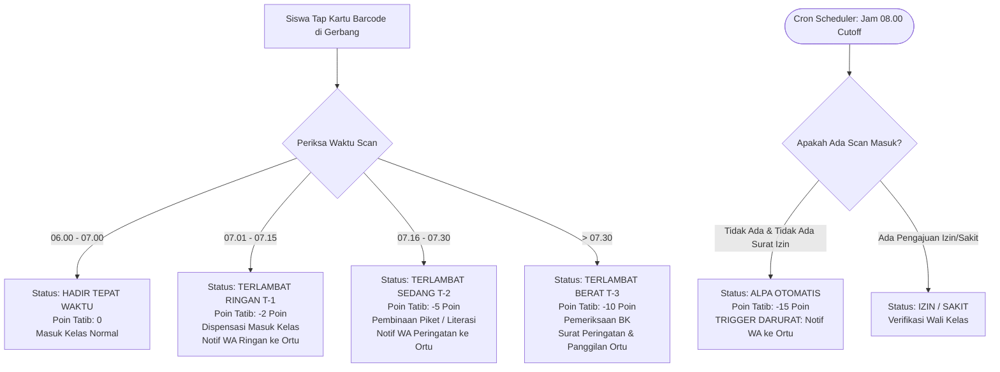
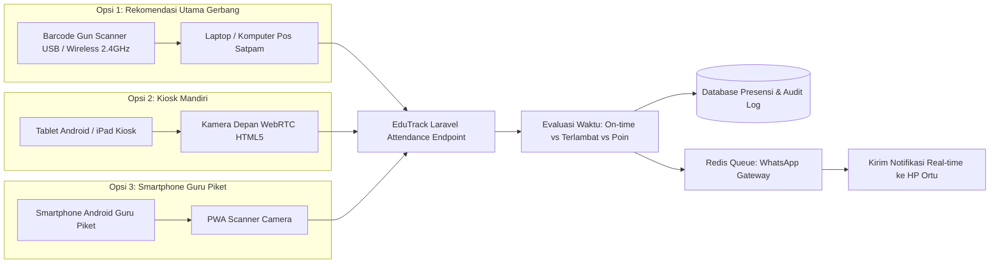

# Cetak Biru: Sistem Barcode Kartu Pelajar & Rule Engine Keterlambatan Presensi

Dokumen ini menjelaskan rancangan komprehensif sistem pemindaian barcode kartu pelajar untuk presensi, aturan berjenjang keterlambatan siswa, integrasi poin kedisiplinan, keamanan barcode anti-duplikasi, serta mekanisme pencetakan kartu fisik standar ISO.

---

## 1. Skema & Aturan Keterlambatan (Attendance Rule Engine)

Sistem presensi tidak sekadar mencatat hadir/tidak hadir, melainkan beroperasi sebagai **mesin aturan (*rule engine*) otomatis** yang terhubung langsung dengan buku tata tertib dan gateway notifikasi WhatsApp orang tua.



### Rincian Jendela Waktu & Konsekuensi Kedisiplinan:

| Jendela Waktu | Kategori Presensi | Poin Tatib (Demerit) | Tindakan Sekolah | Integrasi WhatsApp Orang Tua |
| :--- | :--- | :---: | :--- | :--- |
| **06.00 - 07.00** | **Hadir Tepat Waktu** | `0` | Siswa langsung menuju kelas untuk tadarus/literasi pagi. | Rekap harian masuk ke portal orang tua. |
| **07.01 - 07.15** | **Terlambat Ringan (T-1)** | `-2` | Siswa melapor ke Guru Piket, dicatat alasannya, dan diberikan surat izin masuk kelas. | Notifikasi WA info: *"Ananda [Nama] tercatat hadir pukul 07.08 (Terlambat 8 menit)."* |
| **07.16 - 07.30** | **Terlambat Sedang (T-2)** | `-5` | Pintu gerbang utama ditutup. Siswa diarahkan ke pos pembinaan (membersihkan area literasi / bimbingan karakter). | Notifikasi WA peringatan: *"Ananda [Nama] terlambat >15 menit dan sedang mengikuti pembinaan kedisiplinan."* |
| **> 07.30** | **Terlambat Berat (T-3)** | `-10` | Siswa diserahkan ke Guru BK. Wajib membuat surat pernyataan dan orang tua dihubungi langsung. | Panggilan telepon / notifikasi resmi pemanggilan orang tua ke sekolah. |
| **08.00 WIB** | **Auto-Alpa (Cutoff Time)** | `-15` | Cron Job otomatis menandai siswa yang belum hadir sebagai **Alpa (Tanpa Keterangan)**. | **Alert Darurat WA**: *"Bapak/Ibu, ananda tercatat TIDAK HADIR di sekolah tanpa keterangan. Mohon konfirmasi segera keberadaan ananda."* |
| **14.30 - 17.00** | **Presensi Pulang (Check-out)** | `0` | Siswa tap kartu saat jam pulang untuk memverifikasi siswa tidak membolos di tengah pelajaran. | Info kepulangan siswa tercatat di aplikasi. |

---

## 2. Arsitektur Kartu Pelajar & Desain Fisik (ISO CR-80)

Kartu pelajar dibuat mengikuti dimensi standar perbankan dunia **ISO/IEC 7810 ID-1 (CR-80)**:
- **Panjang x Lebar**: `85.60 mm x 53.98 mm` (Tebal 0.76 mm, material PVC glossy/doff).
- **Format Barcode**: Menggunakan simbologi ganda:
  1. **Barcode 1D (Code 128)**: Sangat kompatibel dengan semua jenis pemindai laser / optik USB scanner murah tanpa lag.
  2. **QR Code 2D (Cryptographically Signed)**: Memuat payload ber-tanda tangan digital HMAC-SHA256 untuk memverifikasi keaslian kartu dan mencegah pemalsuan/titip absen.

```
+-------------------------------------------------------------------------------+
| [LOGO]  SMK NEGERI UNGGULAN 1                           KARTU IDENTITAS SISWA |
|         Jl. Pendidikan No. 45, Kota Teladan            ISO/IEC 27001 SECURED  |
|-------------------------------------------------------------------------------|
|  +---------+   Nama Lengkap   : AHMAD RIFAI                                   |
|  |         |   NISN / NIS     : 0081234567 / 24081                            |
|  |  FOTO   |   Kelas / Rombel : X-RPL-1 (Rekayasa Perangkat Lunak)            |
|  |  SISWA  |   Tempat, Tgl Lhr: Jakarta, 14 Mei 2010                          |
|  |  (3x4)  |   Golongan Darah : O                                             |
|  +---------+                                                                  |
|  ||||||||||||||||||||||||||||||||||||||||||||||       [  QR CODE SIGNED  ]    |
|  *0081234567*  (Code 128 Barcode)                     [ Verify: Hash Valid]   |
+-------------------------------------------------------------------------------+
```

### Keamanan Barcode & Pencegahan Pemalsuan (ISO 27001 A.10):
1. **Masalah Kartu Konvensional**: Siswa memfotokopi barcode atau mengirimkan foto barcode via HP agar diabsenkan temannya (titip absen).
2. **Mitigasi Teknis**:
   - **QR Code Signed Payload**: QR Code berisi string:  
     `EDUTRACK:0081234567:CARD-UUID-88912:SIGNATURE_HASH`
   - **One-Card One-Active Policy**: Setiap kartu memiliki `card_uuid` unik di database. Jika siswa mengaku kartunya hilang, admin langsung menonaktifkan (*revoke*) `card_uuid` lama dan menerbitkan kartu baru. Kartu lama yang ditemukan/dipalsukan otomatis ditolak scanner.
   - **Cooldown & Anti-Double Tap**: Jika kartu yang sama di-tap kembali dalam rentang waktu < 5 menit, scanner menolak scan berulang dan memunculkan suara beep peringatan: *"Siswa sudah tercatat hadir pada 06:48 WIB"*.

---

## 3. Mekanisme Pemindaian di Gerbang Sekolah (Hardware & Workflow)

Sistem dirancang agar dapat menggunakan **3 Opsi Hardware** fleksibel sesuai anggaran sekolah:



### Keunggulan Barcode Gun Scanner USB (Opsi 1):
- **Kecepatan Tinggi**: Waktu pemindaian hanya **0.2 - 0.4 detik per siswa**.
- **Kapasitas**: 1 jalur gerbang dengan 1 scanner mampu melayani **30-40 siswa per menit**. Untuk sekolah dengan 1.000 siswa, 2 pos gerbang hanya membutuhkan waktu sekitar 15-20 menit.
- **Plug & Play**: Alat bertindak sebagai *Keyboard Wedge*, tidak membutuhkan driver khusus.

---

## 4. Fitur Cetak Kartu Pelajar di Aplikasi

Aplikasi menyediakan dua moda pencetakan langsung dari dashboard Admin/Tata Usaha:
1. **Cetak Satuan (Single Card Print)**:
   - Digunakan untuk siswa baru pindahan atau penggantian kartu yang hilang/rusak.
   - Format: PDF ukuran persis CR-80 (85.6mm x 54mm) 300 DPI siap cetak menggunakan printer ID card (contoh: Fargo, Evolis, Zebra).
2. **Cetak Massal (Batch Print Sheet A4)**:
   - Digunakan saat tahun ajaran baru untuk seluruh siswa satu angkatan/kelas.
   - Format: Lembar A4 memuat 8-10 kartu lengkap dengan *crop marks* (garis panduan potong) untuk pencetakan menggunakan kertas PVC instan / laminasi.
