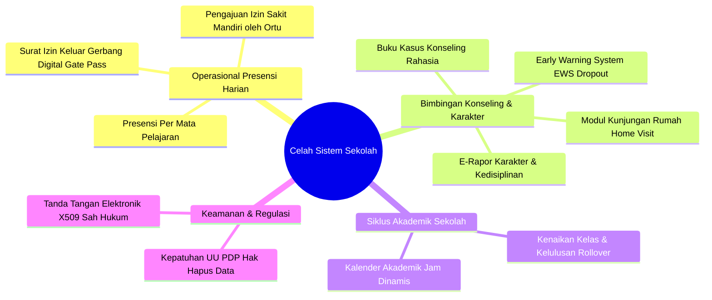
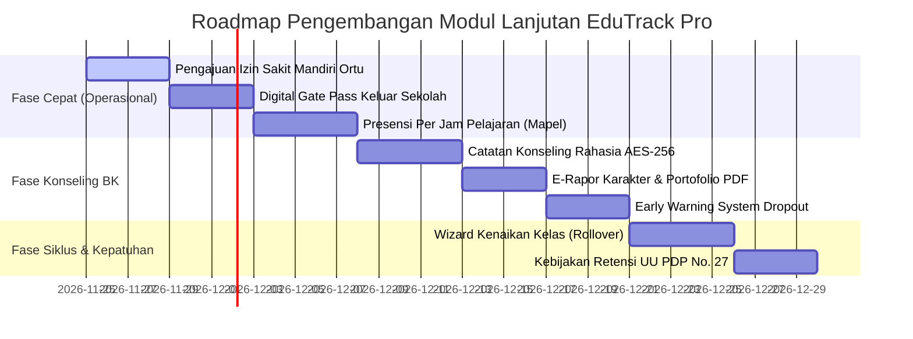

# Analisis Celah Fungsional & Cetak Biru Pengembangan Lanjutan (Plan Mode)
## Sistem Monitoring Terpadu Sekolah (EduTrack Pro)

Dokumen ini merupakan hasil audit teknis, analisis kebutuhan operasional sekolah nyata di Indonesia, serta evaluasi kepatuhan tata kelola keamanan **ISO/IEC 27001:2022** dan **UU Pelindungan Data Pribadi (UU PDP No. 27/2022)**.

---

## 1. Ringkasan Eksekutif Hasil Audit Celah

Saat ini, sistem telah memiliki fondasi yang solid:
- ✅ Presensi gerbang dengan barcode & rule keterlambatan berjenjang.
- ✅ Pencatatan pelanggaran, demerit points, dan Surat Peringatan (SP) otomatis.
- ✅ Bank prestasi siswa berbobot merit points.
- ✅ Kanal aduan whistleblower anti-bullying terenkripsi AES-256.
- ✅ Portal orang tua mandiri dan notifikasi WhatsApp otomatis.
- ✅ Manajemen pengguna (RBAC), backup data 3-2-1, serta audit log ISO 27001.

Namun, untuk diterapkan pada **operasional sekolah tingkat lanjut skala penuh**, masih terdapat **11 celah fungsional (*functional gaps*)** yang sangat krusial untuk menutup celah kecurangan siswa, memfasilitasi peran Guru BK secara profesional, serta menjamin siklus tahunan sekolah berjalan mulus.

---

## 2. Pemetaan Celah Fungsional (Feature Gap Matrix)

---

## 3. Rincian 11 Fitur Lanjutan yang Perlu Ditambahkan

### KELOMPOK A: Operasional Presensi & Keamanan Fisik Gerbang (Prioritas P0)

#### 1. Presensi Per Mata Pelajaran (*Subject-Based Classroom Attendance*)
- **Masalah Lapangan**: Siswa hadir dan tap kartu di gerbang pada pukul 06.45, namun setelah istirahat (jam ke-4 atau jam ke-6), siswa membolos atau nongkrong di kantin saat pelajaran tertentu.
- **Solusi Sistem**:
  - Guru mata pelajaran melakukan presensi singkat per jam pelajaran melalui smartphone/laptop guru (hanya 5 detik per kelas: tombol *"Sama dengan presensi gerbang"* atau tandai yang tidak ada di kursi).
  - Jika siswa tercatat hadir di gerbang tetapi tidak ada di jam pelajaran tanpa izin: sistem otomatis menerbitkan pelanggaran *"Membolos Jam Pelajaran"* (-25 Poin) dan memicu notifikasi WhatsApp ke orang tua saat jam pelajaran tersebut berlangsung.

#### 2. Surat Izin Keluar Gerbang Digital (*Digital Gate Pass*)
- **Masalah Lapangan**: Siswa sakit mendadak di sekolah, ada keperluan keluarga mendesak, atau mewakili sekolah lomba di luar dan harus keluar gerbang sebelum jam pulang (14.30). Satpam pos gerbang sering ragu apakah siswa benar-benar diizinkan keluar atau kabur.
- **Solusi Sistem**:
  - Wali Kelas atau Guru BK menerbitkan **Digital Gate Pass** pada aplikasi (menyertakan alasan, jam keluar, dan nama penjemput).
  - Siswa menerima QR Code Izin Keluar di ponselnya (atau dicetak struk kecil di piket).
  - Satpam di pos gerbang cukup **memindai QR Gate Pass** siswa dengan scanner gerbang. Jika sah, palang gerbang dibuka dan sistem merekam jam keluar resmi siswa.

#### 3. Pengajuan Izin / Sakit Mandiri oleh Orang Tua (*Parent Self-Service Leave Request*)
- **Masalah Lapangan**: Jika anak sakit di rumah dan orang tua belum sempat menelepon sekolah, Cron Job pukul 08.00 akan otomatis menandai anak sebagai **Alpa** (-15 Poin) dan memicu kepanikan orang tua.
- **Solusi Sistem**:
  - Pada Portal Orang Tua, disediakan tombol *"Ajukan Izin / Sakit Anak"*.
  - Orang tua mengunggah foto surat keterangan dokter atau surat izin tertulis, memilih rentang tanggal izin, dan mengisi keterangan.
  - Tiket izin masuk ke dashboard Wali Kelas untuk verifikasi (1-klik *"Setujui"*).
  - Begitu disetujui, status presensi anak pada rentang tanggal tersebut otomatis terkunci menjadi **Sakit / Izin**, sehingga terbebas dari sanksi Auto-Alpa.

---

### KELOMPOK B: Pendalaman Bimbingan Konseling (BK) & Karakter Siswa (Prioritas P1)

#### 4. Catatan Konseling Rahasia Siswa (*Confidential Counseling Session Notes*)
- **Masalah Lapangan**: Sesuai kode etik konselor dan privasi medis/psikologis, catatan bimbingan konseling (seperti masalah keluarga/broken home, trauma psikologis, depresi, pelecehan) **TIDAK BOLEH** dibaca oleh wali kelas, guru lain, apalagi siswa lain.
- **Solusi Sistem (ISO 27001 Cryptographic Control)**:
  - Modul Konseling BK terisolasi penuh dengan enkripsi field-level **AES-256-GCM**.
  - Hanya akun dengan role `Guru BK` dan `Kepala Sekolah` yang memiliki *private authorization key* untuk membuka catatan ini.
  - Menyimpan riwayat sesi konseling (Tanggal, Masalah, Pendekatan Terapi, Hasil Kesepakatan, Status Perubahan Perilaku).

#### 5. Modul Kunjungan Rumah (*Home Visit Management*)
- **Masalah Lapangan**: Ketika siswa mengalami masalah berat (mencapai SP-2 atau alpa 3 hari berturut-turut), guru BK dan wali kelas wajib mengadakan kunjungan ke rumah orang tua (*Home Visit*). Administrasi berita acara ini sering tercecer.
- **Solusi Sistem**:
  - Penjadwalan Home Visit resmi dengan surat tugas otomatis.
  - Formulir digital Berita Acara Home Visit (Geotagging lokasi rumah siswa via GPS, foto dokumentasi kunjungan, catatan hasil temu wicara dengan orang tua, tanda tangan digital orang tua di layar smartphone guru).

#### 6. Sistem Peringatan Dini Risiko Putus Sekolah (*Early Warning System - EWS*)
- **Solusi Sistem**:
  - Algoritma analitik prediktif yang memantau 3 variabel:
    1. Tren penurunan kehadiran > 15% dalam 1 bulan terakhir.
    2. Peningkatan akumulasi poin pelanggaran berturut-turut.
    3. Aduan terkait siswa (korban perundungan atau masalah ekonomi).
  - Sistem otomatis menampilkan badge kuning/merah *"Siswa Membutuhkan Perhatian Khusus"* pada dashboard Kepala Sekolah dan Guru BK sebelum masalah menjadi fatal/anak putus sekolah (*dropout prevention*).

#### 7. E-Rapor Karakter & Portofolio Siswa (*Character & Discipline Report Card*)
- **Solusi Sistem**:
  - Selain rapor akademik kurikulum nasional, sekolah menerbitkan **Rapor Kedisiplinan & Karakter** di akhir semester:
    - Rekapitulasi persentase kehadiran bersih (H/S/I/A/T).
    - Skor Akhir Kedisiplinan: `100 - (Poin Pelanggaran) + (Poin Prestasi / Merit)`.
    - Predikat Karakter: **A (Sangat Berkarakter & Berprestasi)**, **B (Baik/Disiplin)**, **C (Cukup/Dalam Pembinaan)**, **D (Butuh Perhatian Khusus)**.
    - Format PDF resmi ber-QR Code untuk dilampirkan saat pendaftaran beasiswa, magang PKL SMK, atau kelulusan.

---

### KELOMPOK C: Siklus Akademik Tahunan (Prioritas P1)

#### 8. Manajemen Kenaikan Kelas, Kelulusan & Mutasi (*Academic Period Rollover*)
- **Masalah Lapangan**: Setiap pergantian tahun ajaran baru (bulan Juli), sistem sekolah sering mengalami kekacauan data jika tidak ada mekanisme migrasi massal.
- **Solusi Sistem**:
  - Wizard Kenaikan Kelas satu-klik (*Batch Promotion Tool*):
    - Siswa kelas X-RPL-1 naik ke XI-RPL-1.
    - Siswa kelas XII dinyatakan **Lulus (Arsip Alumni)**.
    - Siswa yang tidak naik kelas tetap di rombel tingkat sebelumnya.
  - Poin pelanggaran di-reset ke 0 pada tahun ajaran baru (atau poin pelanggaran berat diarsipkan ke buku rekam jejak permanen).

#### 9. Kalender Akademik Dinamis & Jam Khusus (*Dynamic School Schedule*)
- **Masalah Lapangan**: Jam masuk sekolah tidak selalu tetap pukul 07.00. Pada hari Jumat jam masuk sering lebih awal (06.30 untuk senam/yasinan), pada bulan Ramadhan jam masuk mundur ke 07.30, dan pada saat pekan ujian jam pulang menjadi pukul 12.00.
- **Solusi Sistem**:
  - Manajemen kalender sekolah fleksibel: Admin dapat mengatur aturan keterlambatan khusus hari Jumat, jadwal khusus Ramadhan, tanggal merah libur nasional, dan masa jeda libur semester.

---

### KELOMPOK D: Kepatuhan Hukum & Keamanan Tingkat Lanjut (Prioritas P2)

#### 10. Kepatuhan UU Pelindungan Data Pribadi (UU PDP No. 27/2022)
- **Klausul Regulasi**: Data anak di bawah umur (siswa) merupakan **Data Pribadi Spesifik** yang dilindungi secara ketat di Indonesia.
- **Fitur Kepatuhan**:
  - *Consent Management*: Persetujuan eksplisit orang tua saat pertama kali aktivasi akun untuk pengumpulan data presensi dan wajah/foto anak.
  - *Data Retention & Anonymization Policy*: Data siswa yang telah lulus lebih dari 5 tahun secara otomatis dianonimkan (nama dan NISN disamarkan) dari basis data aktif untuk mencegah kebocoran data di masa depan.

#### 11. Tanda Tangan Elektronik Tersertifikasi (TTE X.509 / BSrE)
- **Kebutuhan**: Surat Peringatan (SP) atau Surat Pemanggilan Orang Tua sering digugat keabsahannya jika hanya berupa file PDF biasa.
- **Solusi**: Integrasi API Tanda Tangan Elektronik berstandar sertifikat digital X.509 (seperti BSrE BSSN atau PrivyID) sehingga setiap dokumen yang terbit memiliki kekuatan hukum sah dan tidak dapat dimanipulasi dengan software pengedit dokumen.

---

## 4. Rekomendasi Roadmap Implementasi Selanjutnya

### 3 Modul yang Paling Mendesak untuk Dibangun Pertama Kali:
1. 🥇 **Pengajuan Izin/Sakit Mandiri oleh Orang Tua**: Menghindari anak yang sakit di rumah terkena Auto-Alpa oleh sistem.
2. 🥈 **Digital Gate Pass (Izin Keluar Gerbang)**: Menutup celah keamanan fisik sekolah agar siswa tidak bisa kabur di jam istirahat.
3. 🥉 **Presensi Per Jam Pelajaran**: Memastikan siswa yang sudah tap di gerbang pagi hari benar-benar mengikuti seluruh mata pelajaran sampai jam kepulangan.
