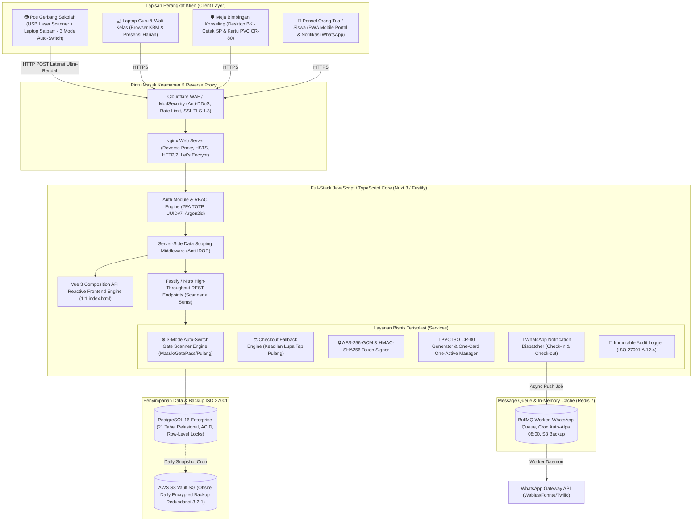

# Arsitektur Sistem & Spesifikasi Database Produksi (SSOT)
**Aplikasi**: EduTrack Pro (Sistem Monitoring Terpadu Sekolah)  
**Institusi**: SDN Kebonagung Kota Pasuruan  
**Arsitektur Inti**: Full-stack JavaScript / TypeScript (Nuxt 3 Vue 3 / Node.js Fastify + PostgreSQL 16 + Redis 7)  
**ORM & Database Layer**: Drizzle ORM / Prisma + Native PostgreSQL DDL (21 Tabel Relasional)  
**Antrean Asinkron**: BullMQ + Redis 7 Daemon  
**Kepatuhan Standar**: ISO/IEC 27001:2022 & OWASP Top 10 (2021/2026)  
**Target Server**: aaPanel Linux (PM2 Cluster + Nginx) & Bare VPS / Docker Compose

Dokumen ini merupakan **Single Source of Truth (SSOT)** untuk seluruh arsitektur teknis berbasis JavaScript, struktur monorepo/modular, skema DDL 21 tabel basis data relasional lengkap dengan atribut jam pulang dan izin fleksibel, serta konfigurasi server produksi.

---

## 1. Topologi Arsitektur Sistem (High-Level Topology)



---

## 2. Struktur Proyek Full-stack JavaScript / TypeScript

Mengadopsi struktur monorepo / modular modern yang menyatukan backend API berkecepatan tinggi dengan antarmuka Vue 3 dari `index.html`:

```
edutrack-app/
├── server/                                   # Backend & API Engine (Nitro / Fastify)
│   ├── api/
│   │   ├── attendance/
│   │   │   ├── gate-scan.post.ts            # Endpoint scanner 3-mode (< 50ms)
│   │   │   ├── classroom-bulk.post.ts       # Presensi cepat H/S/I/A/T
│   │   │   └── subject-sync.post.ts         # Deteksi siswa membolos KBM
│   │   ├── gate-pass/
│   │   │   ├── issue.post.ts                # Terbitkan tiket izin keluar
│   │   │   └── verify.post.ts               # Verifikasi satpam pos gerbang
│   │   ├── leave-requests/
│   │   │   ├── submit.post.ts               # Pengajuan izin sakit fleksibel ortu
│   │   │   └── approve.put.ts               # Persetujuan wali kelas
│   │   ├── violations/                      # CRUD tatib, SP 1-3 & QR verifikasi
│   │   ├── achievements/                    # CRUD bank prestasi & poin merit
│   │   ├── complaints/                      # Aduan whistleblower AES-256
│   │   ├── master/
│   │   │   ├── teachers.ts                  # Master GTK (Khusus Super Admin)
│   │   │   ├── students.ts                  # Master Siswa & Rombel
│   │   │   └── parents.ts                   # Master Wali Murid & Aktivasi WA
│   │   └── system/
│   │       ├── audit-logs.get.ts            # Log audit kekal ISO 27001
│   │       └── backup.post.ts               # Snapshot terenkripsi 3-2-1
│   ├── services/
│   │   ├── AttendanceRuleEngineService.ts   # 3 Jendela waktu & rule keterlambatan
│   │   ├── CheckoutJusticeService.ts        # Keadilan lupa tap pulang vs KBM
│   │   ├── BarcodeCryptoService.ts          # HMAC-SHA256 & Code 128
│   │   ├── FieldEncryptionService.ts        # AES-256-GCM cipher
│   │   └── WhatsAppQueueService.ts          # BullMQ queue dispatcher
│   ├── jobs/
│   │   ├── AutoAlpaCronJob.ts               # Cron cutoff jam 08:00 WIB
│   │   ├── SendWhatsAppNotificationJob.ts   # Worker pengiriman WA masuk & pulang
│   │   └── DailyEncryptedBackupJob.ts       # Cron snapshot jam 02:00 WIB ke S3
│   └── middleware/
│       ├── auth.ts                          # Verifikasi JWT / Sesi & 2FA
│       └── dataScope.ts                     # Isolasi query data sisi server
├── database/                                # Skema Database & Migrasi (Drizzle ORM)
│   ├── schema/
│   │   ├── users.ts
│   │   ├── teachers.ts                      # Master GTK
│   │   ├── students.ts
│   │   ├── attendances.ts                   # Harian, KBM, Gate Pass, Izin
│   │   ├── discipline.ts                    # Pelanggaran, Presets, SP
│   │   ├── complaints.ts                    # Aduan terenkripsi AES-256
│   │   └── audit.ts                         # Immutable audit logs
│   ├── migrations/                          # Berkas migrasi SQL
│   └── seeders/                             # Data seeder SDN Kebonagung
├── app/ (atau client/)                       # Frontend Vue 3 (Migrasi 1:1 index.html)
│   ├── components/
│   │   ├── ui/                              # Pagination, SearchBar, MultiFilter, InfoCards
│   │   ├── charts/                          # TrendBarChart, DisciplineDonutChart
│   │   ├── scanner/                         # GateScannerStation, WebAudioFeedback
│   │   └── cards/                           # StudentCardCR80Preview
│   ├── pages/                               # Rute Halaman (Dashboard, Presensi, Scanner, dll.)
│   └── composables/                         # useAttendance, useRoleScope, useAudioScanner
├── package.json
├── tsconfig.json
└── ecosystem.config.js                      # PM2 Cluster Mode Configuration
```

---

## 3. Skema Basis Data Relasional (DDL 21 Tabel PostgreSQL 16)

Skema basis data relasional dirancang dengan **UUIDv7**, indeks komposit teroptimasi, serta kolom operasional terbaru untuk **presensi pulang, izin sakit fleksibel, dan digital gate pass**:

```sql
-- 1. EXTENSIONS
CREATE EXTENSION IF NOT EXISTS "pgcrypto";

-- 2. TABEL PENGGUNA (Users & RBAC)
CREATE TABLE users (
    id BIGSERIAL PRIMARY KEY,
    uuid UUID DEFAULT gen_random_uuid() UNIQUE NOT NULL,
    name VARCHAR(150) NOT NULL,
    email VARCHAR(150) UNIQUE NOT NULL,
    password_hash VARCHAR(255) NOT NULL,
    role VARCHAR(50) NOT NULL CHECK (role IN ('admin', 'bk', 'wali_kelas', 'orang_tua', 'siswa', 'satpam')),
    data_scope_type VARCHAR(50) NOT NULL DEFAULT 'all', -- 'all', 'classroom', 'student'
    data_scope_target VARCHAR(100) NULL,
    phone VARCHAR(30) NULL,
    two_factor_secret TEXT NULL,
    two_factor_enabled BOOLEAN DEFAULT FALSE,
    is_active BOOLEAN DEFAULT TRUE,
    created_at TIMESTAMP WITH TIME ZONE DEFAULT CURRENT_TIMESTAMP,
    updated_at TIMESTAMP WITH TIME ZONE DEFAULT CURRENT_TIMESTAMP
);

-- 3. TABEL GURU & TENAGA KEPENDIDIKAN (GTK - Master Staff Eksklusif Admin)
CREATE TABLE teachers (
    id BIGSERIAL PRIMARY KEY,
    uuid UUID DEFAULT gen_random_uuid() UNIQUE NOT NULL,
    user_id BIGINT UNIQUE REFERENCES users(id) ON DELETE SET NULL,
    nip VARCHAR(30) DEFAULT '-' NOT NULL,
    nuptk VARCHAR(30) DEFAULT '-' NOT NULL,
    name VARCHAR(150) NOT NULL,
    gender VARCHAR(20) NOT NULL CHECK (gender IN ('Laki-laki', 'Perempuan')),
    role_position VARCHAR(100) NOT NULL, -- 'Kepala Sekolah', 'Guru BK', 'Wali Kelas', 'Guru Mapel', 'TU', 'Satpam'
    employment_status VARCHAR(50) NOT NULL CHECK (employment_status IN ('PNS / ASN', 'PPPK', 'Honorer Daerah (PTT)', 'Pegawai Kontrak')),
    subject_or_class VARCHAR(150) NOT NULL,
    phone VARCHAR(30) NOT NULL,
    email VARCHAR(150) NOT NULL,
    status VARCHAR(30) DEFAULT 'Aktif' NOT NULL CHECK (status IN ('Aktif', 'Cuti', 'Mutasi', 'Pensiun')),
    created_at TIMESTAMP WITH TIME ZONE DEFAULT CURRENT_TIMESTAMP,
    updated_at TIMESTAMP WITH TIME ZONE DEFAULT CURRENT_TIMESTAMP
);

-- 4. TABEL KELAS / ROMBEL (Classrooms)
CREATE TABLE classrooms (
    id BIGSERIAL PRIMARY KEY,
    code VARCHAR(50) UNIQUE NOT NULL, -- 'X-RPL-1', 'Kelas 4-A'
    name VARCHAR(100) NOT NULL,
    grade_level INT NOT NULL,
    academic_year VARCHAR(20) NOT NULL,
    homeroom_teacher_id BIGINT REFERENCES teachers(id) ON DELETE SET NULL,
    created_at TIMESTAMP WITH TIME ZONE DEFAULT CURRENT_TIMESTAMP
);

-- 5. TABEL MASTER SISWA (Students)
CREATE TABLE students (
    id BIGSERIAL PRIMARY KEY,
    uuid UUID DEFAULT gen_random_uuid() UNIQUE NOT NULL,
    user_id BIGINT UNIQUE REFERENCES users(id) ON DELETE SET NULL,
    classroom_id BIGINT REFERENCES classrooms(id) ON DELETE RESTRICT,
    nisn VARCHAR(20) UNIQUE NOT NULL,
    nis VARCHAR(20) UNIQUE NOT NULL,
    name VARCHAR(150) NOT NULL,
    gender VARCHAR(20) NOT NULL CHECK (gender IN ('Laki-laki', 'Perempuan')),
    birth_place VARCHAR(100) NOT NULL,
    birth_date DATE NOT NULL,
    blood_type VARCHAR(5) DEFAULT 'O',
    address TEXT NOT NULL,
    demerit_points INT DEFAULT 0 CHECK (demerit_points >= 0),
    merit_points INT DEFAULT 0 CHECK (merit_points >= 0),
    status VARCHAR(30) DEFAULT 'Aktif' CHECK (status IN ('Aktif', 'Lulus', 'Pindah', 'Drop-out')),
    created_at TIMESTAMP WITH TIME ZONE DEFAULT CURRENT_TIMESTAMP,
    updated_at TIMESTAMP WITH TIME ZONE DEFAULT CURRENT_TIMESTAMP
);
CREATE INDEX idx_students_nisn ON students(nisn);
CREATE INDEX idx_students_classroom ON students(classroom_id);

-- 6. TABEL MASTER ORANG TUA / WALI (Parents)
CREATE TABLE parents (
    id BIGSERIAL PRIMARY KEY,
    uuid UUID DEFAULT gen_random_uuid() UNIQUE NOT NULL,
    user_id BIGINT UNIQUE REFERENCES users(id) ON DELETE SET NULL,
    name VARCHAR(150) NOT NULL,
    phone VARCHAR(30) NOT NULL,
    email VARCHAR(150) NULL,
    job VARCHAR(100) DEFAULT 'Wiraswasta',
    portal_status VARCHAR(50) DEFAULT 'Belum Terhubung' CHECK (portal_status IN ('Belum Terhubung', 'Terhubung (Aktif)', 'Dinonaktifkan')),
    last_login_at TIMESTAMP WITH TIME ZONE NULL,
    created_at TIMESTAMP WITH TIME ZONE DEFAULT CURRENT_TIMESTAMP
);

-- 7. TABEL RELASI SISWA DENGAN ORANG TUA (Student-Parent Links)
CREATE TABLE student_parent_relations (
    id BIGSERIAL PRIMARY KEY,
    student_id BIGINT NOT NULL REFERENCES students(id) ON DELETE CASCADE,
    parent_id BIGINT NOT NULL REFERENCES parents(id) ON DELETE CASCADE,
    relation_type VARCHAR(50) NOT NULL CHECK (relation_type IN ('Ayah Kandung', 'Ibu Kandung', 'Wali Murid')),
    is_primary_contact BOOLEAN DEFAULT TRUE,
    UNIQUE(student_id, parent_id)
);

-- 8. TABEL KARTU PELAJAR PVC & BARCODE (Student Cards)
CREATE TABLE student_cards (
    id BIGSERIAL PRIMARY KEY,
    uuid UUID DEFAULT gen_random_uuid() UNIQUE NOT NULL,
    student_id BIGINT NOT NULL REFERENCES students(id) ON DELETE CASCADE,
    card_uid VARCHAR(100) UNIQUE NOT NULL,         -- 'CRD-88912-X'
    barcode_1d VARCHAR(50) NOT NULL,              -- Code 128 (NISN)
    qr_payload_hmac TEXT NOT NULL,                -- Signed cryptographic payload
    issued_date DATE DEFAULT CURRENT_DATE NOT NULL,
    status VARCHAR(30) DEFAULT 'Aktif' CHECK (status IN ('Aktif', 'Dicabut (Revoked)', 'Hilang')),
    revoked_at TIMESTAMP WITH TIME ZONE NULL,
    revocation_reason TEXT NULL,
    created_at TIMESTAMP WITH TIME ZONE DEFAULT CURRENT_TIMESTAMP
);

-- 9. TABEL PRESENSI HARIAN SISWA (Daily Attendances - Masuk & Pulang)
CREATE TABLE attendances_daily (
    id BIGSERIAL PRIMARY KEY,
    uuid UUID DEFAULT gen_random_uuid() UNIQUE NOT NULL,
    student_id BIGINT NOT NULL REFERENCES students(id) ON DELETE RESTRICT,
    date DATE NOT NULL,
    
    -- Jendela Masuk Pagi
    check_in_time TIME NULL,
    status VARCHAR(50) NOT NULL CHECK (status IN ('Hadir', 'Terlambat', 'Sakit', 'Izin', 'Alpa', 'Dispensasi')),
    late_category VARCHAR(30) NULL CHECK (late_category IN ('T-1', 'T-2', 'T-3', NULL)),
    late_minutes INT DEFAULT 0,
    points_deducted INT DEFAULT 0,
    scan_method_in VARCHAR(30) DEFAULT 'Barcode Scanner',
    
    -- Jendela Kepulangan Sore & Izin Pulang Cepat
    check_out_time TIME NULL,
    checkout_status VARCHAR(50) DEFAULT 'Belum Pulang' CHECK (checkout_status IN ('Belum Pulang', 'Check-out Normal', 'Izin Pulang Cepat', 'Check-out Default (Selesai KBM)')),
    early_leave_time TIME NULL,
    early_leave_reason TEXT NULL,
    early_leave_pickup_by VARCHAR(150) NULL,
    is_checkout_missed BOOLEAN DEFAULT FALSE,     -- Flag jika lupa tap pulang
    
    notes TEXT NULL,
    verified_by_user_id BIGINT REFERENCES users(id),
    created_at TIMESTAMP WITH TIME ZONE DEFAULT CURRENT_TIMESTAMP,
    updated_at TIMESTAMP WITH TIME ZONE DEFAULT CURRENT_TIMESTAMP,
    UNIQUE(student_id, date)
);
CREATE INDEX idx_attendance_date ON attendances_daily(date);
CREATE INDEX idx_attendance_student_date ON attendances_daily(student_id, date);

-- 10. TABEL MATA PELAJARAN (Subjects)
CREATE TABLE subjects (
    id BIGSERIAL PRIMARY KEY,
    code VARCHAR(50) UNIQUE NOT NULL,
    name VARCHAR(150) NOT NULL,
    grade_level INT NOT NULL
);

-- 11. TABEL PRESENSI KBM JAM MAPEL (Subject-Based Classroom Attendance)
CREATE TABLE attendances_subject (
    id BIGSERIAL PRIMARY KEY,
    student_id BIGINT NOT NULL REFERENCES students(id) ON DELETE CASCADE,
    subject_id BIGINT NOT NULL REFERENCES subjects(id) ON DELETE RESTRICT,
    teacher_id BIGINT NOT NULL REFERENCES teachers(id) ON DELETE RESTRICT,
    classroom_id BIGINT NOT NULL REFERENCES classrooms(id) ON DELETE RESTRICT,
    date DATE NOT NULL,
    period_hours VARCHAR(50) NOT NULL, -- 'Jam Ke 1 - 3'
    status VARCHAR(30) NOT NULL CHECK (status IN ('Hadir', 'Sakit', 'Izin', 'Membolos')),
    is_skipping BOOLEAN DEFAULT FALSE,
    notes TEXT NULL,
    created_at TIMESTAMP WITH TIME ZONE DEFAULT CURRENT_TIMESTAMP
);

-- 12. TABEL PENGAJUAN IZIN / SAKIT FLEKSIBEL (Leave Requests)
CREATE TABLE leave_requests (
    id BIGSERIAL PRIMARY KEY,
    uuid UUID DEFAULT gen_random_uuid() UNIQUE NOT NULL,
    student_id BIGINT NOT NULL REFERENCES students(id) ON DELETE CASCADE,
    parent_id BIGINT NOT NULL REFERENCES parents(id) ON DELETE CASCADE,
    type VARCHAR(100) NOT NULL CHECK (type IN (
        'Sakit 1 Hari (Surat Izin Ortu)', 
        'Sakit >1 Hari (Surat Dokter Terlampir)', 
        'Izin Keperluan Keluarga', 
        'Dispensasi Tugas Sekolah'
    )),
    start_date DATE NOT NULL,
    end_date DATE NOT NULL,
    reason TEXT NOT NULL,
    attachment_path VARCHAR(255) NULL,
    semester_quota_used INT DEFAULT 1,
    status VARCHAR(50) DEFAULT 'Menunggu Persetujuan Wali Kelas' CHECK (status IN ('Menunggu Persetujuan Wali Kelas', 'Disetujui', 'Ditolak')),
    approved_by_teacher_id BIGINT REFERENCES teachers(id),
    submitted_at TIMESTAMP WITH TIME ZONE DEFAULT CURRENT_TIMESTAMP
);

-- 13. TABEL DIGITAL GATE PASS (Izin Pulang Cepat Satpam)
CREATE TABLE gate_passes (
    id BIGSERIAL PRIMARY KEY,
    pass_code VARCHAR(50) UNIQUE NOT NULL, -- 'GP-20261123-001'
    student_id BIGINT NOT NULL REFERENCES students(id) ON DELETE CASCADE,
    reason TEXT NOT NULL,
    pickup_person VARCHAR(150) NOT NULL,
    pickup_relation VARCHAR(50) NOT NULL,
    approved_by_teacher_id BIGINT NOT NULL REFERENCES teachers(id),
    status VARCHAR(50) DEFAULT 'Siap Diverifikasi Satpam' CHECK (status IN ('Siap Diverifikasi Satpam', 'Telah Melintasi Gerbang', 'Dibatalkan')),
    issued_at TIMESTAMP WITH TIME ZONE DEFAULT CURRENT_TIMESTAMP,
    verified_at TIMESTAMP WITH TIME ZONE NULL,
    verified_by_satpam_id BIGINT REFERENCES users(id)
);

-- 14. TABEL PRESET KATALOG PELANGGARAN (Violation Presets)
CREATE TABLE violation_presets (
    id BIGSERIAL PRIMARY KEY,
    code VARCHAR(50) UNIQUE NOT NULL,
    title VARCHAR(200) NOT NULL,
    severity VARCHAR(30) NOT NULL CHECK (severity IN ('Ringan', 'Sedang', 'Berat')),
    points INT NOT NULL CHECK (points > 0)
);

-- 15. TABEL PELANGGARAN SISWA (Student Violations)
CREATE TABLE student_violations (
    id BIGSERIAL PRIMARY KEY,
    uuid UUID DEFAULT gen_random_uuid() UNIQUE NOT NULL,
    student_id BIGINT NOT NULL REFERENCES students(id) ON DELETE CASCADE,
    preset_id BIGINT REFERENCES violation_presets(id),
    title VARCHAR(200) NOT NULL,
    severity VARCHAR(30) NOT NULL CHECK (severity IN ('Ringan', 'Sedang', 'Berat')),
    points INT NOT NULL CHECK (points > 0),
    date DATE DEFAULT CURRENT_DATE NOT NULL,
    status VARCHAR(50) DEFAULT 'Diproses' CHECK (status IN ('Diproses', 'SP-1', 'SP-2', 'SP-3', 'Selesai')),
    notes TEXT NULL,
    recorded_by_user_id BIGINT NOT NULL REFERENCES users(id),
    created_at TIMESTAMP WITH TIME ZONE DEFAULT CURRENT_TIMESTAMP
);

-- 16. TABEL SURAT PERINGATAN (Warning Letters - SP)
CREATE TABLE warning_letters (
    id BIGSERIAL PRIMARY KEY,
    sp_number VARCHAR(100) UNIQUE NOT NULL, -- 'SP/2026/XI/004'
    student_id BIGINT NOT NULL REFERENCES students(id) ON DELETE CASCADE,
    violation_id BIGINT REFERENCES student_violations(id),
    sp_level VARCHAR(20) NOT NULL CHECK (sp_level IN ('SP-1', 'SP-2', 'SP-3')),
    qr_verification_token VARCHAR(255) UNIQUE NOT NULL,
    issue_date DATE DEFAULT CURRENT_DATE NOT NULL,
    pdf_path VARCHAR(255) NULL,
    is_signed BOOLEAN DEFAULT TRUE,
    created_at TIMESTAMP WITH TIME ZONE DEFAULT CURRENT_TIMESTAMP
);

-- 17. TABEL BANK PRESTASI (Student Achievements)
CREATE TABLE achievements (
    id BIGSERIAL PRIMARY KEY,
    uuid UUID DEFAULT gen_random_uuid() UNIQUE NOT NULL,
    student_id BIGINT NOT NULL REFERENCES students(id) ON DELETE CASCADE,
    title VARCHAR(200) NOT NULL,
    level VARCHAR(50) NOT NULL CHECK (level IN ('Sekolah', 'Kota/Kabupaten', 'Provinsi', 'Nasional', 'Internasional')),
    rank VARCHAR(50) NOT NULL,
    points INT NOT NULL CHECK (points > 0),
    organizer VARCHAR(150) NOT NULL,
    date DATE NOT NULL,
    certificate_path VARCHAR(255) NULL,
    verified_by_user_id BIGINT REFERENCES users(id),
    created_at TIMESTAMP WITH TIME ZONE DEFAULT CURRENT_TIMESTAMP
);

-- 18. TABEL ADUAN & WHISTLEBLOWER (Complaints - Enkripsi AES-256)
CREATE TABLE complaints (
    id BIGSERIAL PRIMARY KEY,
    ticket_number VARCHAR(50) UNIQUE NOT NULL, -- 'WB-202611-001'
    student_id BIGINT REFERENCES students(id) ON DELETE SET NULL,
    parent_id BIGINT REFERENCES parents(id) ON DELETE SET NULL,
    category VARCHAR(100) NOT NULL,
    title VARCHAR(200) NOT NULL,
    description_encrypted TEXT NOT NULL,      -- AES-256-GCM cipher text
    is_anonymous BOOLEAN DEFAULT FALSE,
    reporter_display_name VARCHAR(150) NOT NULL,
    status VARCHAR(50) DEFAULT 'Menunggu Verifikasi' CHECK (status IN ('Menunggu Verifikasi', 'Investigasi', 'Selesai', 'Ditolak')),
    assigned_to VARCHAR(150) DEFAULT 'Tim Satgas Anti-Kekerasan & Guru BK',
    created_at TIMESTAMP WITH TIME ZONE DEFAULT CURRENT_TIMESTAMP,
    updated_at TIMESTAMP WITH TIME ZONE DEFAULT CURRENT_TIMESTAMP
);

-- 19. TABEL PESAN INVESTIGASI ADUAN (Complaint Messages - Enkripsi AES-256)
CREATE TABLE complaint_messages (
    id BIGSERIAL PRIMARY KEY,
    complaint_id BIGINT NOT NULL REFERENCES complaints(id) ON DELETE CASCADE,
    sender_type VARCHAR(50) NOT NULL CHECK (sender_type IN ('reporter', 'school_staff')),
    sender_name VARCHAR(150) NOT NULL,
    message_encrypted TEXT NOT NULL,          -- AES-256-GCM cipher text
    sent_at TIMESTAMP WITH TIME ZONE DEFAULT CURRENT_TIMESTAMP
);

-- 20. TABEL LOG AUDIT KEKAL ISO 27001 (Immutable Audit Logs - A.12.4)
CREATE TABLE audit_logs (
    id BIGSERIAL PRIMARY KEY,
    timestamp TIMESTAMP WITH TIME ZONE DEFAULT CURRENT_TIMESTAMP NOT NULL,
    user_id BIGINT NULL REFERENCES users(id) ON DELETE SET NULL,
    user_email VARCHAR(150) NOT NULL,
    role VARCHAR(50) NOT NULL,
    action VARCHAR(100) NOT NULL,
    details TEXT NOT NULL,
    ip_address VARCHAR(45) NOT NULL,
    user_agent TEXT NULL,
    metadata_json JSONB NULL
);
CREATE INDEX idx_audit_logs_timestamp ON audit_logs(timestamp);
CREATE INDEX idx_audit_logs_user ON audit_logs(user_email);

-- 21. TABEL CADANGAN TERENKRIPSI ISO 27001 (Backup Registry 3-2-1)
CREATE TABLE backup_archives (
    id BIGSERIAL PRIMARY KEY,
    filename VARCHAR(255) NOT NULL,
    size_bytes BIGINT NOT NULL,
    storage_location VARCHAR(150) NOT NULL,   -- 'Lokal + AWS S3 Vault SG'
    checksum_sha256 VARCHAR(100) NOT NULL,
    encryption_algorithm VARCHAR(50) DEFAULT 'AES-256-GCM',
    status VARCHAR(50) DEFAULT 'Terverifikasi SHA-256',
    created_at TIMESTAMP WITH TIME ZONE DEFAULT CURRENT_TIMESTAMP
);
```

---

## 4. Konfigurasi Deployment Ganda JavaScript (aaPanel & Bare VPS / Docker)

### Target 1: aaPanel Linux Hosting (Node.js Version Manager & PM2)
1. **Node.js Project Manager (aaPanel GUI)**:
   - Menjalankan aplikasi Nuxt 3 / Node.js Fastify via PM2 Cluster Mode (`instances: 'max'`).
   - Berkas `ecosystem.config.js`:
     ```javascript
     module.exports = {
       apps: [
         {
           name: 'edutrack-app',
           script: './.output/server/index.mjs',
           instances: 'max',
           exec_mode: 'cluster',
           env: {
             PORT: 3000,
             NODE_ENV: 'production'
           }
         },
         {
           name: 'edutrack-bullmq-worker',
           script: './server/jobs/worker.ts',
           instances: 1,
           exec_mode: 'fork'
         }
       ]
     };
     ```
2. **Nginx Reverse Proxy GUI**:
   - Proxy Pass ke port `3000` dengan WebSocket support (`Upgrade $http_upgrade`).
   - Konfigurasi Cron Tab aaPanel: Menjalankan skrip backup terenkripsi harian pukul 02:00 WIB.

### Target 2: Bare VPS Linux (Ubuntu 24.04 LTS / Docker Compose)
- Multi-container mandiri:
  - `edutrack-web`: Nginx Alpine dengan SSL Let's Encrypt Certbot & Header Keamanan ISO 27001.
  - `edutrack-node`: Node.js 20/22 LTS Alpine yang menjalankan runtime server.
  - `edutrack-postgres`: PostgreSQL 16 Alpine pada NVMe SSD.
  - `edutrack-redis`: Redis 7 Alpine untuk antrean pesan WhatsApp BullMQ.