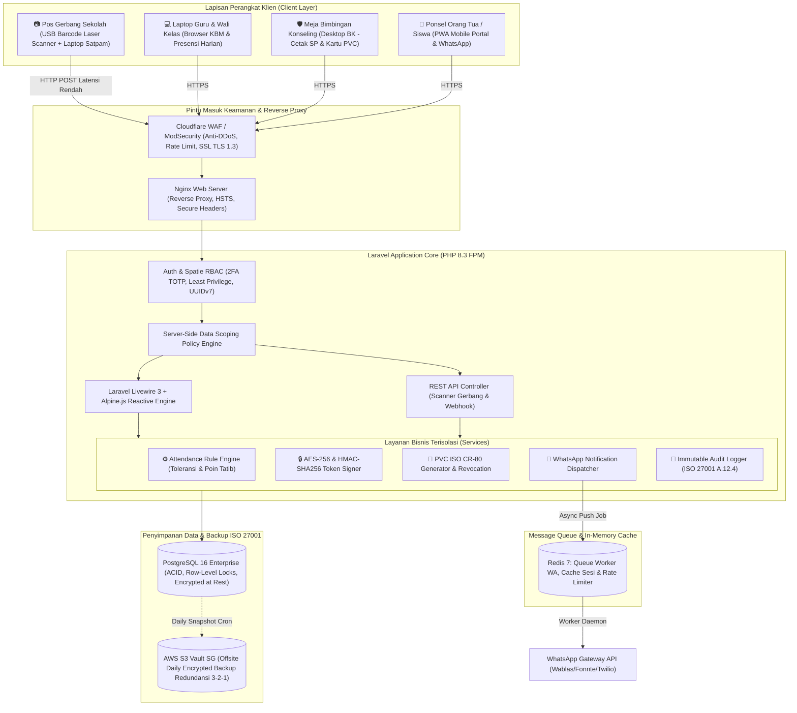

# Arsitektur Sistem & Spesifikasi Database Produksi (SSOT)
**Aplikasi**: EduTrack Pro (Sistem Monitoring Terpadu Sekolah)  
**Institusi**: SDN Kebonagung Kota Pasuruan  
**Arsitektur Inti**: Laravel 11/12 (PHP 8.3+) + PostgreSQL 16 + Redis 7 + Livewire 3 / Alpine.js  
**Kepatuhan Standar**: ISO/IEC 27001:2022 & OWASP Top 10 (2021/2026)  
**Target Server**: aaPanel Linux (Nginx + PHP-FPM) & Bare VPS / Docker Compose

Dokumen ini merupakan **Single Source of Truth (SSOT)** untuk seluruh arsitektur backend, skema basis data relasional (DDL 21 tabel), struktur modular Laravel, endpoint API, dan konfigurasi deployment ganda.

---

## 1. Topologi Arsitektur Sistem (High-Level Topology)



---

## 2. Struktur Modul & Skema Repositori Laravel

Aplikasi dibangun menggunakan struktur modular modern Laravel 11/12 yang memisahkan ranah bisnis kesiswaan secara tegas:

```
app/
├── Http/
│   ├── Controllers/
│   │   ├── Api/
│   │   │   ├── AttendanceBarcodeScanController.php   # Endpoint gerbang (< 200ms)
│   │   │   ├── DigitalGatePassVerifyController.php   # Endpoint verifikasi satpam
│   │   │   └── WhatsAppWebhookController.php         # Webhook interaktif ortu
│   │   └── Auth/
│   │       ├── TwoFactorAuthenticationController.php
│   │       └── AuthenticatedSessionController.php
│   ├── Livewire/
│   │   ├── Attendance/
│   │   │   ├── GateAttendanceScanner.php             # Scanner live & audio hook
│   │   │   ├── ClassroomAttendanceBulk.php           # Tombol H/S/I/A/T cepat
│   │   │   └── SubjectAttendanceTable.php            # Presensi jam mapel & bolos
│   │   ├── Discipline/
│   │   │   ├── ViolationRecordManager.php            # Catat tatib & penalti
│   │   │   └── WarningLetterPreviewModal.php         # Cetak SP ber-QR verifikasi
│   │   ├── StudentCard/
│   │   │   └── CardGeneratorAndRevocation.php        # Preview bolak-balik CR-80
│   │   ├── Complaints/
│   │   │   ├── WhistleblowerTicketCenter.php         # Investigasi aduan rahasia
│   │   │   └── ComplaintChatThread.php               # Ruang chat terenkripsi
│   │   ├── Master/
│   │   │   ├── TeacherStaffCrud.php                  # Master GTK (Admin Only)
│   │   │   ├── StudentCrud.php                       # Master Siswa & Kartu
│   │   │   └── ParentCrud.php                        # Master Ortu & Undangan WA
│   │   └── Security/
│   │       ├── AuditTrailViewer.php                  # Viewer log ISO 27001
│   │       └── EncryptedBackupManager.php            # Snapshot & S3 replication
│   └── Middleware/
│       ├── EnforceServerDataScope.php                # Isolasi baris database per role
│       ├── RequireTwoFactorAuthentication.php
│       └── AuditActivityLogger.php
├── Models/
│   ├── User.php
│   ├── Teacher.php
│   ├── Classroom.php
│   ├── Student.php
│   ├── StudentCard.php
│   ├── ParentGuardian.php
│   ├── DailyAttendance.php
│   ├── SubjectAttendance.php
│   ├── DigitalGatePass.php
│   ├── LeaveRequest.php
│   ├── ViolationPreset.php
│   ├── StudentViolation.php
│   ├── WarningLetter.php
│   ├── Achievement.php
│   ├── Complaint.php
│   ├── ComplaintMessage.php
│   ├── AuditTrailLog.php
│   ├── BackupArchive.php
│   └── WhatsAppDispatchLog.php
├── Policies/
│   ├── StudentPolicy.php                             # Cegah IDOR antar ortu/siswa
│   ├── ComplaintPolicy.php                           # Anonimitas & hak investigasi
│   ├── AttendancePolicy.php                          # Batas wali kelas per rombel
│   └── TeacherPolicy.php                             # Pembatasan GTK eksklusif admin
└── Services/
    ├── AttendanceRuleEngineService.php               # Jendela jam, T1-T3, auto-alpa
    ├── BarcodeSecurityCryptoService.php              # HMAC-SHA256 & Code 128
    ├── WhatsAppNotificationDispatcher.php            # Format template & Redis push
    └── BackupRedundancyS3Service.php                 # AES-256 snapshot & checksum
```

---

## 3. Skema Basis Data Relasional (DDL 21 Tabel PostgreSQL 16)

Seluruh tabel menggunakan **UUIDv7** untuk mitigasi IDOR (*Insecure Direct Object Reference*), indeks teroptimasi untuk pencarian instan, dan *CHECK constraints* ketat untuk integritas data kesiswaan:

```sql
-- 1. EXTENSIONS & UUID
CREATE EXTENSION IF NOT EXISTS "pgcrypto";

-- 2. TABEL USERS (Autentikasi & RBAC)
CREATE TABLE users (
    id BIGSERIAL PRIMARY KEY,
    uuid UUID DEFAULT gen_random_uuid() UNIQUE NOT NULL,
    name VARCHAR(150) NOT NULL,
    email VARCHAR(150) UNIQUE NOT NULL,
    password_hash VARCHAR(255) NOT NULL,
    role VARCHAR(50) NOT NULL CHECK (role IN ('admin', 'bk', 'wali_kelas', 'orang_tua', 'siswa', 'satpam')),
    data_scope_type VARCHAR(50) NOT NULL DEFAULT 'all', -- 'all', 'classroom', 'student'
    data_scope_target VARCHAR(100) NULL,               -- e.g., 'X-RPL-1' or NISN '0081234567'
    phone VARCHAR(30) NULL,
    two_factor_secret TEXT NULL,
    two_factor_enabled BOOLEAN DEFAULT FALSE,
    is_active BOOLEAN DEFAULT TRUE,
    created_at TIMESTAMP WITH TIME ZONE DEFAULT CURRENT_TIMESTAMP,
    updated_at TIMESTAMP WITH TIME ZONE DEFAULT CURRENT_TIMESTAMP
);

-- 3. TABEL GURU & TENAGA KEPENDIDIKAN (GTK - Master Staff)
CREATE TABLE teachers (
    id BIGSERIAL PRIMARY KEY,
    uuid UUID DEFAULT gen_random_uuid() UNIQUE NOT NULL,
    user_id BIGINT UNIQUE REFERENCES users(id) ON DELETE SET NULL,
    nip VARCHAR(30) DEFAULT '-' NOT NULL,
    nuptk VARCHAR(30) DEFAULT '-' NOT NULL,
    name VARCHAR(150) NOT NULL,
    gender VARCHAR(20) NOT NULL CHECK (gender IN ('Laki-laki', 'Perempuan')),
    role_position VARCHAR(100) NOT NULL, -- e.g., 'Kepala Sekolah', 'Guru BK', 'Wali Kelas', 'Guru Mapel', 'TU', 'Satpam'
    employment_status VARCHAR(50) NOT NULL CHECK (employment_status IN ('PNS / ASN', 'PPPK', 'Honorer Daerah (PTT)', 'Pegawai Kontrak')),
    subject_or_class VARCHAR(150) NOT NULL,
    phone VARCHAR(30) NOT NULL,
    email VARCHAR(150) NOT NULL,
    status VARCHAR(30) DEFAULT 'Aktif' NOT NULL CHECK (status IN ('Aktif', 'Cuti', 'Mutasi', 'Pensiun')),
    created_at TIMESTAMP WITH TIME ZONE DEFAULT CURRENT_TIMESTAMP,
    updated_at TIMESTAMP WITH TIME ZONE DEFAULT CURRENT_TIMESTAMP
);

-- 4. TABEL KELAS / ROMBEL (Classrooms)
CREATE TABLE classrooms (
    id BIGSERIAL PRIMARY KEY,
    code VARCHAR(50) UNIQUE NOT NULL, -- 'X-RPL-1', '4-A'
    name VARCHAR(100) NOT NULL,
    grade_level INT NOT NULL,         -- 1 s/d 12
    academic_year VARCHAR(20) NOT NULL,
    homeroom_teacher_id BIGINT REFERENCES teachers(id) ON DELETE SET NULL,
    created_at TIMESTAMP WITH TIME ZONE DEFAULT CURRENT_TIMESTAMP
);

-- 5. TABEL MASTER SISWA (Students)
CREATE TABLE students (
    id BIGSERIAL PRIMARY KEY,
    uuid UUID DEFAULT gen_random_uuid() UNIQUE NOT NULL,
    user_id BIGINT UNIQUE REFERENCES users(id) ON DELETE SET NULL,
    classroom_id BIGINT REFERENCES classrooms(id) ON DELETE RESTRICT,
    nisn VARCHAR(20) UNIQUE NOT NULL,
    nis VARCHAR(20) UNIQUE NOT NULL,
    name VARCHAR(150) NOT NULL,
    gender VARCHAR(20) NOT NULL CHECK (gender IN ('Laki-laki', 'Perempuan')),
    birth_place VARCHAR(100) NOT NULL,
    birth_date DATE NOT NULL,
    blood_type VARCHAR(5) DEFAULT 'O',
    address TEXT NOT NULL,
    demerit_points INT DEFAULT 0 CHECK (demerit_points >= 0),
    merit_points INT DEFAULT 0 CHECK (merit_points >= 0),
    status VARCHAR(30) DEFAULT 'Aktif' CHECK (status IN ('Aktif', 'Lulus', 'Pindah', 'Drop-out')),
    created_at TIMESTAMP WITH TIME ZONE DEFAULT CURRENT_TIMESTAMP,
    updated_at TIMESTAMP WITH TIME ZONE DEFAULT CURRENT_TIMESTAMP
);
CREATE INDEX idx_students_nisn ON students(nisn);
CREATE INDEX idx_students_classroom ON students(classroom_id);

-- 6. TABEL MASTER ORANG TUA / WALI (Parents)
CREATE TABLE parents (
    id BIGSERIAL PRIMARY KEY,
    uuid UUID DEFAULT gen_random_uuid() UNIQUE NOT NULL,
    user_id BIGINT UNIQUE REFERENCES users(id) ON DELETE SET NULL,
    name VARCHAR(150) NOT NULL,
    phone VARCHAR(30) NOT NULL,
    email VARCHAR(150) NULL,
    job VARCHAR(100) DEFAULT 'Wiraswasta',
    portal_status VARCHAR(50) DEFAULT 'Belum Terhubung' CHECK (portal_status IN ('Belum Terhubung', 'Terhubung (Aktif)', 'Dinonaktifkan')),
    last_login_at TIMESTAMP WITH TIME ZONE NULL,
    created_at TIMESTAMP WITH TIME ZONE DEFAULT CURRENT_TIMESTAMP
);

-- 7. TABEL RELASI SISWA DENGAN ORANG TUA (Student-Parent Links)
CREATE TABLE student_parent_relations (
    id BIGSERIAL PRIMARY KEY,
    student_id BIGINT NOT NULL REFERENCES students(id) ON DELETE CASCADE,
    parent_id BIGINT NOT NULL REFERENCES parents(id) ON DELETE CASCADE,
    relation_type VARCHAR(50) NOT NULL CHECK (relation_type IN ('Ayah Kandung', 'Ibu Kandung', 'Wali Murid')),
    is_primary_contact BOOLEAN DEFAULT TRUE,
    UNIQUE(student_id, parent_id)
);

-- 8. TABEL KARTU PELAJAR PVC & BARCODE (Student Cards)
CREATE TABLE student_cards (
    id BIGSERIAL PRIMARY KEY,
    uuid UUID DEFAULT gen_random_uuid() UNIQUE NOT NULL,
    student_id BIGINT NOT NULL REFERENCES students(id) ON DELETE CASCADE,
    card_uid VARCHAR(100) UNIQUE NOT NULL,         -- 'CRD-88912-X'
    barcode_1d VARCHAR(50) NOT NULL,              -- Code 128 (NISN)
    qr_payload_hmac TEXT NOT NULL,                -- Signed cryptographic payload
    issued_date DATE DEFAULT CURRENT_DATE NOT NULL,
    status VARCHAR(30) DEFAULT 'Aktif' CHECK (status IN ('Aktif', 'Dicabut (Revoked)', 'Hilang')),
    revoked_at TIMESTAMP WITH TIME ZONE NULL,
    revocation_reason TEXT NULL,
    created_at TIMESTAMP WITH TIME ZONE DEFAULT CURRENT_TIMESTAMP
);

-- 9. TABEL PRESENSI HARIAN GERBANG (Daily Attendances)
CREATE TABLE attendances_daily (
    id BIGSERIAL PRIMARY KEY,
    uuid UUID DEFAULT gen_random_uuid() UNIQUE NOT NULL,
    student_id BIGINT NOT NULL REFERENCES students(id) ON DELETE RESTRICT,
    date DATE NOT NULL,
    check_in_time TIME NULL,
    check_out_time TIME NULL,
    status VARCHAR(30) NOT NULL CHECK (status IN ('Hadir', 'Terlambat', 'Sakit', 'Izin', 'Alpa')),
    late_category VARCHAR(30) NULL CHECK (late_category IN ('T-1', 'T-2', 'T-3', NULL)),
    late_minutes INT DEFAULT 0,
    points_deducted INT DEFAULT 0,
    scan_method VARCHAR(30) DEFAULT 'Barcode Scanner' CHECK (scan_method IN ('Barcode Scanner', 'Manual Guru', 'PWA Kiosk')),
    notes TEXT NULL,
    verified_by_user_id BIGINT REFERENCES users(id),
    created_at TIMESTAMP WITH TIME ZONE DEFAULT CURRENT_TIMESTAMP,
    UNIQUE(student_id, date)
);
CREATE INDEX idx_attendance_date ON attendances_daily(date);
CREATE INDEX idx_attendance_student_date ON attendances_daily(student_id, date);

-- 10. TABEL MATA PELAJARAN (Subjects)
CREATE TABLE subjects (
    id BIGSERIAL PRIMARY KEY,
    code VARCHAR(50) UNIQUE NOT NULL,
    name VARCHAR(150) NOT NULL,
    grade_level INT NOT NULL
);

-- 11. TABEL PRESENSI KBM JAM MATA PELAJARAN (Subject-Based Attendances)
CREATE TABLE attendances_subject (
    id BIGSERIAL PRIMARY KEY,
    student_id BIGINT NOT NULL REFERENCES students(id) ON DELETE CASCADE,
    subject_id BIGINT NOT NULL REFERENCES subjects(id) ON DELETE RESTRICT,
    teacher_id BIGINT NOT NULL REFERENCES teachers(id) ON DELETE RESTRICT,
    classroom_id BIGINT NOT NULL REFERENCES classrooms(id) ON DELETE RESTRICT,
    date DATE NOT NULL,
    period_hours VARCHAR(50) NOT NULL, -- 'Jam Ke 1 - 3'
    status VARCHAR(30) NOT NULL CHECK (status IN ('Hadir', 'Sakit', 'Izin', 'Membolos')),
    is_skipping BOOLEAN DEFAULT FALSE,
    notes TEXT NULL,
    created_at TIMESTAMP WITH TIME ZONE DEFAULT CURRENT_TIMESTAMP
);

-- 12. TABEL PENGAJUAN IZIN / SAKIT ORANG TUA (Leave Requests)
CREATE TABLE leave_requests (
    id BIGSERIAL PRIMARY KEY,
    uuid UUID DEFAULT gen_random_uuid() UNIQUE NOT NULL,
    student_id BIGINT NOT NULL REFERENCES students(id) ON DELETE CASCADE,
    parent_id BIGINT NOT NULL REFERENCES parents(id) ON DELETE CASCADE,
    type VARCHAR(100) NOT NULL, -- 'Sakit (Surat Dokter Terlampir)', 'Izin Keperluan Keluarga'
    start_date DATE NOT NULL,
    end_date DATE NOT NULL,
    reason TEXT NOT NULL,
    attachment_path VARCHAR(255) NULL,
    status VARCHAR(50) DEFAULT 'Menunggu Persetujuan Wali Kelas' CHECK (status IN ('Menunggu Persetujuan Wali Kelas', 'Disetujui', 'Ditolak')),
    approved_by_teacher_id BIGINT REFERENCES teachers(id),
    submitted_at TIMESTAMP WITH TIME ZONE DEFAULT CURRENT_TIMESTAMP
);

-- 13. TABEL DIGITAL GATE PASS (Izin Keluar Gerbang Satpam)
CREATE TABLE gate_passes (
    id BIGSERIAL PRIMARY KEY,
    pass_code VARCHAR(50) UNIQUE NOT NULL, -- 'GP-20261123-001'
    student_id BIGINT NOT NULL REFERENCES students(id) ON DELETE CASCADE,
    reason TEXT NOT NULL,
    pickup_person VARCHAR(150) NOT NULL,
    approved_by_teacher_id BIGINT NOT NULL REFERENCES teachers(id),
    status VARCHAR(50) DEFAULT 'Siap Diverifikasi Satpam' CHECK (status IN ('Siap Diverifikasi Satpam', 'Telah Melintasi Gerbang', 'Dibatalkan')),
    issued_at TIMESTAMP WITH TIME ZONE DEFAULT CURRENT_TIMESTAMP,
    verified_at TIMESTAMP WITH TIME ZONE NULL,
    verified_by_satpam_id BIGINT REFERENCES users(id)
);

-- 14. TABEL PRESET KATALOG PELANGGARAN (Violation Catalog)
CREATE TABLE violation_presets (
    id BIGSERIAL PRIMARY KEY,
    code VARCHAR(50) UNIQUE NOT NULL,
    title VARCHAR(200) NOT NULL,
    severity VARCHAR(30) NOT NULL CHECK (severity IN ('Ringan', 'Sedang', 'Berat')),
    points INT NOT NULL CHECK (points > 0)
);

-- 15. TABEL PELANGGARAN SISWA (Student Violations)
CREATE TABLE student_violations (
    id BIGSERIAL PRIMARY KEY,
    uuid UUID DEFAULT gen_random_uuid() UNIQUE NOT NULL,
    student_id BIGINT NOT NULL REFERENCES students(id) ON DELETE CASCADE,
    preset_id BIGINT REFERENCES violation_presets(id),
    title VARCHAR(200) NOT NULL,
    severity VARCHAR(30) NOT NULL CHECK (severity IN ('Ringan', 'Sedang', 'Berat')),
    points INT NOT NULL CHECK (points > 0),
    date DATE DEFAULT CURRENT_DATE NOT NULL,
    status VARCHAR(50) DEFAULT 'Diproses' CHECK (status IN ('Diproses', 'SP-1', 'SP-2', 'SP-3', 'Selesai')),
    notes TEXT NULL,
    recorded_by_user_id BIGINT NOT NULL REFERENCES users(id),
    created_at TIMESTAMP WITH TIME ZONE DEFAULT CURRENT_TIMESTAMP
);

-- 16. TABEL SURAT PERINGATAN (Warning Letters - SP)
CREATE TABLE warning_letters (
    id BIGSERIAL PRIMARY KEY,
    sp_number VARCHAR(100) UNIQUE NOT NULL, -- 'SP/2026/XI/004'
    student_id BIGINT NOT NULL REFERENCES students(id) ON DELETE CASCADE,
    violation_id BIGINT REFERENCES student_violations(id),
    sp_level VARCHAR(20) NOT NULL CHECK (sp_level IN ('SP-1', 'SP-2', 'SP-3')),
    qr_verification_token VARCHAR(255) UNIQUE NOT NULL,
    issue_date DATE DEFAULT CURRENT_DATE NOT NULL,
    pdf_path VARCHAR(255) NULL,
    is_signed BOOLEAN DEFAULT TRUE,
    created_at TIMESTAMP WITH TIME ZONE DEFAULT CURRENT_TIMESTAMP
);

-- 17. TABEL BANK PRESTASI (Student Achievements)
CREATE TABLE achievements (
    id BIGSERIAL PRIMARY KEY,
    uuid UUID DEFAULT gen_random_uuid() UNIQUE NOT NULL,
    student_id BIGINT NOT NULL REFERENCES students(id) ON DELETE CASCADE,
    title VARCHAR(200) NOT NULL,
    level VARCHAR(50) NOT NULL CHECK (level IN ('Sekolah', 'Kota/Kabupaten', 'Provinsi', 'Nasional', 'Internasional')),
    rank VARCHAR(50) NOT NULL,
    points INT NOT NULL CHECK (points > 0),
    organizer VARCHAR(150) NOT NULL,
    date DATE NOT NULL,
    certificate_path VARCHAR(255) NULL,
    verified_by_user_id BIGINT REFERENCES users(id),
    created_at TIMESTAMP WITH TIME ZONE DEFAULT CURRENT_TIMESTAMP
);

-- 18. TABEL ADUAN & WHISTLEBLOWER (Complaints)
CREATE TABLE complaints (
    id BIGSERIAL PRIMARY KEY,
    ticket_number VARCHAR(50) UNIQUE NOT NULL, -- 'WB-202611-001'
    student_id BIGINT REFERENCES students(id) ON DELETE SET NULL,
    parent_id BIGINT REFERENCES parents(id) ON DELETE SET NULL,
    category VARCHAR(100) NOT NULL,
    title VARCHAR(200) NOT NULL,
    description_encrypted TEXT NOT NULL,      -- AES-256-GCM cipher text
    is_anonymous BOOLEAN DEFAULT FALSE,
    reporter_display_name VARCHAR(150) NOT NULL,
    status VARCHAR(50) DEFAULT 'Menunggu Verifikasi' CHECK (status IN ('Menunggu Verifikasi', 'Investigasi', 'Selesai', 'Ditolak')),
    assigned_to VARCHAR(150) DEFAULT 'Tim Satgas Anti-Kekerasan & Guru BK',
    created_at TIMESTAMP WITH TIME ZONE DEFAULT CURRENT_TIMESTAMP,
    updated_at TIMESTAMP WITH TIME ZONE DEFAULT CURRENT_TIMESTAMP
);

-- 19. TABEL PESAN CHAT INVESTIGASI ADUAN (Complaint Messages)
CREATE TABLE complaint_messages (
    id BIGSERIAL PRIMARY KEY,
    complaint_id BIGINT NOT NULL REFERENCES complaints(id) ON DELETE CASCADE,
    sender_type VARCHAR(50) NOT NULL CHECK (sender_type IN ('reporter', 'school_staff')),
    sender_name VARCHAR(150) NOT NULL,
    message_encrypted TEXT NOT NULL,          -- AES-256-GCM cipher text
    sent_at TIMESTAMP WITH TIME ZONE DEFAULT CURRENT_TIMESTAMP
);

-- 20. TABEL LOG AUDIT KEKAL ISO 27001 (Immutable Audit Logs - A.12.4)
CREATE TABLE audit_logs (
    id BIGSERIAL PRIMARY KEY,
    timestamp TIMESTAMP WITH TIME ZONE DEFAULT CURRENT_TIMESTAMP NOT NULL,
    user_id BIGINT NULL REFERENCES users(id) ON DELETE SET NULL,
    user_email VARCHAR(150) NOT NULL,
    role VARCHAR(50) NOT NULL,
    action VARCHAR(100) NOT NULL,             -- e.g., 'CREATE_STUDENT', 'UPDATE_ATTENDANCE'
    details TEXT NOT NULL,
    ip_address VARCHAR(45) NOT NULL,
    user_agent TEXT NULL,
    metadata_json JSONB NULL
);
CREATE INDEX idx_audit_logs_timestamp ON audit_logs(timestamp);
CREATE INDEX idx_audit_logs_user ON audit_logs(user_email);

-- 21. TABEL CADANGAN TERENKRIPSI ISO 27001 (Backup Registry)
CREATE TABLE backup_archives (
    id BIGSERIAL PRIMARY KEY,
    filename VARCHAR(255) NOT NULL,
    size_bytes BIGINT NOT NULL,
    storage_location VARCHAR(150) NOT NULL,   -- 'Lokal + AWS S3 Vault SG'
    checksum_sha256 VARCHAR(100) NOT NULL,
    encryption_algorithm VARCHAR(50) DEFAULT 'AES-256-GCM',
    status VARCHAR(50) DEFAULT 'Terverifikasi SHA-256',
    created_at TIMESTAMP WITH TIME ZONE DEFAULT CURRENT_TIMESTAMP
);
```

---

## 4. Spesifikasi Kontrak API Utama (REST Endpoints)

### A. Endpoint Pemindaian Barcode Gerbang (Meja Scanner)
- **Method & Rute**: `POST /api/attendance/gate-scan`
- **Tingkat Akses**: Token API Terotentikasi (Role `admin`, `bk`, `satpam`).
- **Target Waktu Respon**: $\le 200\text{ ms}$
- **Payload Request**:
  ```json
  {
    "barcode_raw": "0081234567",
    "scan_timestamp": "2026-11-23T07:15:22+07:00",
    "scanner_station_id": "POS-GERBANG-01"
  }
  ```
- **Respon Sukses (200 OK)**:
  ```json
  {
    "status": "success",
    "code": "SCAN_PROCESSED",
    "data": {
      "student": {
        "nisn": "0081234567",
        "name": "Ahmad Rifai",
        "classroom": "X-RPL-1",
        "photo_url": "/storage/photos/0081234567.jpg"
      },
      "attendance": {
        "status": "Terlambat",
        "category": "T-1",
        "check_in_time": "07:15:22",
        "points_deducted": 2,
        "instruction": "Siswa diberikan dispensasi masuk kelas dan tercatat -2 poin tatib."
      },
      "audio_cue": "warning_t1",
      "wa_notification_queued": true
    }
  }
  ```

---

## 5. Konfigurasi Deployment Ganda (aaPanel & Bare VPS / Docker)

### Target 1: aaPanel Linux Hosting (Web GUI Deployment)
- **Nginx Reverse Proxy**: Mengarahkan domain sekolah (`edutrack.sdnkebonagung.sch.id`) ke socket PHP-FPM 8.3 dengan FastCGI Caching untuk static assets.
- **Process Manager (Supervisor / Cron)**:
  - Supervisor: Menjalankan worker `php artisan queue:work redis --tries=3 --timeout=90`.
  - Cron Job aaPanel: Menjalankan `php artisan schedule:run` setiap menit (untuk Auto-Alpa pukul 08:00 WIB dan Daily Encrypted Backup pukul 02:00 WIB).

### Target 2: Bare VPS Linux (Ubuntu 24.04 LTS / Docker Compose)
Konfigurasi file multi-container mandiri:
- `docker-compose.yml`:
  - `edutrack-app`: PHP 8.3 FPM + Laravel Core + Opcache aktif.
  - `edutrack-web`: Nginx Alpine dengan konfigurasi SSL Let's Encrypt Certbot & Header Keamanan ISO 27001.
  - `edutrack-db`: PostgreSQL 16 Alpine dengan volume terisolasi pada NVMe SSD.
  - `edutrack-redis`: Redis 7 Alpine dengan kata sandi kuat (*Requirepass*).
  - `edutrack-cron`: Daemon container scheduler pencadangan data otomatis.