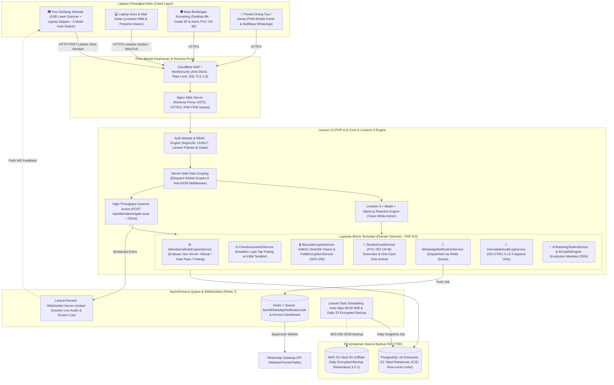

# Arsitektur Sistem & Spesifikasi Database Produksi (SSOT)
**Aplikasi**: EduTrack Pro (Sistem Monitoring Terpadu Sekolah)  
**Institusi**: SDN Kebonagung Kota Pasuruan  
**Arsitektur Inti**: Full-Stack Laravel 13 (PHP 8.4) + Laravel Livewire 3 + Alpine.js + PostgreSQL 16 + Redis 7  
**ORM & Database Layer**: Laravel Eloquent ORM + Native PostgreSQL Migrations & DDL (21 Tabel Relasional dengan UUIDv7)  
**Antrean & Real-Time**: Laravel Queue (Redis 7 Driver) + Laravel Horizon + Laravel Reverb (WebSockets Real-Time Engine)  
**Kepatuhan Standar**: ISO/IEC 27001:2022 & OWASP Top 10 (2021/2026)  
**Target Server**: aaPanel Linux (PHP 8.4-FPM + Nginx + Supervisor) & Bare VPS / Docker Compose (Multi-Container Production)

Dokumen ini merupakan **Single Source of Truth (SSOT)** untuk seluruh arsitektur teknis berbasis **Laravel 13**, struktur modular framework, skema DDL 21 tabel basis data relasional lengkap dengan atribut jam pulang dan izin fleksibel, mapping migrasi Eloquent, serta konfigurasi server produksi enterprise.

---

## 1. Topologi Arsitektur Sistem (High-Level Topology)



---

## 2. Struktur Proyek Laravel 13 (PHP 8.4) Enterprise

Mengadopsi struktur arsitektur standar **Laravel 13** modern yang menggabungkan kecepatan REST API controller, reaktivitas interaktif **Livewire 3**, integrasi desain **Enterprise Clean White Admin Dashboard**, serta pemisahan logika bisnis murni ke lapisan *Services*:

```
edutrack-app/
├── app/
│   ├── Console/
│   │   └── Commands/
│   │       ├── AutoAlpaCutoffCommand.php            # Artisan command cutoff alpa jam 08:00 WIB
│   │       ├── ReconcileMissedCheckoutCommand.php   # Artisan command keadilan checkout jam 17:00 WIB
│   │       └── DailyEncryptedBackupCommand.php      # Artisan command snapshot 3-2-1 jam 02:00 WIB
│   ├── Enums/
│   │   ├── UserRole.php                             # Enum: admin, bk, wali_kelas, orang_tua, siswa, satpam
│   │   ├── AttendanceStatus.php                     # Enum: Hadir, Terlambat, Sakit, Izin, Alpa, Dispensasi
│   │   ├── LateCategory.php                         # Enum: T-1, T-2, T-3
│   │   ├── CheckoutStatus.php                       # Enum: Belum Pulang, Check-out Normal, Izin Pulang Cepat, Check-out Default
│   │   └── GateMode.php                             # Enum: CheckIn, GatePass, CheckOut
│   ├── Events/
│   │   ├── GateAttendanceScanned.php                # Broadcastable event via Laravel Reverb
│   │   └── DigitalGatePassVerified.php              # Broadcastable event
│   ├── Http/
│   │   ├── Controllers/
│   │   │   ├── Api/
│   │   │   │   ├── GateAttendanceScanController.php # Endpoint scanner ultra-cepat (< 50ms)
│   │   │   │   ├── GatePassApiController.php        # API verifikasi QR satpam
│   │   │   │   └── CardVerificationApiController.php# API validasi HMAC kartu
│   │   │   └── Auth/
│   │   │       ├── AuthenticatedSessionController.php # Login Glassmorphism Modal
│   │   │       └── TwoFactorAuthController.php
│   │   ├── Middleware/
│   │   │   ├── EnforceServerDataScope.php           # Middleware isolasi data anti-IDOR
│   │   │   └── ValidateRolePermission.php           # RBAC enforcer
│   │   └── Requests/
│   │       ├── GateScanRequest.php                  # Form request validasi scanner
│   │       └── LeaveRequestFormRequest.php
│   ├── Jobs/
│   │   ├── SendWhatsAppNotificationJob.php          # Worker pengiriman notif WA masuk/pulang
│   │   ├── DispatchAutoAlpaNotificationsJob.php     # Worker blast WA darurat alpa 08:00 WIB
│   │   └── GenerateWarningLetterPdfJob.php          # Worker pembuatan PDF SP ber-QR Code
│   ├── Livewire/                                    # Full-stack Livewire 3 Components (Enterprise Clean White)
│   │   ├── Admin/
│   │   │   ├── ExecutiveDashboard.php               # Dashboard GitHub-style & Morning Briefing
│   │   │   ├── TeacherStaffManagement.php           # Master GTK (Khusus Super Admin)
│   │   │   ├── StudentManagement.php                # Master Siswa & Data Scope
│   │   │   ├── ParentManagement.php                 # Master Orang Tua & Portal Sync
│   │   │   ├── UserScopeManagement.php              # RBAC & Scopes Dinamis
│   │   │   ├── AuditLogViewer.php                   # Viewer Log Audit Kekal ISO 27001
│   │   │   └── BackupRegistryPanel.php              # Redundansi 3-2-1 AWS S3 Vault
│   │   ├── Attendance/
│   │   │   ├── DailyClassroomAttendance.php         # Presensi cepat H/S/I/A/T rombel
│   │   │   ├── SubjectAttendanceKbm.php             # Presensi KBM & deteksi membolos
│   │   │   └── ParentLeaveRequestModal.php          # Pengajuan izin sakit fleksibel ortu
│   │   ├── Scanner/
│   │   │   ├── GateScannerStation.php               # Meja scanner 3-mode & Web Audio cue
│   │   │   └── GatePassVerifierStation.php          # Verifikasi gate pass satpam pos gerbang
│   │   ├── Discipline/
│   │   │   ├── ViolationCatalogTable.php            # Rekapitulasi tatib & demerit points
│   │   │   ├── WarningLetterModal.php               # Modal pratinjau SP 1-3 resmi ber-QR
│   │   │   └── AchievementBankTable.php             # Bank prestasi & merit points
│   │   ├── Whistleblower/
│   │   │   ├── SecretComplaintForm.php              # Aduan anonim terenkripsi AES-256
│   │   │   └── InvestigationChatThread.php          # Ruang obrolan dua arah rahasia
│   │   └── Ai/
│   │       ├── AiAnalysisDashboardView.php          # Dasbor Analisis AI (Rule-Based & Gemini 1.5 Flash)
│   │       ├── FloatingCopilotDrawer.php            # Floating Copilot pill & slide-out chat
│   │       └── MorningBriefingWidget.php            # Analitik ringkasan eksekutif pagi
│   ├── Models/                                      # 21 Eloquent Models (UUIDv7 & Relasi)
│   │   ├── User.php
│   │   ├── Teacher.php                              # Master GTK Admin
│   │   ├── Classroom.php
│   │   ├── Student.php
│   │   ├── ParentModel.php
│   │   ├── StudentParentRelation.php
│   │   ├── StudentCard.php
│   │   ├── AttendanceDaily.php
│   │   ├── Subject.php
│   │   ├── AttendanceSubject.php
│   │   ├── LeaveRequest.php
│   │   ├── GatePass.php
│   │   ├── ViolationPreset.php
│   │   ├── StudentViolation.php
│   │   ├── WarningLetter.php
│   │   ├── Achievement.php
│   │   ├── Complaint.php
│   │   ├── ComplaintMessage.php
│   │   ├── AuditLog.php
│   │   └── BackupArchive.php
│   ├── Policies/                                    # Policy Anti-IDOR per Model
│   │   ├── StudentPolicy.php
│   │   ├── AttendanceDailyPolicy.php
│   │   └── ComplaintPolicy.php
│   ├── Scopes/                                      # Eloquent Global Scopes
│   │   └── ClassroomScope.php
│   └── Services/                                    # Domain Services (PHP 8.4 Typed)
│       ├── AttendanceRuleEngineService.php          # Evaluasi 3 mode otomatis & jam server
│       ├── CheckoutJusticeService.php               # Keadilan lupa tap pulang vs sesi KBM
│       ├── BarcodeCryptoService.php                 # HMAC-SHA256 & Code 128 generator
│       ├── FieldEncryptionService.php               # AES-256-GCM via Illuminate\Support\Facades\Crypt
│       ├── WhatsAppNotificationService.php          # Redis Queue dispatcher WhatsApp API
│       ├── StudentCardService.php                   # Generator ISO CR-80 PVC & Revocation
│       ├── ImmutableAuditLogService.php             # ISO 27001 A.12.4 Append-only logger
│       ├── AiAnalysisGeminiService.php              # LLM Service Google Gemini 1.5 Flash (Deteksi Nilai & Absensi)
│       └── AiCopilotEngineService.php               # LLM Chat context kesiswaan real-time
├── config/
│   ├── app.php
│   ├── auth.php                                     # RBAC Multi-guards
│   ├── database.php                                 # PostgreSQL 16 & Redis 7 driver
│   ├── queue.php                                    # Redis default queue connection
│   ├── reverb.php                                   # Laravel Reverb WebSocket configuration
│   └── services.php                                 # WhatsApp API & LLM credentials
├── database/
│   ├── migrations/                                  # 21 Berkas Migrasi DDL PostgreSQL 16
│   └── seeders/                                     # DatabaseSeeder, GTKSeeder, StudentSeeder
├── resources/
│   ├── css/
│   │   └── app.css                                  # Tailwind CSS v4 + Plus Jakarta Sans + HRD Clean White CSS
│   ├── js/
│   │   ├── app.js                                   # Alpine.js + Reverb Echo + Chart.js
│   │   └── audio-scanner.js                         # Web Audio API sintetis (Beep, Buzz, Chime)
│   └── views/
│       ├── components/                              # Blade UI Components (Pagination, InfoCards)
│       ├── layouts/
│       │   ├── app.blade.php                        # Shell Enterprise Clean White (Sidebar 260px/68px, Sticky Header)
│       │   └── guest.blade.php                      # Glassmorphism Welcome Page & Auth Modal layout
│       └── livewire/                                # Template Blade untuk Livewire 3
├── routes/
│   ├── web.php                                      # Rute halaman internal & portal Livewire
│   ├── api.php                                      # REST API pemindai gerbang (< 50ms)
│   ├── console.php                                  # Task Scheduler (Cron 08:00, 17:00, 02:00)
│   └── channels.php                                 # Laravel Reverb private channels
├── composer.json                                    # PHP 8.4, Laravel 13, Livewire 3, Reverb
├── package.json                                     # Vite, Tailwind CSS v4, Alpine.js, Chart.js
└── docker-compose.yml                               # Bare VPS Multi-container configuration
```

---

## 3. Skema Basis Data Relasional (DDL 21 Tabel PostgreSQL 16)

Skema basis data relasional dirancang menggunakan **UUIDv7**, indeks komposit teroptimasi, serta kolom operasional presisi untuk **presensi pulang, izin sakit fleksibel, dan digital gate pass**. Di Laravel 13, tabel-tabel ini dimigrasikan via `database/migrations/` dan dihubungkan ke model Eloquent:

```sql
-- 1. EXTENSIONS
CREATE EXTENSION IF NOT EXISTS "pgcrypto";

-- 2. TABEL PENGGUNA (Users & RBAC)
CREATE TABLE users (
    id BIGSERIAL PRIMARY KEY,
    uuid UUID DEFAULT gen_random_uuid() UNIQUE NOT NULL,
    name VARCHAR(150) NOT NULL,
    email VARCHAR(150) UNIQUE NOT NULL,
    password_hash VARCHAR(255) NOT NULL,
    role VARCHAR(50) NOT NULL CHECK (role IN ('admin', 'bk', 'wali_kelas', 'orang_tua', 'siswa', 'satpam')),
    data_scope_type VARCHAR(50) NOT NULL DEFAULT 'all', -- 'all', 'classroom', 'student'
    data_scope_target VARCHAR(100) NULL,
    phone VARCHAR(30) NULL,
    two_factor_secret TEXT NULL,
    two_factor_enabled BOOLEAN DEFAULT FALSE,
    is_active BOOLEAN DEFAULT TRUE,
    created_at TIMESTAMP WITH TIME ZONE DEFAULT CURRENT_TIMESTAMP,
    updated_at TIMESTAMP WITH TIME ZONE DEFAULT CURRENT_TIMESTAMP
);

-- 3. TABEL GURU & TENAGA KEPENDIDIKAN (GTK - Master Staff Eksklusif Admin)
CREATE TABLE teachers (
    id BIGSERIAL PRIMARY KEY,
    uuid UUID DEFAULT gen_random_uuid() UNIQUE NOT NULL,
    user_id BIGINT UNIQUE REFERENCES users(id) ON DELETE SET NULL,
    nip VARCHAR(30) DEFAULT '-' NOT NULL,
    nuptk VARCHAR(30) DEFAULT '-' NOT NULL,
    name VARCHAR(150) NOT NULL,
    gender VARCHAR(20) NOT NULL CHECK (gender IN ('Laki-laki', 'Perempuan')),
    role_position VARCHAR(100) NOT NULL, -- 'Kepala Sekolah', 'Guru BK', 'Wali Kelas', 'Guru Mapel', 'TU', 'Satpam'
    employment_status VARCHAR(50) NOT NULL CHECK (employment_status IN ('PNS / ASN', 'PPPK', 'Honorer Daerah (PTT)', 'Pegawai Kontrak')),
    subject_or_class VARCHAR(150) NOT NULL,
    phone VARCHAR(30) NOT NULL,
    email VARCHAR(150) NOT NULL,
    status VARCHAR(30) DEFAULT 'Aktif' NOT NULL CHECK (status IN ('Aktif', 'Cuti', 'Mutasi', 'Pensiun')),
    created_at TIMESTAMP WITH TIME ZONE DEFAULT CURRENT_TIMESTAMP,
    updated_at TIMESTAMP WITH TIME ZONE DEFAULT CURRENT_TIMESTAMP
);

-- 4. TABEL KELAS / ROMBEL (Classrooms)
CREATE TABLE classrooms (
    id BIGSERIAL PRIMARY KEY,
    code VARCHAR(50) UNIQUE NOT NULL, -- 'X-RPL-1', 'Kelas 4-A'
    name VARCHAR(100) NOT NULL,
    grade_level INT NOT NULL,
    academic_year VARCHAR(20) NOT NULL,
    homeroom_teacher_id BIGINT REFERENCES teachers(id) ON DELETE SET NULL,
    created_at TIMESTAMP WITH TIME ZONE DEFAULT CURRENT_TIMESTAMP
);

-- 5. TABEL MASTER SISWA (Students)
CREATE TABLE students (
    id BIGSERIAL PRIMARY KEY,
    uuid UUID DEFAULT gen_random_uuid() UNIQUE NOT NULL,
    user_id BIGINT UNIQUE REFERENCES users(id) ON DELETE SET NULL,
    classroom_id BIGINT REFERENCES classrooms(id) ON DELETE RESTRICT,
    nisn VARCHAR(20) UNIQUE NOT NULL,
    nis VARCHAR(20) UNIQUE NOT NULL,
    name VARCHAR(150) NOT NULL,
    gender VARCHAR(20) NOT NULL CHECK (gender IN ('Laki-laki', 'Perempuan')),
    birth_place VARCHAR(100) NOT NULL,
    birth_date DATE NOT NULL,
    blood_type VARCHAR(5) DEFAULT 'O',
    address TEXT NOT NULL,
    demerit_points INT DEFAULT 0 CHECK (demerit_points >= 0),
    merit_points INT DEFAULT 0 CHECK (merit_points >= 0),
    status VARCHAR(30) DEFAULT 'Aktif' CHECK (status IN ('Aktif', 'Lulus', 'Pindah', 'Drop-out')),
    created_at TIMESTAMP WITH TIME ZONE DEFAULT CURRENT_TIMESTAMP,
    updated_at TIMESTAMP WITH TIME ZONE DEFAULT CURRENT_TIMESTAMP
);
CREATE INDEX idx_students_nisn ON students(nisn);
CREATE INDEX idx_students_classroom ON students(classroom_id);

-- 6. TABEL MASTER ORANG TUA / WALI (Parents)
CREATE TABLE parents (
    id BIGSERIAL PRIMARY KEY,
    uuid UUID DEFAULT gen_random_uuid() UNIQUE NOT NULL,
    user_id BIGINT UNIQUE REFERENCES users(id) ON DELETE SET NULL,
    name VARCHAR(150) NOT NULL,
    phone VARCHAR(30) NOT NULL,
    email VARCHAR(150) NULL,
    job VARCHAR(100) DEFAULT 'Wiraswasta',
    portal_status VARCHAR(50) DEFAULT 'Belum Terhubung' CHECK (portal_status IN ('Belum Terhubung', 'Terhubung (Aktif)', 'Dinonaktifkan')),
    last_login_at TIMESTAMP WITH TIME ZONE NULL,
    created_at TIMESTAMP WITH TIME ZONE DEFAULT CURRENT_TIMESTAMP
);

-- 7. TABEL RELASI SISWA DENGAN ORANG TUA (Student-Parent Links)
CREATE TABLE student_parent_relations (
    id BIGSERIAL PRIMARY KEY,
    student_id BIGINT NOT NULL REFERENCES students(id) ON DELETE CASCADE,
    parent_id BIGINT NOT NULL REFERENCES parents(id) ON DELETE CASCADE,
    relation_type VARCHAR(50) NOT NULL CHECK (relation_type IN ('Ayah Kandung', 'Ibu Kandung', 'Wali Murid')),
    is_primary_contact BOOLEAN DEFAULT TRUE,
    UNIQUE(student_id, parent_id)
);

-- 8. TABEL KARTU PELAJAR PVC & BARCODE (Student Cards)
CREATE TABLE student_cards (
    id BIGSERIAL PRIMARY KEY,
    uuid UUID DEFAULT gen_random_uuid() UNIQUE NOT NULL,
    student_id BIGINT NOT NULL REFERENCES students(id) ON DELETE CASCADE,
    card_uid VARCHAR(100) UNIQUE NOT NULL,         -- 'CRD-88912-X'
    barcode_1d VARCHAR(50) NOT NULL,              -- Code 128 (NISN)
    qr_payload_hmac TEXT NOT NULL,                -- Signed cryptographic payload
    issued_date DATE DEFAULT CURRENT_DATE NOT NULL,
    status VARCHAR(30) DEFAULT 'Aktif' CHECK (status IN ('Aktif', 'Dicabut (Revoked)', 'Hilang')),
    revoked_at TIMESTAMP WITH TIME ZONE NULL,
    revocation_reason TEXT NULL,
    created_at TIMESTAMP WITH TIME ZONE DEFAULT CURRENT_TIMESTAMP
);

-- 9. TABEL PRESENSI HARIAN SISWA (Daily Attendances - Masuk & Pulang)
CREATE TABLE attendances_daily (
    id BIGSERIAL PRIMARY KEY,
    uuid UUID DEFAULT gen_random_uuid() UNIQUE NOT NULL,
    student_id BIGINT NOT NULL REFERENCES students(id) ON DELETE RESTRICT,
    date DATE NOT NULL,
    
    -- Jendela Masuk Pagi
    check_in_time TIME NULL,
    status VARCHAR(50) NOT NULL CHECK (status IN ('Hadir', 'Terlambat', 'Sakit', 'Izin', 'Alpa', 'Dispensasi')),
    late_category VARCHAR(30) NULL CHECK (late_category IN ('T-1', 'T-2', 'T-3', NULL)),
    late_minutes INT DEFAULT 0,
    points_deducted INT DEFAULT 0,
    scan_method_in VARCHAR(30) DEFAULT 'Barcode Scanner',
    
    -- Jendela Kepulangan Sore & Izin Pulang Cepat
    check_out_time TIME NULL,
    checkout_status VARCHAR(50) DEFAULT 'Belum Pulang' CHECK (checkout_status IN ('Belum Pulang', 'Check-out Normal', 'Izin Pulang Cepat', 'Check-out Default (Selesai KBM)')),
    early_leave_time TIME NULL,
    early_leave_reason TEXT NULL,
    early_leave_pickup_by VARCHAR(150) NULL,
    is_checkout_missed BOOLEAN DEFAULT FALSE,     -- Flag jika lupa tap pulang
    
    notes TEXT NULL,
    verified_by_user_id BIGINT REFERENCES users(id),
    created_at TIMESTAMP WITH TIME ZONE DEFAULT CURRENT_TIMESTAMP,
    updated_at TIMESTAMP WITH TIME ZONE DEFAULT CURRENT_TIMESTAMP,
    UNIQUE(student_id, date)
);
CREATE INDEX idx_attendance_date ON attendances_daily(date);
CREATE INDEX idx_attendance_student_date ON attendances_daily(student_id, date);

-- 10. TABEL MATA PELAJARAN (Subjects)
CREATE TABLE subjects (
    id BIGSERIAL PRIMARY KEY,
    code VARCHAR(50) UNIQUE NOT NULL,
    name VARCHAR(150) NOT NULL,
    grade_level INT NOT NULL
);

-- 11. TABEL PRESENSI KBM JAM MAPEL (Subject-Based Classroom Attendance)
CREATE TABLE attendances_subject (
    id BIGSERIAL PRIMARY KEY,
    student_id BIGINT NOT NULL REFERENCES students(id) ON DELETE CASCADE,
    subject_id BIGINT NOT NULL REFERENCES subjects(id) ON DELETE RESTRICT,
    teacher_id BIGINT NOT NULL REFERENCES teachers(id) ON DELETE RESTRICT,
    classroom_id BIGINT NOT NULL REFERENCES classrooms(id) ON DELETE RESTRICT,
    date DATE NOT NULL,
    period_hours VARCHAR(50) NOT NULL, -- 'Jam Ke 1 - 3'
    status VARCHAR(30) NOT NULL CHECK (status IN ('Hadir', 'Sakit', 'Izin', 'Membolos')),
    is_skipping BOOLEAN DEFAULT FALSE,
    notes TEXT NULL,
    created_at TIMESTAMP WITH TIME ZONE DEFAULT CURRENT_TIMESTAMP
);

-- 12. TABEL PENGAJUAN IZIN / SAKIT FLEKSIBEL (Leave Requests)
CREATE TABLE leave_requests (
    id BIGSERIAL PRIMARY KEY,
    uuid UUID DEFAULT gen_random_uuid() UNIQUE NOT NULL,
    student_id BIGINT NOT NULL REFERENCES students(id) ON DELETE CASCADE,
    parent_id BIGINT NOT NULL REFERENCES parents(id) ON DELETE CASCADE,
    type VARCHAR(100) NOT NULL CHECK (type IN (
        'Sakit 1 Hari (Surat Izin Ortu)', 
        'Sakit >1 Hari (Surat Dokter Terlampir)', 
        'Izin Keperluan Keluarga', 
        'Dispensasi Tugas Sekolah'
    )),
    start_date DATE NOT NULL,
    end_date DATE NOT NULL,
    reason TEXT NOT NULL,
    attachment_path VARCHAR(255) NULL,
    semester_quota_used INT DEFAULT 1,
    status VARCHAR(50) DEFAULT 'Menunggu Persetujuan Wali Kelas' CHECK (status IN ('Menunggu Persetujuan Wali Kelas', 'Disetujui', 'Ditolak')),
    approved_by_teacher_id BIGINT REFERENCES teachers(id),
    submitted_at TIMESTAMP WITH TIME ZONE DEFAULT CURRENT_TIMESTAMP
);

-- 13. TABEL DIGITAL GATE PASS (Izin Pulang Cepat Satpam)
CREATE TABLE gate_passes (
    id BIGSERIAL PRIMARY KEY,
    pass_code VARCHAR(50) UNIQUE NOT NULL, -- 'GP-20261123-001'
    student_id BIGINT NOT NULL REFERENCES students(id) ON DELETE CASCADE,
    reason TEXT NOT NULL,
    pickup_person VARCHAR(150) NOT NULL,
    pickup_relation VARCHAR(50) NOT NULL,
    approved_by_teacher_id BIGINT NOT NULL REFERENCES teachers(id),
    status VARCHAR(50) DEFAULT 'Siap Diverifikasi Satpam' CHECK (status IN ('Siap Diverifikasi Satpam', 'Telah Melintasi Gerbang', 'Dibatalkan')),
    issued_at TIMESTAMP WITH TIME ZONE DEFAULT CURRENT_TIMESTAMP,
    verified_at TIMESTAMP WITH TIME ZONE NULL,
    verified_by_satpam_id BIGINT REFERENCES users(id)
);

-- 14. TABEL PRESET KATALOG PELANGGARAN (Violation Presets)
CREATE TABLE violation_presets (
    id BIGSERIAL PRIMARY KEY,
    code VARCHAR(50) UNIQUE NOT NULL,
    title VARCHAR(200) NOT NULL,
    severity VARCHAR(30) NOT NULL CHECK (severity IN ('Ringan', 'Sedang', 'Berat')),
    points INT NOT NULL CHECK (points > 0)
);

-- 15. TABEL PELANGGARAN SISWA (Student Violations)
CREATE TABLE student_violations (
    id BIGSERIAL PRIMARY KEY,
    uuid UUID DEFAULT gen_random_uuid() UNIQUE NOT NULL,
    student_id BIGINT NOT NULL REFERENCES students(id) ON DELETE CASCADE,
    preset_id BIGINT REFERENCES violation_presets(id),
    title VARCHAR(200) NOT NULL,
    severity VARCHAR(30) NOT NULL CHECK (severity IN ('Ringan', 'Sedang', 'Berat')),
    points INT NOT NULL CHECK (points > 0),
    date DATE DEFAULT CURRENT_DATE NOT NULL,
    status VARCHAR(50) DEFAULT 'Diproses' CHECK (status IN ('Diproses', 'SP-1', 'SP-2', 'SP-3', 'Selesai')),
    notes TEXT NULL,
    recorded_by_user_id BIGINT NOT NULL REFERENCES users(id),
    created_at TIMESTAMP WITH TIME ZONE DEFAULT CURRENT_TIMESTAMP
);

-- 16. TABEL SURAT PERINGATAN (Warning Letters - SP)
CREATE TABLE warning_letters (
    id BIGSERIAL PRIMARY KEY,
    sp_number VARCHAR(100) UNIQUE NOT NULL, -- 'SP/2026/XI/004'
    student_id BIGINT NOT NULL REFERENCES students(id) ON DELETE CASCADE,
    violation_id BIGINT REFERENCES student_violations(id),
    sp_level VARCHAR(20) NOT NULL CHECK (sp_level IN ('SP-1', 'SP-2', 'SP-3')),
    qr_verification_token VARCHAR(255) UNIQUE NOT NULL,
    issue_date DATE DEFAULT CURRENT_DATE NOT NULL,
    pdf_path VARCHAR(255) NULL,
    is_signed BOOLEAN DEFAULT TRUE,
    created_at TIMESTAMP WITH TIME ZONE DEFAULT CURRENT_TIMESTAMP
);

-- 17. TABEL BANK PRESTASI (Student Achievements)
CREATE TABLE achievements (
    id BIGSERIAL PRIMARY KEY,
    uuid UUID DEFAULT gen_random_uuid() UNIQUE NOT NULL,
    student_id BIGINT NOT NULL REFERENCES students(id) ON DELETE CASCADE,
    title VARCHAR(200) NOT NULL,
    level VARCHAR(50) NOT NULL CHECK (level IN ('Sekolah', 'Kota/Kabupaten', 'Provinsi', 'Nasional', 'Internasional')),
    rank VARCHAR(50) NOT NULL,
    points INT NOT NULL CHECK (points > 0),
    organizer VARCHAR(150) NOT NULL,
    date DATE NOT NULL,
    certificate_path VARCHAR(255) NULL,
    verified_by_user_id BIGINT REFERENCES users(id),
    created_at TIMESTAMP WITH TIME ZONE DEFAULT CURRENT_TIMESTAMP
);

-- 18. TABEL ADUAN & WHISTLEBLOWER (Complaints - Enkripsi AES-256)
CREATE TABLE complaints (
    id BIGSERIAL PRIMARY KEY,
    ticket_number VARCHAR(50) UNIQUE NOT NULL, -- 'WB-202611-001'
    student_id BIGINT REFERENCES students(id) ON DELETE SET NULL,
    parent_id BIGINT REFERENCES parents(id) ON DELETE SET NULL,
    category VARCHAR(100) NOT NULL,
    title VARCHAR(200) NOT NULL,
    description_encrypted TEXT NOT NULL,      -- AES-256-GCM cipher text
    is_anonymous BOOLEAN DEFAULT FALSE,
    reporter_display_name VARCHAR(150) NOT NULL,
    status VARCHAR(50) DEFAULT 'Menunggu Verifikasi' CHECK (status IN ('Menunggu Verifikasi', 'Investigasi', 'Selesai', 'Ditolak')),
    assigned_to VARCHAR(150) DEFAULT 'Tim Satgas Anti-Kekerasan & Guru BK',
    created_at TIMESTAMP WITH TIME ZONE DEFAULT CURRENT_TIMESTAMP,
    updated_at TIMESTAMP WITH TIME ZONE DEFAULT CURRENT_TIMESTAMP
);

-- 19. TABEL PESAN INVESTIGASI ADUAN (Complaint Messages - Enkripsi AES-256)
CREATE TABLE complaint_messages (
    id BIGSERIAL PRIMARY KEY,
    complaint_id BIGINT NOT NULL REFERENCES complaints(id) ON DELETE CASCADE,
    sender_type VARCHAR(50) NOT NULL CHECK (sender_type IN ('reporter', 'school_staff')),
    sender_name VARCHAR(150) NOT NULL,
    message_encrypted TEXT NOT NULL,          -- AES-256-GCM cipher text
    sent_at TIMESTAMP WITH TIME ZONE DEFAULT CURRENT_TIMESTAMP
);

-- 20. TABEL LOG AUDIT KEKAL ISO 27001 (Immutable Audit Logs - A.12.4)
CREATE TABLE audit_logs (
    id BIGSERIAL PRIMARY KEY,
    timestamp TIMESTAMP WITH TIME ZONE DEFAULT CURRENT_TIMESTAMP NOT NULL,
    user_id BIGINT NULL REFERENCES users(id) ON DELETE SET NULL,
    user_email VARCHAR(150) NOT NULL,
    role VARCHAR(50) NOT NULL,
    action VARCHAR(100) NOT NULL,
    details TEXT NOT NULL,
    ip_address VARCHAR(45) NOT NULL,
    user_agent TEXT NULL,
    metadata_json JSONB NULL
);
CREATE INDEX idx_audit_logs_timestamp ON audit_logs(timestamp);
CREATE INDEX idx_audit_logs_user ON audit_logs(user_email);

-- 21. TABEL CADANGAN TERENKRIPSI ISO 27001 (Backup Registry 3-2-1)
CREATE TABLE backup_archives (
    id BIGSERIAL PRIMARY KEY,
    filename VARCHAR(255) NOT NULL,
    size_bytes BIGINT NOT NULL,
    storage_location VARCHAR(150) NOT NULL,   -- 'Lokal + AWS S3 Vault SG'
    checksum_sha256 VARCHAR(100) NOT NULL,
    encryption_algorithm VARCHAR(50) DEFAULT 'AES-256-GCM',
    status VARCHAR(50) DEFAULT 'Terverifikasi SHA-256',
    created_at TIMESTAMP WITH TIME ZONE DEFAULT CURRENT_TIMESTAMP
);
```

---

## 4. Konfigurasi Deployment Ganda Laravel 13 (aaPanel & Bare VPS / Docker)

### Target 1: aaPanel Linux Hosting (PHP 8.4-FPM + Nginx + Supervisor)
1. **PHP 8.4 & Ekstensi Wajib (aaPanel App Store)**:
   - Pasang PHP 8.4 dengan ekstensi: `pdo_pgsql`, `pgsql`, `redis`, `opcache`, `bcmath`, `fileinfo`, `gd`, `zip`.
   - Konfigurasi OPcache produksi (`opcache.enable=1`, `opcache.jit=tracing`, `opcache.jit_buffer_size=128M`).
2. **Supervisor Daemon (Proses Asinkron & Real-Time)**:
   - Daemon 1: Laravel Queue Worker
     ```ini
     [program:edutrack-queue]
     process_name=%(program_name)s_%(process_num)02d
     command=php /www/wwwroot/edutrack.sdnkebonagung.sch.id/artisan queue:work redis --sleep=3 --tries=3 --max-time=3600
     autostart=true
     autorestart=true
     user=www
     numprocs=2
     redirect_stderr=true
     stdout_logfile=/www/wwwroot/edutrack.sdnkebonagung.sch.id/storage/logs/worker.log
     ```
   - Daemon 2: Laravel Reverb WebSocket Server
     ```ini
     [program:edutrack-reverb]
     command=php /www/wwwroot/edutrack.sdnkebonagung.sch.id/artisan reverb:start --port=8080 --host=0.0.0.0
     autostart=true
     autorestart=true
     user=www
     redirect_stderr=true
     stdout_logfile=/www/wwwroot/edutrack.sdnkebonagung.sch.id/storage/logs/reverb.log
     ```
3. **Nginx Reverse Proxy & WebSocket Sub-Path**:
   - Konfigurasi Root Nginx mengarah ke `/www/wwwroot/edutrack.sdnkebonagung.sch.id/public`.
   - Blok Reverse Proxy WebSocket Laravel Reverb:
     ```nginx
     location /app {
         proxy_pass http://127.0.0.1:8080;
         proxy_http_version 1.1;
         proxy_set_header Upgrade $http_upgrade;
         proxy_set_header Connection "Upgrade";
         proxy_set_header Host $host;
     }
     ```
4. **Cron Tab aaPanel (Task Scheduling)**:
   - Jalankan scheduler Laravel setiap menit:
     ```bash
     * * * * * cd /www/wwwroot/edutrack.sdnkebonagung.sch.id && php artisan schedule:run >> /dev/null 2>&1
     ```

### Target 2: Bare VPS Linux (Ubuntu 24.04 LTS / Docker Compose Production)
Menggunakan multi-container mandiri terisolasi:

```yaml
version: '3.9'

services:
  app:
    build:
      context: .
      dockerfile: Dockerfile
    image: edutrack-app:13.0
    restart: always
    working_dir: /var/www/html
    volumes:
      - ./:/var/www/html
      - ./storage:/var/www/html/storage
    environment:
      APP_ENV: production
      APP_KEY: ${APP_KEY}
      DB_CONNECTION: pgsql
      DB_HOST: postgres
      DB_PORT: 5432
      DB_DATABASE: edutrack_db
      DB_USERNAME: ${DB_USERNAME}
      DB_PASSWORD: ${DB_PASSWORD}
      REDIS_HOST: redis
      QUEUE_CONNECTION: redis
      BROADCAST_CONNECTION: reverb
    depends_on:
      - postgres
      - redis

  web:
    image: nginx:alpine
    restart: always
    ports:
      - "80:80"
      - "443:443"
    volumes:
      - ./:/var/www/html
      - ./docker/nginx/default.conf:/etc/nginx/conf.d/default.conf
      - ./docker/ssl:/etc/nginx/ssl
    depends_on:
      - app

  postgres:
    image: postgres:16-alpine
    restart: always
    environment:
      POSTGRES_DB: edutrack_db
      POSTGRES_USER: ${DB_USERNAME}
      POSTGRES_PASSWORD: ${DB_PASSWORD}
    volumes:
      - postgres_data:/var/lib/postgresql/data
    ports:
      - "127.0.0.1:5432:5432"

  redis:
    image: redis:7-alpine
    restart: always
    volumes:
      - redis_data:/data
    command: ["redis-server", "--appendonly", "yes"]

  queue-worker:
    image: edutrack-app:13.0
    restart: always
    working_dir: /var/www/html
    command: ["php", "artisan", "queue:work", "redis", "--sleep=3", "--tries=3"]
    depends_on:
      - app
      - redis

  reverb:
    image: edutrack-app:13.0
    restart: always
    working_dir: /var/www/html
    command: ["php", "artisan", "reverb:start", "--host=0.0.0.0", "--port=8080"]
    ports:
      - "8080:8080"
    depends_on:
      - app
      - redis

volumes:
  postgres_data:
  redis_data:
```
