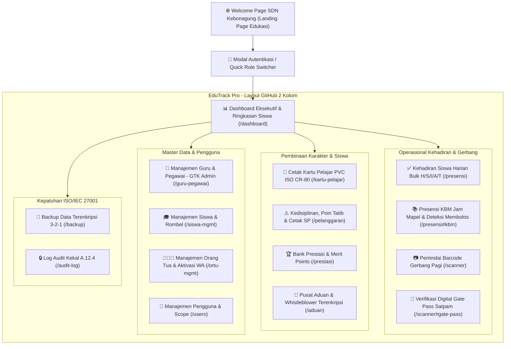

# Desain Antarmuka Pengguna & Spesifikasi Halaman (Design UI) - SSOT
**Aplikasi**: EduTrack Pro (Sistem Monitoring Terpadu Sekolah)  
**Institusi**: SDN Kebonagung Kota Pasuruan  
**Total Modul & Tampilan**: 15 Halaman & 12 Modal Interaktif  
**Standar Desain**: Clean White Minimalist & GitHub Repository Theme

Dokumen ini merupakan **Single Source of Truth (SSOT)** untuk tata letak visual (*wireframe*), hierarki navigasi, interaksi komponen, dan alur kerja pengguna pada setiap modul aplikasi.

---

## 1. Peta Navigasi & Rute Halaman (Sitemap)

---

## 2. Rincian Wireframe & Spesifikasi Modul Kunci

### 2.1 Welcome Landing Page (Halaman Depan Edukasi)
- **Hero Canvas**: Nuansa *Soft Lavender* (`#F3F0FF`) dengan kubah lengkung artistik ungu.
- **Karakter Utama**: Ilustrasi 3D Guru ASN/PNS laki-laki berseragam khaki dinas rapi menyambut ramah memegang buku pelajaran.
- **Lencana Mengapung (*Floating Badges*)**:
  - Lencana Google Drive Materi Terintegrasi.
  - Lencana Saluran YouTube Pembelajaran Sekolah.
  - Lencana Akreditasi Resmi SDN Kebonagung Kota Pasuruan.
- **Tombol Masuk Cepat**: Tombol **"GET A DEMO / LOGIN"** pada navbar atas dan tombol **"LEARN NOW"** pada hero memicu jendela sembulan (*modal popup*) dengan pilihan akun peran demo kilat.

---

### 2.2 Dashboard Eksekutif (Berbasis Isolasi Peran)
- **Banner Komit GitHub (Commit Bar)**: Menampilkan status rilis kode, author komit terakhir (`Drs. H. Mulyadi M.Pd`), pesan pembaruan sistem, hash terverifikasi `34acc33`, dan counter komit.
- **Kartu Metrik KPI (Role Scoped)**:
  - *Tingkat Kehadiran Hari Ini*: Persentase kehadiran agregat ($94\%$).
  - *Siswa Hadir Tepat Waktu*: Jumlah siswa berstatus Hadir/Terlambat.
  - *Ketidakhadiran / Alpa*: Jumlah siswa alpa yang memicu peringatan WhatsApp.
  - *Tiket Aduan Aktif*: Jumlah aduan yang sedang dalam tahap investigasi satgas.
- **Sidebar Kanan ('About Repositori')**:
  - Bagian *About*: Profil SDN Kebonagung Pasuruan, deskripsi kepatuhan ISO 27001.
  - Bagian *Releases*: Status versi aktif `v2.4-Production-Ready`.
  - Bagian *Deployments*: Status Server Daemon OK, S3 Backup Vault SG OK, WA Gateway Ready.
  - Bagian *Cakupan Data*: Indikator wilayah isolasi data yang sedang aktif.

---

### 2.3 Modul Presensi Kehadiran Siswa
- **Tab 1: Presensi Harian Siswa (Bulk Attendance Mode)**:
  - Filter pencarian teks nama/NISN, dropdown filter rombel kelas, dropdown status kehadiran.
  - Tombol master: `"✓ Set Semua Hadir"` untuk menandai seluruh kelas secara serempak.
  - Tombol cepat per baris: `H` (Hadir), `S` (Sakit), `I` (Izin), `A` (Alpa - otomatis picu alert WA), `T` (Terlambat).
  - Tombol `"✏️ Catatan"`: Membuka modal koreksi presensi dan catatan dispensasi khusus.
- **Tab 2: Presensi KBM Jam Mapel (Deteksi Siswa Membolos)**:
  - Pemilih mata pelajaran (contoh: *Pemrograman Web & Mobile*, *Matematika Terapan*).
  - Kolom status kehadiran di kelas. Jika siswa berstatus hadir di gerbang namun tidak ada di kelas, muncul tombol merah **"🚨 Lapor Membolos ke BK"** (+10 Poin Tatib).
- **Modal Pengajuan Izin / Sakit Mandiri oleh Ortu**:
  - Pilihan tipe izin (Sakit dengan surat dokter terlampir vs Izin keperluan keluarga).
  - Upload file bukti surat dokter (`.pdf` / `.jpg`).
  - Banner notifikasi verifikasi di sisi dashboard Wali Kelas dengan tombol persetujuan 1-klik.

---

### 2.4 Scanner Barcode Gerbang Sekolah (Meja Scanner Pos Satpam)
- **Tab 1: Live Gate Scanner (Kecepatan $\le 300\text{ ms}$)**:
  - Input field auto-focus konstan yang siap menerima semburan karakter (*burst keystroke*) dari barcode scanner laser USB.
  - Simulasi Waktu Gerbang: Tombol selektor jam simulasi (`06:45 WIB`, `07:10 WIB`, `07:25 WIB`, `07:45 WIB`).
  - Panel Hasil Pemindaian Terakhir (*Last Scan Feedback*):
    - Foto siswa format pas foto 3x4.
    - Nama Lengkap, NISN, dan Rombel Kelas.
    - Lencana Status Kehadiran (Hadir / Terlambat T-1 / T-2 / T-3) dengan warna semantik tegas.
    - Poin Tatib yang Dikenakan (-0 / -2 / -5 / -10 Poin).
    - Instruksi tindak lanjut bagi petugas keamanan (Izinkan Masuk / Pembinaan Piket / Penyerahan ke BK).
    - Status pengiriman notifikasi WhatsApp ke orang tua.
- **Tab 2: Verifikasi Digital Gate Pass (Satpam)**:
  - Input kode izin keluar atau scan QR tiket gate pass siswa.
  - Tampilan biodata siswa yang dijemput, alasan izin meninggalkan sekolah, nama penjemput terverifikasi, dan pejabat yang menyetujui.
  - Tombol **"✓ Izinkan Keluar & Buka Palang"** yang merekam jam keluar resmi siswa.

---

### 2.5 Generator & Cetak Kartu Pelajar PVC (ISO CR-80)
- **Akses Eksklusif**: Hanya dapat diakses oleh **Super Admin** dan **Guru BK**.
- **Interactive Card Canvas (Standar ISO CR-80: 85.60 x 53.98 mm)**:
  - Pratinjau tampak depan (*Front View*): Kop SDN Kebonagung, foto siswa, biodata, Barcode 1D Code 128, dan QR Code 2D bertanda tangan digital HMAC-SHA256.
  - Pratinjau tampak belakang (*Back View*): Tata tertib pemakaian kartu dan tanda tangan kepala sekolah.
- **Tombol Operasional**:
  - Tombol **"🖨️ Cetak Kartu Siswa Ini"**: Membuka dialog print CSS yang telah disesuaikan ukuran fisik PVC ID Card printer.
  - Tombol **"Revoke & Regenerate Barcode"**: Membatalkan barcode lama jika kartu hilang dan menerbitkan barcode digital baru.

---

### 2.6 Modul Kedisiplinan, Poin Tatib & Penerbitan SP
- **Tabel Rekapitulasi Pelanggaran**:
  - Filter tingkat keparahan (Ringan, Sedang, Berat) dan status tindak lanjut (Diproses, SP-1, SP-2, SP-3, Selesai).
  - Tombol **"+ Catat Pelanggaran Siswa"**: Modal dengan dropdown siswa dan dropdown preset katalog pelanggaran (poin otomatis terisi).
  - Tombol **"📄 Lihat SP"**: Membuka modal pratinjau surat resmi berkop kedinasan SDN Kebonagung Kota Pasuruan lengkap dengan QR Code verifikasi keabsahan.
  - Tombol **"Batalkan / Hapus"**: Membatalkan pelanggaran dan otomatis memulihkan poin demerit siswa.

---

### 2.7 Pusat Aduan & Whistleblower Terenkripsi
- **Matriks Akses Bertingkat**:
  - *Siswa*: Menu disembunyikan demi perlindungan privasi.
  - *Orang Tua*: Menu **"Pengaduan Saya"** (hanya melihat aduan mandiri).
  - *Wali Kelas*: Menu **"Aduan Siswa Kelas"** (hanya aduan rombel binaan).
  - *Admin & Guru BK*: Menu **"Pusat Aduan / Whistle"** (melihat seluruh aduan se-sekolah).
- **Modal Tulis Aduan Baru**:
  - Toggle switch: *"Kirim sebagai Anonim (Whistleblower)"*.
  - Kategori aduan (Perundungan/Bullying, Pungutan Liar, Fasilitas, Kekerasan).
- **Ruang Obrolan Investigasi Terenkripsi (Chat Thread)**:
  - Indikator keamanan cipher AES-256-GCM.
  - Komunikasi dua arah antara pelapor dan Tim Satgas Sekolah.
  - Dropdown perubahan status kasus (Menunggu Verifikasi $\to$ Investigasi $\to$ Selesai).

---

### 2.8 Manajemen Guru & Tenaga Kependidikan (GTK - Eksklusif Admin)
- Modul master GTK terlindung hanya untuk role Super Admin / Kepala Sekolah.
- Tabel data memuat NIP, NUPTK, Nama Lengkap, Gender, Status Kepegawaian (PNS / PPPK / Honorer / Kontrak), Jabatan Utama, Rombel/Mapel Binaan, Nomor WhatsApp, dan Status Keaktifan.
- Modal Tambah/Edit GTK dengan validasi format penomoran kepegawaian otomatis.
- Tombol Hapus data GTK dengan konfirmasi pencatatan audit trail ISO 27001.

---

### 2.9 Log Audit & Backup Redundansi ISO 27001
- **Log Audit Kekal (A.12.4)**: Tabel riwayat mutasi *Who, What, When, IP Address* yang tidak dapat diedit atau dihapus.
- **Manajemen Cadangan 3-2-1 (A.12.3)**:
  - Ringkasan strategi penyimpanan (Server Lokal SSD + AWS S3 Vault Singapore).
  - Tombol **"⚡ Buat Cadangan Baru Sekarang"**: Memproses dump database terenkripsi AES-256 secara instan.
  - Tombol **"📥 Unduh (.enc)"**: Mengunduh berkas arsip terenkripsi untuk pengujian disaster recovery.