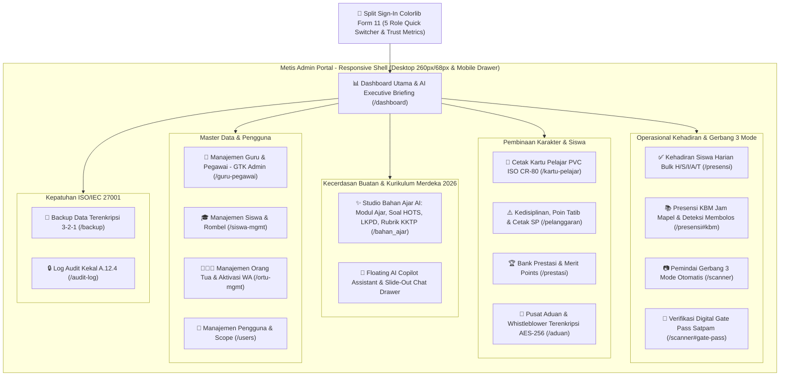

# Desain Antarmuka Pengguna & Spesifikasi Halaman (Design UI) - SSOT
**Aplikasi**: EduTrack Pro (Sistem Monitoring Terpadu Sekolah)  
**Institusi**: SDN Kebonagung Kota Pasuruan  
**Gaya Desain**: Metis Bootstrap 5 Admin Dashboard Template + Colorlib Login Form 11  
**Komponen Inti**: Responsive Mini-Collapsible Sidebar (260px / 68px), Interactive Charts, Pagination, Multi-Filter, Studio Bahan Ajar AI, Floating Copilot  
**Total Tampilan**: 16 Modul Halaman & 12 Modal Interaktif

Dokumen ini merupakan **Single Source of Truth (SSOT)** untuk seluruh tata letak visual (*wireframe*), struktur shell Metis Admin, formulir login split-screen Colorlib Form 11, kartu statistik, grafik analitik data, bilah pencarian & filter dinamis, paginasi, studio bahan ajar AI, dan alur antarmuka pemindai gerbang 3 mode.

---

## 1. Peta Rute Navigasi Sistem (Sitemap)



---

## 2. Struktur Tata Letak Halaman Standar (Metis Admin Shell)

Setiap halaman modul menerapkan shell standar Metis Bootstrap 5 yang bersih, modern, dan sangat responsif:

```
+--------------------------------------------------------------------------------------------------------------------------------+
| [M] Metis  [≡ Toggle]  [🔍 Search... (Ctrl+K)    ]         [🚪 Keluar]  [Role: 👑 Super Admin v]  [☀] [⛶] [🔔 3]  [👤 John Doe v] |
+---------------+----------------------------------------------------------------------------------------------------------------+
| SIDEBAR       | CONTENT AREA (admin-main container-fluid p-3 p-lg-4)                                                           |
| (260px/68px)  |                                                                                                                |
|               | [ AI EXECUTIVE BRIEFING & SMART INSIGHT CARD ]                                                                 |
| [📊 Dashboard]| +------------------------------------------------------------------------------------------------------------+ |
| [✅ Kehadiran]| | [✨] AI Executive Briefing · Analisis Real-Time Pagi Hari             [📄 Drafkan SP]  [💬 Buka AI Copilot] | |
| [📷 Scanner]  | | Kehadiran 94.8% · Ditemukan 1 Kasus Kesiswaan Perlu Tindak Lanjut: Budi Santoso (XI-TKJ-2) Alpa 3 hari.   | |
| [🪪 Kartu]    | +------------------------------------------------------------------------------------------------------------+ |
| [⚠️ Tatib]    |                                                                                                                |
| [🏆 Prestasi] | [ 4 METIS STATS CARDS (TOTAL USERS, REVENUE, ORDERS, AVG. RESPONSE / KEHADIRAN) ]                              |
| [✨ Bahan Ajar| +--------------------+ +--------------------+ +--------------------+ +-----------------------------------------+ |
|     (AI)]     | | TOTAL USERS        | | REVENUE            | | ORDERS             | | AVG. RESPONSE / PRESENSI                | |
| [📢 Aduan]    | | 12,426   ↑ 12.5%   | | $54,320   ↑ 8.2%   | | 1,852    ↓ 2.1%    | | 2.3s / 94.8% Hadir            ↑ 5.4%   | |
| [👔 GTK]      | +--------------------+ +--------------------+ +--------------------+ +-----------------------------------------+ |
| [🎓 Siswa]    |                                                                                                                |
| [👨‍👩‍👦 Ortu]     | [ SEKSI GRAFIK & AKTIVITAS DUA KOLOM ]                                                                         |
| [👥 User]     | +------------------------------------------------------------+ +-----------------------------------------------+ |
| [💾 Backup]   | | REVENUE / PRESENSI OVERVIEW (Chart.js Kurva 7D/30D/90D/1Y) | | RECENT ACTIVITY / LOG KESISWAAN               | |
| [🔒 Audit]    | | ~~~~~~~~~~~~~~~~~~~~~~~~~~~~~~~~~~                         | | • Siswa baru terdaftar                        | |
|               | | ----------------------------------                         | | • Presensi gerbang selesai                    | |
|               | +------------------------------------------------------------+ +-----------------------------------------------+ |
|               |                                                                                                                |
|               | [ TABEL DATA INTERAKTIF DENGAN ACTION DROPDOWN & STATUS PILLS ]                                                |
|               | +------------------------------------------------------------------------------------------------------------+ |
|               | | NISN/SISWA         | KELAS   | JAM MASUK | JAM PULANG & STATUS | STATUS    | REKONSILIASI   | AKSI CEPAT   | |
|               | | Ahmad Rifai        | X-RPL-1 | 07:15 WIB | ✔ Pulang: 14:15 WIB | Terlambat | Ban bocor      | [Catatan][H] | |
|               | | Siti Nurhaliza     | X-RPL-1 | 06:45 WIB | ✔ Pulang: 14:15 WIB | Hadir     | Tepat waktu    | [Catatan][H] | |
|               | | Budi Santoso       | XI-TKJ-2| -         | -                   | Alpa (3x) | Butuh HomeVisit| [Catatan][A] | |
|               | +------------------------------------------------------------------------------------------------------------+ |
|               |                                                                                                                |
|               | [ METIS ADMIN FOOTER: Metis Admin © 2026. SDN Kebonagung Pasuruan · Sistem Informasi Kesiswaan ]              |
+---------------+----------------------------------------------------------------------------------------------------------------+
                                                                                       [ ✨ AI Copilot Launcher Pill (Fixed) ]
```

---

## 3. Wireframe Studio Bahan Ajar AI (`/bahan_ajar`)

```
+--------------------------------------------------------------------------------------------------------------------------------+
| STUDIO BAHAN AJAR & ASISTEN GURU AI (KURIKULUM MERDEKA 2026)                                                                   |
| [Kurikulum Merdeka 2026] [AI Teaching Studio] [Fase A - F]                             [💬 Chat AI Copilot]                    |
+--------------------------------------------------------------------------------------------------------------------------------+
| [📘 Modul Ajar (RPP)] [📝 Bank Soal HOTS] [📋 Lembar LKPD] [🎯 Rubrik KKTP] [🎲 Ice Breaking] [💡 Remedial & Pengayaan]       |
+--------------------------------------------------------------------------------------------------------------------------------+
| PARAMETER & KONFIGURASI (KOLOM KIRI - 40%)                   | HASIL DOKUMEN TERBITAN AI (KOLOM KANAN - 60%)                  |
|                                                              |                                                                |
| Preset Cepat: [➗ Pecahan] [💧 Siklus Air] [📖 Fantasi]       | [Siap Digunakan]          [📋 Salin] [🖨️ Cetak] [💾 Unduh File] |
|                                                              | +------------------------------------------------------------+ |
| Mata Pelajaran: [Matematika                           v]     | | # MODUL AJAR KURIKULUM MERDEKA (RPP PLUS)                  | |
| Jenjang/Fase:   [Fase B - Kelas 4 SD                  v]     | | INFORMASI UMUM: SDN Kebonagung Kota Pasuruan               | |
| Topik/Materi:   [Pecahan Senilai dan Operasi Hitung   ]     | | Fase B / Kelas 4 / Matematika / 2 x 35 Menit (PBL)         | |
| Model Belajar:  [Problem Based Learning (PBL)         v]     | |                                                            | |
| Alokasi Waktu:  [2 x 35 Menit (2 JP)                  v]     | | I. TUJUAN PEMBELAJARAN (TP & KKTP):                        | |
| Jumlah Soal:    [5 Butir Soal                         v]     | | Peserta didik dapat menganalisis representasi pecahan...   | |
|                                                              | | II. KEGIATAN PEMBELAJARAN (LENGKAP):                       | |
| [ 🚀 Generate Bahan Ajar dengan AI ]                         | | - Pendahuluan (10 Menit): Ice breaking & apersepsi         | |
|                                                              | | - Inti (50 Menit): Orientasi masalah & diskusi kelompok    | |
| 🛡️ Terverifikasi BSKAP Kemendikbudristek & Profil Pancasila | | - Penutup (10 Menit): Refleksi & asesmen formatif          | |
|                                                              | +------------------------------------------------------------+ |
+--------------------------------------------------------------+----------------------------------------------------------------+
```

---

## 4. Rincian Wireframe Modul Kunci Lainnya

### 3.1 Scanner Barcode Gerbang 3 Mode Otomatis (`/scanner`)
- **Indikator Mode Aktif Otomatis**:
  - Banner dinamis di atas layar menampilkan mode yang sedang berjalan sesuai jam server:
    - `06:00 - 08:00 WIB` = **MODE 1: PRESENSI MASUK (CHECK-IN)** (Lencana Hijau Emerald).
    - `08:01 - 13:00 WIB` = **MODE 2: SIAGA DIGITAL GATE PASS (IZIN KELUAR)** (Lencana Biru Sky).
    - `13:01 - 17:00 WIB` = **MODE 3: PRESENSI PULANG (CHECK-OUT)** (Lencana Oranye Amber).
- **Tab 1: Live Scanner Screen**:
  - Input auto-focus konstan yang siap menerima semburan keystroke dari laser gun scanner.
  - Kartu Hasil Pemindaian Terakhir (*Feedback Box*):
    - Foto siswa format 3x4.
    - Nama, NISN, Rombel Kelas.
    - Status Kehadiran (Hadir, T-1, T-2, T-3, Pulang Tercatat).
    - Umpan Balik Audio (Beep 880Hz, Buzz 180Hz, Chime 3 nada).
    - Indikator centang hijau: *"Notifikasi WhatsApp Terkirim ke Wali Murid"*.
- **Tab 2: Verifikasi Digital Gate Pass Satpam**:
  - Formulir input/scan kode tiket gate pass (`GP-20261123-001`).
  - Menampilkan alasan izin keluar, pejabat yang menyetujui, dan nama penjemput yang terverifikasi.
  - Tombol **"✓ Izinkan Keluar & Buka Palang"**: Merekam `early_leave_time`, mengubah status presensi menjadi `Hadir (Izin Pulang Cepat)`, dan mengirim alert WhatsApp ke orang tua.

---

### 3.2 Modul Pengajuan Izin / Sakit Fleksibel Ortu
- **Tombol di Dashboard Ortu**: *"📝 Ajukan Izin / Sakit Anak"*.
- **Modal Interaktif Pilihan Kategori**:
  - Pilihan 1: **Sakit 1 Hari (Surat Izin Ortu)** — Menampilkan kuota tersisa (misal: *Sisa kuota semester ini: 1x*). Cukup unggah foto surat izin tulisan tangan bertanda tangan orang tua.
  - Pilihan 2: **Sakit > 1 Hari (Wajib Surat Dokter)** — Mewajibkan unggah surat dokter/Puskesmas.
  - Pilihan 3: **Izin Keperluan Keluarga Mendesak** — Rentang tanggal kalender.
- **Tampilan Sisi Wali Kelas**:
  - Banner peringatan di atas tabel presensi jika ada permohonan izin baru yang belum diverifikasi.
  - Tombol 1-klik: **"✓ Setujui Izin"** (otomatis membebaskan siswa dari Auto-Alpa).

---

### 3.3 Presensi KBM Jam Mapel & Deteksi Membolos
- Selector pilihan mata pelajaran aktif (contoh: *Pemrograman Web & Mobile*, *Matematika Terapan*).
- Menampilkan status awal siswa yang diambil dari presensi gerbang pagi.
- Jika siswa hadir pagi tetapi tidak ada di kursi saat pelajaran, guru mengklik tombol merah **"🚨 Lapor Membolos ke BK"**.
- Poin tatib bertambah +10, tercatat di log audit, dan alert WhatsApp darurat terkirim seketika.

---

### 3.4 Cetak Kartu Pelajar PVC ISO CR-80 (`/kartu-pelajar`)
- Pratinjau kanvas bolak-balik dimensi fisik $85.60\text{ mm} \times 53.98\text{ mm}$.
- Tampilan depan: Pas foto 3x4, Barcode Code 128 (NISN), dan QR Code 2D (HMAC-SHA256).
- Tampilan belakang: Aturan kartu dan tanda tangan digital kepala sekolah.
- Tombol **"🖨️ Cetak Kartu Siswa Ini"** (otomatis print CSS ukuran CR-80) dan tombol **"Revoke & Regenerate"** (jika kartu hilang).

---

### 3.5 Manajemen Guru & Tenaga Kependidikan (GTK - Master Staff)
- Modul eksklusif dilindungi hanya untuk role Super Admin / Kepala Sekolah.
- Kartu KPI: Total Guru PNS/PPPK, Total Tenaga Honorer, Petugas Sarpras & Keamanan.
- Tabel lengkap memuat NIP, NUPTK, Nama Lengkap & Gelar, Gender, Status Kepegawaian, Jabatan/Tugas Utama, Rombel/Mapel Binaan, Kontak WhatsApp, dan Status Keaktifan.
- Modal Tambah/Edit GTK dengan validasi penomoran kepegawaian otomatis dan audit log ISO 27001.