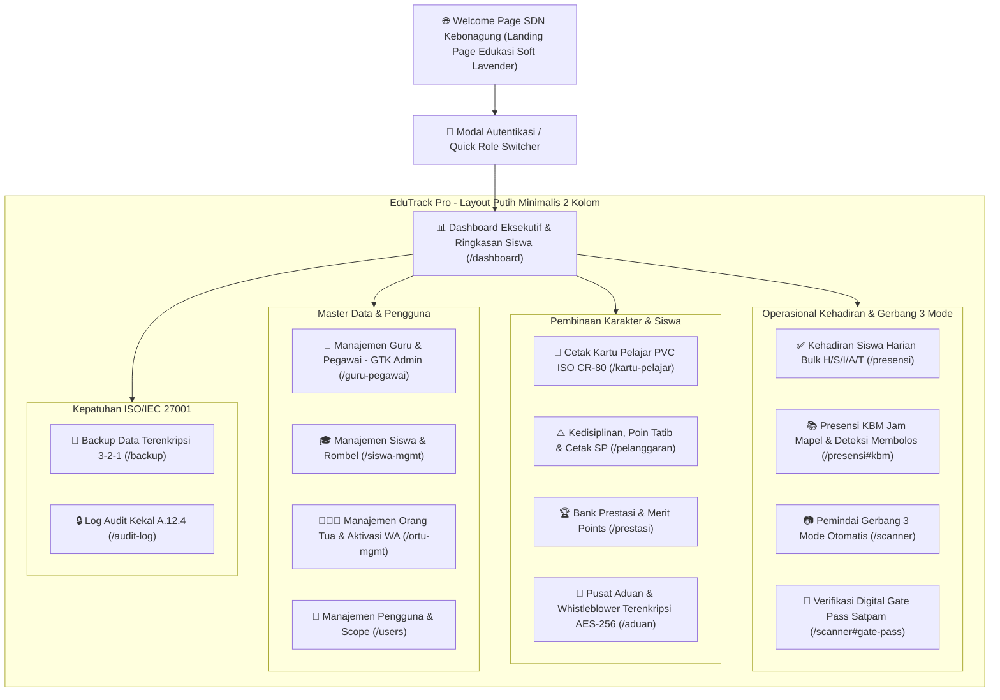

# Desain Antarmuka Pengguna & Spesifikasi Halaman (Design UI) - SSOT
**Aplikasi**: EduTrack Pro (Sistem Monitoring Terpadu Sekolah)  
**Institusi**: SDN Kebonagung Kota Pasuruan  
**Gaya Desain**: Dominan Putih Minimalis Modern Profesional (White Minimalist)  
**Komponen Inti**: Bootstrap 5 Modern Effects + Tailwind CSS + Interactive Charts + Pagination + Multi-Filter + Info Cards  
**Total Tampilan**: 15 Modul Halaman & 12 Modal Interaktif

Dokumen ini merupakan **Single Source of Truth (SSOT)** untuk seluruh tata letak visual (*wireframe*), komponen kartu statistik putih, grafik analitik data interaktif, bilah pencarian & filter dinamis, paginasi, dan alur antarmuka pemindai gerbang 3 mode.

---

## 1. Peta Rute Navigasi Sistem (Sitemap)



---

## 2. Struktur Tata Letak Halaman Standar (Dominan Putih Minimalis)

Setiap halaman modul menerapkan struktur seragam yang bersih, modern, dan sangat informatif:

```
+--------------------------------------------------------------------------------------------------+
| [LOGO] sdn-kebonagung-pasuruan / school_app  [Public]   [🔍 Cari Cepat / ]   [👑 Role Switcher]  |
+--------------------------------------------------------------------------------------------------+
| [Dashboard] [Presensi] [Scanner 3-Mode] [Kartu CR-80] [Tatib & SP] [Prestasi] [Aduan] [Master]   |
+--------------------------------------------------------------------------------------------------+
|                                                                                                  |
| [ BARIS KARTU STATISTIK KPI & INFO CARDS (4 Kolom Grid Putih) ]                                  |
| +--------------------+ +--------------------+ +--------------------+ +-------------------------+ |
| | [📈] Total Hadir   | | [⏰] Terlambat     | | [🚨] Alpa Hari Ini | | [📢] Aduan Baru         | |
| | 94.8% (474 Siswa)  | | 12 Siswa (T1-T3)   | | 4 Siswa (WA Alert) | | 2 Tiket Investigasi     | |
| | ~~~/\_ (Sparkline) | | ~~\___ (Sparkline) | | ---\__ (Sparkline) | | [Lihat Tiket ->]        | |
| +--------------------+ +--------------------+ +--------------------+ +-------------------------+ |
|                                                                                                  |
| [ SEKSI GRAFIK VISUALISASI DATA INTERAKTIF (Chart.js / ApexCharts) ]                             |
| +---------------------------------------------------+ +----------------------------------------+ |
| | GRAFIK BATANG: Tren Kehadiran Mingguan (Sen - Jum)| | DONUT CHART: Rasio Disiplin vs Prestasi| |
| | [Bar Chart: Tepat Waktu | Terlambat | Alpa]       | | [Donut: 78% Bersih, 15% Prestasi, 7% SP]| |
| +---------------------------------------------------+ +----------------------------------------+ |
|                                                                                                  |
| [ BILAH PENCARIAN & FILTER MULTI-KRITERIA (Multi-Criteria Filter Bar) ]                          |
| +----------------------------------------------------------------------------------------------+ |
| | [🔍 Cari Nama/NISN...]  [Semua Kelas v]  [Semua Status v]  [Tingkat Tatib v]  [↺ Reset Filter]| |
| +----------------------------------------------------------------------------------------------+ |
|                                                                                                  |
| [ TABEL DATA INTERAKTIF DENGAN SORTABLE HEADERS & ACTION BUTTONS ]                               |
| +----------------------------------------------------------------------------------------------+ |
| | NISN       | Nama Siswa    | Kelas   | Status Masuk  | Status Pulang | Poin | Aksi           | |
| | 0081234567 | Ahmad Rifai   | X-RPL-1 | [Hadir 06:45] | [Pulang 14:15]| 0    | [Edit][Detail] | |
| | 0081234568 | Siti Nurhaliza| X-RPL-1 | [T-1 07:08]   | [Pulang 14:10]| -2   | [Edit][Detail] | |
| +----------------------------------------------------------------------------------------------+ |
|                                                                                                  |
| [ KOMPONEN PAGINASI DINAMIS (Dynamic Pagination) ]                                               |
| +----------------------------------------------------------------------------------------------+ |
| | Menampilkan 1 - 10 dari 480 data          [Baris: 10 v]          [ < ] [1] [2] [3] ... [48] [> | |
| +----------------------------------------------------------------------------------------------+ |
+--------------------------------------------------------------------------------------------------+
```

---

## 3. Rincian Wireframe Modul Kunci

### 3.1 Scanner Barcode Gerbang 3 Mode Otomatis (`/scanner`)
- **Indikator Mode Aktif Otomatis**:
  - Banner dinamis di atas layar menampilkan mode yang sedang berjalan sesuai jam server:
    - `06:00 - 08:00 WIB` = **MODE 1: PRESENSI MASUK (CHECK-IN)** (Lencana Hijau Emerald).
    - `08:01 - 13:00 WIB` = **MODE 2: SIAGA DIGITAL GATE PASS (IZIN KELUAR)** (Lencana Biru Sky).
    - `13:01 - 17:00 WIB` = **MODE 3: PRESENSI PULANG (CHECK-OUT)** (Lencana Oranye Amber).
- **Tab 1: Live Scanner Screen**:
  - Input auto-focus konstan yang siap menerima semburan keystroke dari laser gun scanner.
  - Kartu Hasil Pemindaian Terakhir (*Feedback Box*):
    - Foto siswa format 3x4.
    - Nama, NISN, Rombel Kelas.
    - Status Kehadiran (Hadir, T-1, T-2, T-3, Pulang Tercatat).
    - Umpan Balik Audio (Beep 880Hz, Buzz 180Hz, Chime 3 nada).
    - Indikator centang hijau: *"Notifikasi WhatsApp Terkirim ke Wali Murid"*.
- **Tab 2: Verifikasi Digital Gate Pass Satpam**:
  - Formulir input/scan kode tiket gate pass (`GP-20261123-001`).
  - Menampilkan alasan izin keluar, pejabat yang menyetujui, dan nama penjemput yang terverifikasi.
  - Tombol **"✓ Izinkan Keluar & Buka Palang"**: Merekam `early_leave_time`, mengubah status presensi menjadi `Hadir (Izin Pulang Cepat)`, dan mengirim alert WhatsApp ke orang tua.

---

### 3.2 Modul Pengajuan Izin / Sakit Fleksibel Ortu
- **Tombol di Dashboard Ortu**: *"📝 Ajukan Izin / Sakit Anak"*.
- **Modal Interaktif Pilihan Kategori**:
  - Pilihan 1: **Sakit 1 Hari (Surat Izin Ortu)** — Menampilkan kuota tersisa (misal: *Sisa kuota semester ini: 1x*). Cukup unggah foto surat izin tulisan tangan bertanda tangan orang tua.
  - Pilihan 2: **Sakit > 1 Hari (Wajib Surat Dokter)** — Mewajibkan unggah surat dokter/Puskesmas.
  - Pilihan 3: **Izin Keperluan Keluarga Mendesak** — Rentang tanggal kalender.
- **Tampilan Sisi Wali Kelas**:
  - Banner peringatan di atas tabel presensi jika ada permohonan izin baru yang belum diverifikasi.
  - Tombol 1-klik: **"✓ Setujui Izin"** (otomatis membebaskan siswa dari Auto-Alpa).

---

### 3.3 Presensi KBM Jam Mapel & Deteksi Membolos
- Selector pilihan mata pelajaran aktif (contoh: *Pemrograman Web & Mobile*, *Matematika Terapan*).
- Menampilkan status awal siswa yang diambil dari presensi gerbang pagi.
- Jika siswa hadir pagi tetapi tidak ada di kursi saat pelajaran, guru mengklik tombol merah **"🚨 Lapor Membolos ke BK"**.
- Poin tatib bertambah +10, tercatat di log audit, dan alert WhatsApp darurat terkirim seketika.

---

### 3.4 Cetak Kartu Pelajar PVC ISO CR-80 (`/kartu-pelajar`)
- Pratinjau kanvas bolak-balik dimensi fisik $85.60\text{ mm} \times 53.98\text{ mm}$.
- Tampilan depan: Pas foto 3x4, Barcode Code 128 (NISN), dan QR Code 2D (HMAC-SHA256).
- Tampilan belakang: Aturan kartu dan tanda tangan digital kepala sekolah.
- Tombol **"🖨️ Cetak Kartu Siswa Ini"** (otomatis print CSS ukuran CR-80) dan tombol **"Revoke & Regenerate"** (jika kartu hilang).

---

### 3.5 Manajemen Guru & Tenaga Kependidikan (GTK - Master Staff)
- Modul eksklusif dilindungi hanya untuk role Super Admin / Kepala Sekolah.
- Kartu KPI: Total Guru PNS/PPPK, Total Tenaga Honorer, Petugas Sarpras & Keamanan.
- Tabel lengkap memuat NIP, NUPTK, Nama Lengkap & Gelar, Gender, Status Kepegawaian, Jabatan/Tugas Utama, Rombel/Mapel Binaan, Kontak WhatsApp, dan Status Keaktifan.
- Modal Tambah/Edit GTK dengan validasi penomoran kepegawaian otomatis dan audit log ISO 27001.