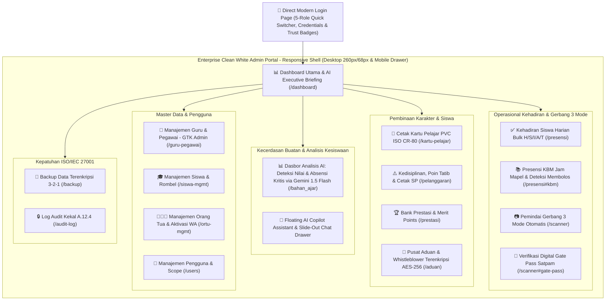

# Desain Antarmuka Pengguna & Spesifikasi Halaman (Design UI) - SSOT
**Aplikasi**: EduTrack Pro (Sistem Monitoring Terpadu Sekolah)  
**Institusi**: SDN Kebonagung Kota Pasuruan  
**Gaya Desain**: Enterprise Clean White Modern Minimalist Dashboard (HRD-Style) + Direct Modern Login Page (1-Click Role Switcher)  
**Tipografi**: Plus Jakarta Sans (300-800)  
**Palet Utama**: Clean White Slate Canvas (`#f8fafc`), Primary Rose-600 (`#e11d48`), Rose-700 hover (`#be123c`), Soft Tint Rose-50 (`#fff1f2`), Emerald-500, Amber-500  
**Komponen Inti**: Responsive Mini-Collapsible Sidebar (260px / 68px), Sticky Glassmorphism Header (`backdrop-blur-md bg-white/90`), Role Switcher Pill di Header, Omnibox Quick Search (`Ctrl+K`), Ambient Subtle Pastel Blurs, Rounded-2xl Cards, Soft Pill Badges, Dasbor Analisis AI (Gemini 1.5 Flash), Floating Copilot  
**Total Tampilan**: 16 Modul Halaman & 12 Modal Interaktif

Dokumen ini merupakan **Single Source of Truth (SSOT)** untuk seluruh tata letak visual (*wireframe*), struktur shell Enterprise Clean White Admin, halaman masuk langsung (*Direct Modern Login Page* dengan 1-Click Role Switcher), kartu statistik `rounded-2xl`, grafik analitik data, bilah pencarian & filter dinamis, paginasi, Dasbor Analisis AI (Rule-Based & Gemini 1.5 Flash), dan alur antarmuka pemindai gerbang 3 mode.

---

## 1. Peta Rute Navigasi Sistem (Sitemap)



---

## 2. Struktur Tata Letak Halaman Standar (Enterprise Clean White Shell)

Setiap halaman modul menerapkan shell standar Enterprise Clean White Modern Minimalist yang elegan, bersih, dan sangat responsif:

```
+--------------------------------------------------------------------------------------------------------------------------------+
| [E] EduTrack.Pro  [≡ Toggle]  [🔍 Search... (Ctrl+K)]        [Role: 👑 Super Admin v]  [🚪 Keluar]  [🔔 3]  [👤 John Doe (Super Admin)]|
+---------------+----------------------------------------------------------------------------------------------------------------+
| SIDEBAR       | CONTENT AREA (admin-main container-fluid p-3 p-lg-4, Canvas bg-slate-100 / ambient subtle pastel blurs)       |
| (260px/68px)  |                                                                                                                |
|               | [ AI EXECUTIVE BRIEFING & SMART INSIGHT CARD (Border Rose-100 / bg-white rounded-2xl shadow-sm) ]              |
| [📊 Dashboard]| +------------------------------------------------------------------------------------------------------------+ |
| [✅ Kehadiran]| | [✨] AI Executive Briefing · Analisis Real-Time Pagi Hari             [📄 Drafkan SP]  [💬 Buka AI Copilot] | |
| [📷 Scanner]  | | Kehadiran 94.8% · Ditemukan 1 Kasus Kesiswaan Perlu Tindak Lanjut: Budi Santoso (XI-TKJ-2) Alpa 3 hari.   | |
| [🪪 Kartu]    | +------------------------------------------------------------------------------------------------------------+ |
| [⚠️ Tatib]    |                                                                                                                |
| [🏆 Prestasi] | [ 4 ENTERPRISE STATS CARDS (TOTAL SISWA, KEHADIRAN HARI INI, PELANGGARAN AKTIF, LAPORAN ADUAN) ]              |
| [📊 Analisis  | +--------------------+ +--------------------+ +--------------------+ +-----------------------------------------+ |
|      AI]      | | TOTAL SISWA AKTIF  | | KEHADIRAN HARI INI | | PELANGGARAN AKTIF  | | ADUAN / WHISTLEBLOWER                   | |
| [📢 Aduan]    | | 432 Siswa   ↑ 1.2% | | 94.8% Hadir ↑ 5.4% | | 3 Kasus    ↓ 25%   | | 0 Kasus Terbuka (Aman)                | |
| [👔 GTK]      | +--------------------+ +--------------------+ +--------------------+ +-----------------------------------------+ |
| [🎓 Siswa]    |                                                                                                                |
| [👨‍👩‍👦 Ortu]     | [ SEKSI GRAFIK & AKTIVITAS DUA KOLOM (Clean White Card rounded-2xl border-slate-100) ]                        |
| [👥 User]     | +------------------------------------------------------------+ +-----------------------------------------------+ |
| [💾 Backup]   | | TREN KEHADIRAN MINGGUAN (Rose-600 & Emerald-500 Curves)    | | RECENT ACTIVITY / LOG KESISWAAN               | |
| [🔒 Audit]    | | ~~~~~~~~~~~~~~~~~~~~~~~~~~~~~~~~~~                         | | • Siswa baru terdaftar                        | |
|               | | ----------------------------------                         | | • Presensi gerbang selesai (410 hadir)        | |
|               | +------------------------------------------------------------+ +-----------------------------------------------+ |
|               |                                                                                                                |
|               | [ TABEL DATA INTERAKTIF DENGAN ACTION DROPDOWN & SOFT STATUS PILLS ]                                           |
|               | +------------------------------------------------------------------------------------------------------------+ |
|               | | NISN/SISWA         | KELAS   | JAM MASUK | JAM PULANG & STATUS | STATUS    | REKONSILIASI   | AKSI CEPAT   | |
|               | | Ahmad Rifai        | X-RPL-1 | 07:15 WIB | ✔ Pulang: 14:15 WIB | Terlambat | Ban bocor      | [Catatan][H] | |
|               | | Siti Nurhaliza     | X-RPL-1 | 06:45 WIB | ✔ Pulang: 14:15 WIB | Hadir     | Tepat waktu    | [Catatan][H] | |
|               | | Budi Santoso       | XI-TKJ-2| -         | -                   | Alpa (3x) | Butuh HomeVisit| [Catatan][A] | |
|               | +------------------------------------------------------------------------------------------------------------+ |
|               |                                                                                                                |
|               | [ FOOTER: EduTrack Pro © 2026. SDN Kebonagung Pasuruan · Sistem Informasi Terpadu Kesiswaan & Presensi ]       |
+---------------+----------------------------------------------------------------------------------------------------------------+
                                                                                       [ ✨ AI Copilot Launcher Pill (Rose-600) ]
```

---

## 3. Wireframe Dasbor Analisis AI (`/bahan_ajar`)

```
+--------------------------------------------------------------------------------------------------------------------------------+
| DASBOR ANALISIS AI KESISWAAN                                                                                                   |
| [Dasbor Analisis AI] [Rule-Based Filter] [Google Gemini 1.5 Flash]          [API Key: ••••••••••••] [✓ Simpan]                 |
+--------------------------------------------------------------------------------------------------------------------------------+
| DATA SISWA SIMULASI & INDIKATOR RULE-BASED                                                                                     |
| Total: 3 Siswa · Bermasalah: 2 Siswa (Kriteria: Penurunan Nilai M2 < M1 - 10 atau Alpa >= 3x)                                  |
| +-----------------+-------+-------------+-------------+---------------+---------------+--------------------------------------+ |
| | NAMA SISWA      | KELAS | NILAI M1    | NILAI M2    | SELISIH NILAI | ALPA BULAN INI| STATUS RULE-BASED                    | |
| | Ahmad           | 5A    | 80          | 65          | 🔻 -15 (Turun)| 0             | [⚠️ Penurunan Nilai Signifikan]       | |
| | Budi            | 5A    | 70          | 72          | 🔺 +2 (Naik)  | 3 Hari        | [🚨 Absensi Kritis (>= 3x Alpa)]     | |
| | Citra           | 5B    | 90          | 85          | -5            | 1 Hari        | [✅ Normal / Aman]                   | |
| +-----------------+-------+-------------+-------------+---------------+---------------+--------------------------------------+ |
+--------------------------------------------------------------------------------------------------------------------------------+
| KARTU UTAMA: ANALISIS MINGGUAN AI (Background Putih, Rounded-2xl, Shadow Halus)                                                |
|                                                                                                                                |
| [⚠️ Ikon Oranye/Merah]  Analisis Mingguan AI                                       [🕒 17:30:15 WIB]                          |
|                         Rangkuman empatik kondisi siswa bermasalah dan rekomendasi tindakan guru via Google Gemini 1.5 Flash   |
|                                                                                                                                |
| +----------------------------------------------------------------------------------------------------------------------------+ |
| | [Gemini 1.5 Flash Empathetic Response · Maks. 3 kalimat + 1 saran tindakan guru]                                          | |
| |                                                                                                                            | |
| | Ahmad (5A) mengalami penurunan nilai matematika yang cukup signifikan dari 80 ke 65 (-15 poin), sedangkan Budi (5A)      | |
| | berada pada status absensi kritis dengan catatan 3 kali alpa dalam bulan ini. Kondisi kedua siswa ini memerlukan          | |
| | perhatian dan pendampingan segera agar ketertinggalan materi numerasi serta kebiasaan ketidakhadiran tidak semakin         | |
| | mendalam. Saran tindakan nyata: Guru wali kelas disarankan menjadwalkan sesi bimbingan belajar remedial personal untuk     | |
| | Ahmad dan segera menghubungi orang tua Budi secara empatik untuk mencari solusi bersama terkait penyebab ketidakhadirannya.| |
| +----------------------------------------------------------------------------------------------------------------------------+ |
|                                                                                                                                |
| [ 🔄 Muat Ulang Analisis (Tombol Biru) ]                                       🛡️ Model: gemini-1.5-flash · Data Diproses Aman  |
+--------------------------------------------------------------------------------------------------------------------------------+
```

---

## 4. Rincian Wireframe Modul Kunci Lainnya

### 3.1 Scanner Barcode Gerbang 3 Mode Otomatis (`/scanner`)
- **Indikator Mode Aktif Otomatis**:
  - Banner dinamis di atas layar menampilkan mode yang sedang berjalan sesuai jam server:
    - `06:00 - 08:00 WIB` = **MODE 1: PRESENSI MASUK (CHECK-IN)** (Lencana Hijau Emerald).
    - `08:01 - 13:00 WIB` = **MODE 2: SIAGA DIGITAL GATE PASS (IZIN KELUAR)** (Lencana Biru Sky).
    - `13:01 - 17:00 WIB` = **MODE 3: PRESENSI PULANG (CHECK-OUT)** (Lencana Oranye Amber).
- **Tab 1: Live Scanner Screen**:
  - Input auto-focus konstan yang siap menerima semburan keystroke dari laser gun scanner.
  - Kartu Hasil Pemindaian Terakhir (*Feedback Box*):
    - Foto siswa format 3x4.
    - Nama, NISN, Rombel Kelas.
    - Status Kehadiran (Hadir, T-1, T-2, T-3, Pulang Tercatat).
    - Umpan Balik Audio (Beep 880Hz, Buzz 180Hz, Chime 3 nada).
    - Indikator centang hijau: *"Notifikasi WhatsApp Terkirim ke Wali Murid"*.
- **Tab 2: Verifikasi Digital Gate Pass Satpam**:
  - Formulir input/scan kode tiket gate pass (`GP-20261123-001`).
  - Menampilkan alasan izin keluar, pejabat yang menyetujui, dan nama penjemput yang terverifikasi.
  - Tombol **"✓ Izinkan Keluar & Buka Palang"**: Merekam `early_leave_time`, mengubah status presensi menjadi `Hadir (Izin Pulang Cepat)`, dan mengirim alert WhatsApp ke orang tua.

---

### 3.2 Modul Pengajuan Izin / Sakit Fleksibel Ortu
- **Tombol di Dashboard Ortu**: *"📝 Ajukan Izin / Sakit Anak"*.
- **Modal Interaktif Pilihan Kategori**:
  - Pilihan 1: **Sakit 1 Hari (Surat Izin Ortu)** — Menampilkan kuota tersisa (misal: *Sisa kuota semester ini: 1x*). Cukup unggah foto surat izin tulisan tangan bertanda tangan orang tua.
  - Pilihan 2: **Sakit > 1 Hari (Wajib Surat Dokter)** — Mewajibkan unggah surat dokter/Puskesmas.
  - Pilihan 3: **Izin Keperluan Keluarga Mendesak** — Rentang tanggal kalender.
- **Tampilan Sisi Wali Kelas**:
  - Banner peringatan di atas tabel presensi jika ada permohonan izin baru yang belum diverifikasi.
  - Tombol 1-klik: **"✓ Setujui Izin"** (otomatis membebaskan siswa dari Auto-Alpa).

---

### 3.3 Presensi KBM Jam Mapel & Deteksi Membolos
- Selector pilihan mata pelajaran aktif (contoh: *Pemrograman Web & Mobile*, *Matematika Terapan*).
- Menampilkan status awal siswa yang diambil dari presensi gerbang pagi.
- Jika siswa hadir pagi tetapi tidak ada di kursi saat pelajaran, guru mengklik tombol merah **"🚨 Lapor Membolos ke BK"**.
- Poin tatib bertambah +10, tercatat di log audit, dan alert WhatsApp darurat terkirim seketika.

---

### 3.4 Cetak Kartu Pelajar PVC ISO CR-80 (`/kartu-pelajar`)
- Pratinjau kanvas bolak-balik dimensi fisik $85.60\text{ mm} \times 53.98\text{ mm}$.
- Tampilan depan: Pas foto 3x4, Barcode Code 128 (NISN), dan QR Code 2D (HMAC-SHA256).
- Tampilan belakang: Aturan kartu dan tanda tangan digital kepala sekolah.
- Tombol **"🖨️ Cetak Kartu Siswa Ini"** (otomatis print CSS ukuran CR-80) dan tombol **"Revoke & Regenerate"** (jika kartu hilang).

---

### 3.5 Manajemen Guru & Tenaga Kependidikan (GTK - Master Staff)
- Modul eksklusif dilindungi hanya untuk role Super Admin / Kepala Sekolah.
- Kartu KPI: Total Guru PNS/PPPK, Total Tenaga Honorer, Petugas Sarpras & Keamanan.
- Tabel lengkap memuat NIP, NUPTK, Nama Lengkap & Gelar, Gender, Status Kepegawaian, Jabatan/Tugas Utama, Rombel/Mapel Binaan, Kontak WhatsApp, dan Status Keaktifan.
- Modal Tambah/Edit GTK dengan validasi penomoran kepegawaian otomatis dan audit log ISO 27001.