# Arsitektur & Panduan Orkestrasi Multi-Agent AI (Orchestration) - SSOT
**Aplikasi**: EduTrack Pro (Sistem Monitoring Terpadu Sekolah)  
**Institusi**: SDN Kebonagung Kota Pasuruan  
**Framework Orkestrasi**: Native Antigravity Swarm & Sharded Subagents Pools  
**Stack Eksekusi**: Full-stack JavaScript / TypeScript (Nuxt 3 Vue 3 / Fastify + Drizzle ORM + PostgreSQL 16 + BullMQ)  
**Format Kerja**: Single Source of Truth (SSOT)

Dokumen ini merupakan **Single Source of Truth (SSOT)** untuk protokol orkestrasi tim agen AI otonom menggunakan pola **Multiple Sub-Agent Worker Pools** dalam membangun sistem kesiswaan terpadu berbasis JavaScript.

---

## 1. Topologi Orkestrasi Multiple Sub-Agent (JavaScript Ecosystem)

```mermaid
graph TD
    LEAD["👑 Lead Orchestrator Agent\n(Koordinator Utama, Task Sharder & Quality Gatekeeper)"]

    subgraph Core_Shared ["Gerbang Fondasi SSOT"]
        DBA["🗄️ db-architect-agent\n(Scaffold Nuxt 3 / Fastify TypeScript, Drizzle ORM, DDL 21 Tabel PostgreSQL & Seeder)"]
    end

    subgraph Backend_Pool ["Backend Squad (4 Sub-Agent Paralel)"]
        BE1["⚙️ be-worker-attendance\n(Scanner Gerbang 3-Mode, Rule Engine T1-T3, Auto-Alpa & Keadilan Checkout Fallback)"]
        BE2["⚙️ be-worker-discipline\n(Katalog Tatib, Poin Demerit, PDF SP 1-3 & QR HMAC-SHA256)"]
        BE3["⚙️ be-worker-portal\n(Master GTK, Izin Sakit Fleksibel & BullMQ Redis Queue WA Masuk/Pulang)"]
        BE4["⚙️ be-worker-whistle\n(Kanal Aduan AES-256, Chat Thread & Log Audit Kekal ISO 27001)"]
    end

    subgraph Frontend_Pool ["Frontend Squad (3 Sub-Agent Paralel - White Minimalist)"]
        FE1["💻 fe-worker-scanner\n(UI Scanner 3-Mode, Web Audio Beep/Buzz/Chime & Kartu PVC CR-80)"]
        FE2["💻 fe-worker-academic\n(UI Presensi Bulk H/S/I/A/T, Presensi KBM Mapel & Modal Izin Sakit Ortu)"]
        FE3["💻 fe-worker-admin\n(Welcome Page ASN, Dashboard Eksekutif, Chart.js, Master GTK & Backup 3-2-1)"]
    end

    subgraph QA_Pool ["QA & Stress Squad (4 Sub-Agent Pengujian Paralel)"]
        QA1["🧪 qa-worker-scanner-load\n(Stress Test: 50 Scan Gerbang Serentak pd Node.js Fastify <= 50ms)"]
        QA2["🧪 qa-worker-rbac-idor\n(Pen-Test: Bypass Scope Antar Orang Tua & Siswa Kelas Lain)"]
        QA3["🧪 qa-worker-e2e-flow\n(Siklus Lengkap: Tap Masuk -> KBM Mapel -> Izin Ortu -> Pulang Sore -> WA Alert)"]
        QA4["🧪 security-audit-agent\n(Audit OWASP Top 10, Enkripsi AES-256 & Immutable Audit Log A.12.4)"]
    end

    subgraph Infra_Squad ["Infrastruktur & Keamanan"]
        OPS["🚀 devops-deploy-agent\n(Deployment Ganda: aaPanel PM2 Cluster & Bare VPS Docker Compose)"]
    end

    LEAD --> DBA
    DBA --> Backend_Pool
    Backend_Pool --> Frontend_Pool
    Frontend_Pool --> QA_Pool
    QA_Pool --> OPS
```

---

## 2. Rincian Batas Wilayah Kerja Sub-Agent (Worker Boundaries)

| Nama Worker | Tipe / Spesialisasi | Wilayah Berkas (*Allowed Paths*) | Target Keluaran & Deliverables |
| :--- | :--- | :--- | :--- |
| `db-architect-agent` | Database Architect | `database/schema/*`, `database/migrations/*`, `database/seeders/*` | 21 tabel relasional PostgreSQL via Drizzle ORM, UUIDv7, CHECK constraints, seeder realistis SDN Kebonagung. |
| `be-worker-attendance`| Backend Attendance Dev | `server/api/attendance/*`, `server/services/AttendanceRule*`, `server/services/CheckoutJustice*` | Endpoint scan gerbang 3-mode (latensi $\le 50\text{ ms}$), evaluasi T-1 s/d T-3, scheduler Auto-Alpa jam 08:00 WIB, keadilan checkout missed, Digital Gate Pass. |
| `be-worker-discipline`| Backend Discipline Dev | `server/api/violations/*`, `server/services/BarcodeCrypto*`, `server/services/PdfGenerator*` | Generator PDF Surat Peringatan ber-QR verification, manajemen merit points, kalkulasi demerit points. |
| `be-worker-portal` | Backend Portal & Queue | `server/api/master/*`, `server/services/WhatsAppQueue*`, `server/jobs/*` | BullMQ Redis Queue Worker untuk WhatsApp API (masuk & pulang), CRUD Master GTK, Siswa, Orang Tua, dan workflow izin sakit fleksibel. |
| `be-worker-whistle` | Security & Cryptography | `server/services/FieldEncryption*`, `server/api/complaints/*`, `server/services/AuditLog*` | Enkripsi AES-256-GCM modul aduan whistleblower, obrolan investigasi dua arah, log audit kekal ISO 27001. |
| `fe-worker-scanner` | Frontend Hardware & Audio| `app/pages/scanner.vue`, `app/composables/useAudioScanner.ts` | Meja Scanner Gerbang 3-mode, Web Audio API (Beep 880Hz, Buzz 180Hz, Chime 3 nada C-E-G), cetak kartu pelajar PVC ISO CR-80. |
| `fe-worker-academic` | Frontend Classroom UI | `app/pages/presensi.vue`, `app/components/attendance/*`, `app/pages/pelanggaran.vue` | Tabel presensi cepat H/S/I/A/T, presensi KBM mapel, deteksi siswa membolos, modal izin sakit fleksibel, pagination, searching, multi-filter. |
| `fe-worker-admin` | Frontend System & Admin | `app/pages/dashboard.vue`, `app/pages/guru-pegawai.vue`, `app/components/charts/*` | Desain dominan putih minimalis, efek Bootstrap 5 modern, grafik Chart.js tren kehadiran mingguan, Master GTK, User Scopes, Backup 3-2-1. |
| `qa-worker-scanner-load`| QA Performance Tester | `tests/load/gate-scanner.bench.ts` | Pengujian 50 scan paralel serentak, verifikasi latensi $\le 50\text{ ms}$ di Node.js Fastify, validasi cooldown 5 menit. |
| `qa-worker-rbac-idor` | QA Security Auditor | `tests/security/rbac-idor.test.ts` | Pengujian manipulasi IDOR via URL/API, verifikasi isolasi query wali kelas, ortu, dan siswa. |
| `qa-worker-e2e-flow` | QA End-to-End Dev | `tests/e2e/school-lifecycle.test.ts` | Pengujian alur lengkap: Tap Masuk $\to$ Bolos KBM $\to$ Izin Ortu $\to$ Pulang Sore $\to$ WA Alert $\to$ Audit Log. |
| `security-audit-agent`| Security Lead | `tests/security/owasp.test.ts` | Verifikasi Argon2id, enkripsi kolom AES-256 database, sanitasi input, sertifikasi ISO 27001 A.12.4. |
| `devops-deploy-agent` | DevOps Engineer | `ecosystem.config.js`, `docker-compose.yml`, `deploy/*` | Konfigurasi aaPanel PM2 Cluster, Docker multi-container, SSL Certbot, Cron backup S3 otomatis. |

---

## 3. Protokol Gerbang Eksekusi (Execution Quality Gates)

- [ ] **Gate 1 (DDL & Drizzle Migrations)**: 21 tabel PostgreSQL 16 sukses dimigrasi via Drizzle ORM tanpa error; seeder data SDN Kebonagung terpasang aktif.
- [ ] **Gate 2 (Scanner Latency & 3 Mode)**: Endpoint `POST /api/attendance/gate-scan` terbukti merespons dalam $\le 50\text{ ms}$ dan otomatis beralih 3 mode sesuai jam server.
- [ ] **Gate 3 (Keadilan Absensi Pulang)**: Pengujian membuktikan siswa yang lupa tap pulang tetap berstatus `Hadir` jika hadir di KBM jam terakhir.
- [ ] **Gate 4 (Isolasi Data & Anti-IDOR)**: Pengujian penetrasi membuktikan akun orang tua dan siswa tidak dapat mengakses data di luar cakupannya (*Zero IDOR Leakage*).
- [ ] **Gate 5 (Kepatuhan Enkripsi ISO 27001)**: Kolom aduan terenkripsi AES-256-GCM, log audit terbukti *immutable* terhadap pembaruan/penghapusan, dan QR Code memuat HMAC valid.
- [ ] **Gate 6 (UI Putih Minimalis & Komponen Lengkap)**: Seluruh tabel dilengkapi pagination dinamis, debounced search, multi-filter, grafik Chart.js, kartu KPI, dan cetak kartu fisik CR-80.
- [ ] **Gate 7 (Dual Deployment Ready)**: Konfigurasi aaPanel PM2 dan Docker Compose terverifikasi siap melayani domain produksi sekolah.