# Arsitektur & Panduan Orkestrasi Multi-Agent AI (Orchestration) - SSOT
**Aplikasi**: EduTrack Pro (Sistem Monitoring Terpadu Sekolah)  
**Institusi**: SDN Kebonagung Kota Pasuruan  
**Framework Orkestrasi**: Native Antigravity Swarm & Sharded Subagents Pools  
**Format Kerja**: Single Source of Truth (SSOT)

Dokumen ini merupakan **Single Source of Truth (SSOT)** untuk protokol orkestrasi tim agen AI otonom menggunakan pola **Multiple Sub-Agent Worker Pools** (paralelisasi tugas lintas modul kesiswaan, isolasi branch workspace, dan sinkronisasi gerbang integrasi berjenjang).

---

## 1. Topologi Orkestrasi Multiple Sub-Agent

```mermaid
graph TD
    LEAD["👑 Lead Orchestrator Agent\n(Koordinator Utama, Task Sharder & Quality Gatekeeper)"]

    subgraph Core_Shared ["Gerbang Fondasi SSOT"]
        DBA["🗄️ db-architect-agent\n(Scaffold Laravel 11, DDL 21 Tabel PostgreSQL & Seeder SDN Kebonagung)"]
    end

    subgraph Backend_Pool ["Backend Squad (4 Sub-Agent Paralel)"]
        BE1["⚙️ be-worker-attendance\n(Scanner Gerbang /api/attendance/gate-scan, Rule Engine T1-T3 & Auto-Alpa)"]
        BE2["⚙️ be-worker-discipline\n(Katalog Tatib, Poin Demerit, PDF SP 1-3 & QR HMAC-SHA256)"]
        BE3["⚙️ be-worker-portal\n(Master GTK, Siswa, Ortu, Izin Sakit & Redis Queue WA Dispatcher)"]
        BE4["⚙️ be-worker-whistle\n(Kanal Aduan AES-256, Chat Thread & Log Audit Kekal ISO 27001)"]
    end

    subgraph Frontend_Pool ["Frontend Squad (3 Sub-Agent Paralel)"]
        FE1["💻 fe-worker-scanner\n(UI Meja Scanner Gerbang, Web Audio 880Hz/180Hz & Kartu PVC CR-80)"]
        FE2["💻 fe-worker-academic\n(UI Presensi Bulk H/S/I/A/T, Presensi KBM Mapel & Approval Izin Ortu)"]
        FE3["💻 fe-worker-admin\n(Welcome Page PNS, Dashboard Eksekutif, Master GTK & Backup ISO 27001)"]
    end

    subgraph QA_Pool ["QA & Stress Squad (4 Sub-Agent Pengujian Paralel)"]
        QA1["🧪 qa-worker-scanner-load\n(Stress Test: 50 Scan Gerbang Serentak pd Beban Puncak <= 200ms)"]
        QA2["🧪 qa-worker-rbac-idor\n(Pen-Test: Bypass Scope Antar Orang Tua & Siswa Kelas Lain)"]
        QA3["🧪 qa-worker-e2e-flow\n(Siklus Pagi: Tap Gerbang -> KBM Mapel -> Izin Ortu -> SP -> WA Alert)"]
        QA4["🧪 security-audit-agent\n(Audit OWASP Top 10, Enkripsi AES-256 & Immutable Audit Log A.12.4)"]
    end

    subgraph Infra_Squad ["Infrastruktur & Keamanan"]
        OPS["🚀 devops-deploy-agent\n(Deployment Ganda: aaPanel Nginx PHP-FPM & Bare VPS Docker Compose)"]
    end

    LEAD --> DBA
    DBA --> Backend_Pool
    Backend_Pool --> Frontend_Pool
    Frontend_Pool --> QA_Pool
    QA_Pool --> OPS
```



---

## 2. Rincian Peran & Batas Wilayah Kerja Sub-Agent (Worker Boundaries)

| Nama Worker | Tipe / Spesialisasi | Wilayah Berkas yang Boleh Disentuh (*Allowed Paths*) | Target Keluaran & Deliverables |
| :--- | :--- | :--- | :--- |
| `db-architect-agent` | Database & Core Architect | `database/migrations/*`, `database/seeders/*`, `app/Models/*` | 21 tabel relasional PostgreSQL, UUIDv7, CHECK constraints, seeder realistis SDN Kebonagung. |
| `be-worker-attendance`| Backend Attendance Engineer | `app/Http/Controllers/Api/Attendance*`, `app/Services/AttendanceRule*`, `app/Console/Commands/*` | Endpoint scan gerbang latensi rendah, evaluasi T-1 s/d T-3, scheduler Auto-Alpa jam 08:00 WIB, Digital Gate Pass. |
| `be-worker-discipline`| Backend Discipline Specialist | `app/Services/Discipline*`, `app/Services/BarcodeSecurity*`, `app/Models/WarningLetter*` | Generator PDF Surat Peringatan ber-QR verification, manajemen merit points, kalkulasi demerit points. |
| `be-worker-portal` | Backend Integration & Portal | `app/Services/WhatsApp*`, `app/Jobs/*`, `app/Http/Controllers/Master/*` | Redis Queue Worker untuk WhatsApp API, CRUD Master GTK, Siswa, Orang Tua, dan workflow approval izin sakit. |
| `be-worker-whistle` | Security & Cryptography Dev | `app/Services/CryptoSecurity*`, `app/Models/Complaint*`, `app/Services/AuditLog*` | Enkripsi AES-256-GCM modul aduan whistleblower, obrolan investigasi dua arah, log audit kekal ISO 27001. |
| `fe-worker-scanner` | Frontend Hardware & Audio | `resources/views/livewire/scanner/*`, `resources/js/audio-scanner.js` | Meja Scanner Gerbang USB laser wedge, Web Audio API (Beep 880Hz / Buzz 180Hz), cetak kartu pelajar PVC ISO CR-80. |
| `fe-worker-academic` | Frontend Classroom & UI | `resources/views/livewire/attendance/*`, `resources/views/livewire/discipline/*` | Tabel presensi cepat H/S/I/A/T, presensi KBM mapel, deteksi siswa membolos, preview SP, bank prestasi. |
| `fe-worker-admin` | Frontend System & Landing | `resources/views/welcome.blade.php`, `resources/views/dashboard.blade.php`, `resources/views/livewire/master/*` | Halaman depan edukasi Dribbble Guru PNS, Dashboard metrik eksekutif, Master GTK, User Scopes, Backup 3-2-1. |
| `qa-worker-scanner-load`| QA Performance Tester | `tests/Feature/GateScanPerformanceTest.php` | Pengujian 50 scan paralel serentak, verifikasi latensi $\le 200\text{ ms}$, validasi cooldown 5 menit. |
| `qa-worker-rbac-idor` | QA Security Auditor | `tests/Feature/RbacDataIsolationTest.php` | Pengujian manipulasi IDOR via URL/API, verifikasi isolasi query wali kelas, ortu, dan siswa. |
| `qa-worker-e2e-flow` | QA End-to-End Specialist | `tests/Feature/FullSchoolLifecycleE2ETest.php` | Pengujian alur lengkap: Tap Gerbang $\to$ Bolos KBM $\to$ SP-1 $\to$ Notifikasi WA $\to$ Audit Trail. |
| `security-audit-agent`| Security & Compliance Lead | `tests/Security/*`, `reports/security-audit.md` | Verifikasi Argon2id, enkripsi kolom AES-256 database, sanitasi input, sertifikasi ISO 27001 A.12.4. |
| `devops-deploy-agent` | Infrastructure & Deployment | `deploy/*`, `docker-compose.yml`, `ecosystem.config.js` | Konfigurasi aaPanel Nginx PHP-FPM, Docker multi-container, SSL Certbot, Cron backup S3 otomatis. |

---

## 3. Protokol Gerbang Eksekusi (Execution Quality Gates)

Setiap tahapan wajib memenuhi kriteria gerbang sebelum Lead Orchestrator mengizinkan penggabungan (*merge*) ke branch utama:

- [ ] **Gerbang 0 (Inisialisasi & SSOT Lock)**: Seluruh dokumen di `plan/docs/` telah terkunci dan selaras penuh dengan konsep [index.html](file:///c:/scholl_app/index.html).
- [ ] **Gerbang 1 (DDL & Migrasi Basis Data)**: 21 tabel PostgreSQL 16 sukses dieksekusi tanpa error; seeder data SDN Kebonagung terpasang aktif.
- [ ] **Gerbang 2 (Kinerja Presensi Gerbang)**: Endpoint `POST /api/attendance/gate-scan` terbukti merespons dalam $\le 200\text{ ms}$ dengan umpan balik audio dan event queue WhatsApp.
- [ ] **Gerbang 3 (Isolasi Data & Anti-IDOR)**: Pengujian penetrasi membuktikan akun orang tua dan siswa tidak dapat mengakses data di luar cakupannya (*Zero IDOR Leakage*).
- [ ] **Gerbang 4 (Kepatuhan Kriptografi & ISO 27001)**: Kolom aduan terenkripsi AES-256-GCM, log audit terbukti *immutable* terhadap upaya pembaruan/penghapusan, dan QR Code memuat HMAC valid.
- [ ] **Gerbang 5 (Antarmuka & Pengalaman Pengguna)**: Seluruh 15 modul dan 12 modal diuji berfungsi reaktif tanpa *page reload*, mendukung cetak kartu fisik CR-80 dan SP resmi.
- [ ] **Gerbang 6 (Kesiapan Deployment Dual-Target)**: Konfigurasi aaPanel dan Docker Compose terverifikasi siap jalan dengan pengujian pencadangan otomatis 3-2-1 ke S3.

---

## 4. Format Laporan Estafet Handover Antar Sub-Agent

Setiap sub-agent yang menyelesaikan tugasnya wajib menerbitkan laporan serah terima terstruktur:

```markdown
### 📦 LAPORAN HANDOVER SUB-AGENT: [Nama Worker]
- **ID Kontrak Handover**: [H-01 s/d H-08]
- **Status Eksekusi**: [SELESAI / 100% PASS]
- **Target Worktree / Branch**: [Nama Worktree]

1. Berkas yang Dibuat / Dimodifikasi:
   - `path/ke/file1.php`
   - `path/ke/file2.blade.php`

2. Kepatuhan SSOT & Batas Wilayah:
   - [x] Tidak menyentuh berkas di luar wewenang yang diizinkan
   - [x] Sesuai skema 03_ARSITEKTUR.md dan token 02_DESIGN_SYSTEM.md

3. Hasil Uji Perintah Keluar (*Exit Gate Command*):
   - `php artisan test --filter=GateScanTest` -> 100% PASS

4. Catatan Integrasi untuk Worker Berikutnya:
   - [Instruksi spesifik atau dependensi yang harus diperhatikan]
```