# Arsitektur & Panduan Orkestrasi Multi-Agent AI (Orchestration) - SSOT
**Aplikasi**: EduTrack Pro (Sistem Monitoring Terpadu Sekolah)  
**Institusi**: SDN Kebonagung Kota Pasuruan  
**Framework Orkestrasi**: Native Antigravity Swarm & Sharded Subagents Pools  
**Stack Eksekusi**: Full-Stack Laravel 13 (PHP 8.4) + Laravel Livewire 3 + Alpine.js + PostgreSQL 16 + Redis 7 + Laravel Reverb  
**Format Kerja**: Single Source of Truth (SSOT)

Dokumen ini merupakan **Single Source of Truth (SSOT)** untuk protokol orkestrasi tim agen AI otonom menggunakan pola **Multiple Sub-Agent Worker Pools** dalam membangun sistem kesiswaan terpadu berbasis **Laravel 13**.

---

## 1. Topologi Orkestrasi Multiple Sub-Agent (Laravel 13 Ecosystem)

```mermaid
graph TD
    LEAD["👑 Lead Orchestrator Agent\n(Koordinator Utama, Task Sharder & Quality Gatekeeper)"]

    subgraph Core_Shared ["Gerbang Fondasi SSOT"]
        DBA["🗄️ db-architect-agent\n(Scaffold Laravel 13 PHP 8.4, Livewire 3, Migrasi Eloquent 21 Tabel PostgreSQL 16 & Seeder)"]
    end

    subgraph Backend_Pool ["Backend Squad (4 Sub-Agent Paralel)"]
        BE1["⚙️ be-worker-attendance\n(Scanner Gerbang 3-Mode, Rule Engine T1-T3, Artisan Auto-Alpa & Keadilan Checkout Fallback)"]
        BE2["⚙️ be-worker-discipline\n(Katalog Tatib, Poin Demerit, PDF SP 1-3 & QR HMAC-SHA256)"]
        BE3["⚙️ be-worker-portal\n(Master GTK, Izin Sakit Fleksibel & Redis Queue Worker WA Masuk/Pulang)"]
        BE4["⚙️ be-worker-whistle\n(Kanal Aduan AES-256 via Crypt, Chat Thread & Log Audit Kekal ISO 27001)"]
    end

    subgraph Frontend_Pool ["Frontend Squad (3 Sub-Agent Paralel - Livewire 3 Clean White)"]
        FE1["💻 fe-worker-scanner\n(Livewire Scanner 3-Mode, Web Audio Beep/Buzz/Chime & Kartu PVC CR-80)"]
        FE2["💻 fe-worker-academic\n(Livewire Presensi Bulk H/S/I/A/T, Presensi KBM Mapel & Modal Izin Sakit Ortu)"]
        FE3["💻 fe-worker-admin\n(Direct Login Page, Dashboard Eksekutif, Chart.js, Master GTK & Backup 3-2-1)"]
    end

    subgraph QA_Pool ["QA & Stress Squad (4 Sub-Agent Pengujian Paralel)"]
        QA1["🧪 qa-worker-scanner-load\n(Stress Test: 50 Scan Gerbang Serentak pd Laravel Controller <= 50ms)"]
        QA2["🧪 qa-worker-rbac-idor\n(Pen-Test: Bypass Scope Antar Orang Tua & Siswa via Laravel Policies)"]
        QA3["🧪 qa-worker-e2e-flow\n(Siklus Lengkap: Tap Masuk -> KBM Mapel -> Izin Ortu -> Pulang Sore -> WA Alert)"]
        QA4["🧪 security-audit-agent\n(Audit OWASP Top 10, Enkripsi AES-256 & Immutable Audit Log A.12.4)"]
    end

    subgraph Infra_Squad ["Infrastruktur & Keamanan"]
        OPS["🚀 devops-deploy-agent\n(Deployment Ganda: aaPanel Nginx/PHP-FPM/Supervisor & Bare VPS Docker Compose)"]
    end

    LEAD --> DBA
    DBA --> Backend_Pool
    Backend_Pool --> Frontend_Pool
    Frontend_Pool --> QA_Pool
    QA_Pool --> OPS
```

---

## 2. Rincian Batas Wilayah Kerja Sub-Agent (Worker Boundaries)

| Nama Worker | Tipe / Spesialisasi | Wilayah Berkas (*Allowed Paths*) | Target Keluaran & Deliverables |
| :--- | :--- | :--- | :--- |
| `db-architect-agent` | Database Architect | `database/migrations/*`, `database/seeders/*`, `app/Models/*` | 21 file migrasi Laravel 13, Eloquent Models (UUIDv7, relasi, cast encrypted), CHECK constraints, seeder realistis SDN Kebonagung. |
| `be-worker-attendance`| Backend Attendance Dev | `app/Http/Controllers/Api/GateAttendanceScanController.php`, `app/Services/AttendanceRule*`, `app/Services/CheckoutJustice*`, `app/Console/Commands/*` | Endpoint scan gerbang 3-mode (latensi $\le 50\text{ ms}$), evaluasi T-1 s/d T-3, command Auto-Alpa jam 08:00 WIB, keadilan checkout missed, Digital Gate Pass. |
| `be-worker-discipline`| Backend Discipline Dev | `app/Services/BarcodeCryptoService.php`, `app/Services/WarningLetterPdfService.php`, `app/Livewire/Discipline/*` | Generator PDF Surat Peringatan ber-QR verification, manajemen merit points, kalkulasi demerit points, tanda tangan HMAC-SHA256. |
| `be-worker-portal` | Backend Portal & Queue | `app/Jobs/SendWhatsAppNotificationJob.php`, `app/Services/WhatsAppNotificationService.php`, `app/Livewire/Admin/TeacherStaff*` | Redis Queue Worker untuk WhatsApp API (masuk & pulang), CRUD Master GTK, Siswa, Orang Tua, dan workflow izin sakit fleksibel. |
| `be-worker-whistle` | Security & Cryptography | `app/Models/Complaint.php`, `app/Livewire/Whistleblower/*`, `app/Services/ImmutableAuditLogService.php` | Enkripsi AES-256 via Laravel Crypt untuk aduan whistleblower, obrolan investigasi dua arah, log audit kekal ISO 27001. |
| `fe-worker-scanner` | Frontend Hardware & Audio| `app/Livewire/Scanner/*`, `resources/views/livewire/scanner/*`, `resources/js/audio-scanner.js` | Meja Scanner Gerbang 3-mode Livewire 3, Web Audio API (Beep 880Hz, Buzz 180Hz, Chime 3 nada C-E-G), cetak kartu pelajar PVC ISO CR-80. |
| `fe-worker-academic` | Frontend Classroom UI | `app/Livewire/Attendance/*`, `resources/views/livewire/attendance/*` | Tabel presensi cepat H/S/I/A/T, presensi KBM mapel, deteksi siswa membolos, modal izin sakit fleksibel, pagination, searching, multi-filter. |
| `fe-worker-admin` | Frontend System & Admin | `app/Livewire/Admin/*`, `resources/views/livewire/admin/*`, `resources/views/layouts/*` | Shell Enterprise Clean White (sidebar 260px/68px, glassmorphism sticky header), grafik Chart.js tren kehadiran mingguan (Rose-600), Master GTK, User Scopes, Backup 3-2-1. |
| `qa-worker-scanner-load`| QA Performance Tester | `tests/Feature/GateScannerBenchmarkTest.php` | Pengujian 50 scan paralel serentak, verifikasi latensi $\le 50\text{ ms}$ pada Laravel Controller + OPcache, validasi cooldown 5 menit. |
| `qa-worker-rbac-idor` | QA Security Auditor | `tests/Feature/SecurityRbacIdorTest.php` | Pengujian manipulasi IDOR via URL/Livewire, verifikasi isolasi query wali kelas, ortu, dan siswa melalui Laravel Policies. |
| `qa-worker-e2e-flow` | QA End-to-End Dev | `tests/Feature/SchoolLifecycleWorkflowTest.php` | Pengujian alur lengkap: Tap Masuk $\to$ Bolos KBM $\to$ Izin Ortu $\to$ Pulang Sore $\to$ WA Alert $\to$ Audit Log. |
| `security-audit-agent`| Security Lead | `tests/Security/OwaspAuditTest.php` | Verifikasi Argon2id, enkripsi kolom AES-256 database, sanitasi input, sertifikasi ISO 27001 A.12.4. |
| `devops-deploy-agent` | DevOps Engineer | `docker-compose.yml`, `Dockerfile`, `deploy/*` | Konfigurasi aaPanel (PHP-FPM 8.4, Supervisor daemon, Nginx Reverse Proxy), Docker multi-container, SSL Certbot, Cron backup S3 otomatis. |

---

## 3. Protokol Gerbang Eksekusi (Execution Quality Gates)

- [ ] **Gate 1 (DDL & Eloquent Migrations)**: 21 tabel PostgreSQL 16 sukses dimigrasi via Laravel Migrations tanpa error; seeder data SDN Kebonagung terpasang aktif.
- [ ] **Gate 2 (Scanner Latency & 3 Mode)**: Endpoint `POST /api/attendance/gate-scan` terbukti merespons dalam $\le 50\text{ ms}$ dan otomatis beralih 3 mode sesuai jam server.
- [ ] **Gate 3 (Keadilan Absensi Pulang)**: Pengujian membuktikan siswa yang lupa tap pulang tetap berstatus `Hadir` jika hadir di KBM jam terakhir via `CheckoutJusticeService`.
- [ ] **Gate 4 (Isolasi Data & Anti-IDOR)**: Pengujian penetrasi membuktikan akun orang tua dan siswa tidak dapat mengakses data di luar cakupannya (*Zero IDOR Leakage*) via Laravel Policies.
- [ ] **Gate 5 (Kepatuhan Enkripsi ISO 27001)**: Kolom aduan terenkripsi AES-256 via Laravel Crypt, log audit terbukti *immutable* terhadap pembaruan/penghapusan, dan QR Code memuat HMAC valid.
- [ ] **Gate 6 (UI Clean White Minimalis & Komponen Lengkap)**: Seluruh tabel Livewire 3 dilengkapi pagination dinamis, debounced search, multi-filter, grafik Chart.js, kartu KPI, dan cetak kartu fisik CR-80.
- [ ] **Gate 7 (Dual Deployment Ready)**: Konfigurasi aaPanel (PHP 8.4-FPM + Supervisor + Nginx) dan Docker Compose terverifikasi siap melayani domain produksi sekolah.
