# Ringkasan Eksekutif: Perbedaan Sistem Eksisting vs. Arsitektur Target (Executive Brief)
**Ditujukan Untuk**: Kepala Sekolah, Dewan Guru, dan Pengurus Komite SDN Kebonagung Kota Pasuruan  
**Topik**: Transformasi EduTrack Pro dari Prototipe Antarmuka ke Sistem Produksi Terintegrasi Resmi

---

## 1. Mengapa Prototipe Saat Ini Harus Ditingkatkan? (The "Why")

Aplikasi yang saat ini berada di [index.html](file:///c:/scholl_app/index.html) adalah sebuah **prototipe mockup interaktif (*client-side prototype*)**. Prototipe ini telah berhasil membuktikan seluruh alur logika bisnis kesiswaan yang sangat baik: alur presensi gerbang dengan aturan keterlambatan, buku saku poin pelanggaran dan pembuatan Surat Peringatan (SP), pengajuan izin sakit oleh orang tua, kanal aduan perundungan, hingga manajemen GTK eksklusif kepala sekolah.

Namun, prototipe tersebut menyimpan seluruh datanya **hanya di dalam memori sementara laptop pengembang**:
1. **Data Hilang Seketika**: Jika tab browser ditutup atau tombol refresh (*F5*) ditekan, seluruh data siswa baru, presensi hari ini, dan catatan aduan yang baru dimasukkan akan **terhapus seketika kembali ke awal**.
2. **Tidak Bisa Digunakan Bersamaan Antar Ruangan**: Komputer petugas keamanan di pos gerbang, laptop guru di ruang kelas, dan ponsel orang tua di rumah **belum saling terhubung**. Jika satpam mencatat anak hadir di gerbang, data tersebut tidak muncul di laptop wali kelas.
3. **Pesan WhatsApp Masih Berupa Simulasi**: Pesan WhatsApp belum benar-benar terkirim ke ponsel orang tua siswa di dunia nyata, melainkan hanya tampil sebagai jendela simulasi di layar komputer.
4. **Keamanan Data Belum Memenuhi Standar Hukum**: Isi laporan aduan siswa belum dienkripsi secara fisik di server, dan pembatasan hak akses belum dilindungi di sisi basis data (*database*), sehingga belum memenuhi ketentuan **UU Pelindungan Data Pribadi (UU PDP No. 27/2022)** dan **ISO/IEC 27001**.

**Arsitektur Target Produksi** hadir untuk mengubah prototipe visual ini menjadi **Sistem Informasi Sekolah Resmi Skala Penuh** yang aman, andal, terhubung ke server cloud/VPS sekolah, dan siap digunakan dalam kegiatan belajar mengajar harian SDN Kebonagung Kota Pasuruan.

---

## 2. Perbandingan Singkat (At-a-Glance Comparison)

```mermaid
graph LR
    subgraph EKSISTING ["PROTOTIPE SAAT INI (MOCKUP BROWSER)"]
        E1["Penyimpanan Sementara di Memori Laptop (RAM)"]
        E2["Simulasi Jam & Scan Tombol Manual"]
        E3["Hanya 1 Komputer (Tidak Saling Terhubung)"]
        E4["Notifikasi WA Hanya Simulasi Layar"]
        E5["Aduan & Dokumen Belum Terenkripsi Fisik"]
    end

    subgraph TARGET ["SISTEM PRODUKSI TARGET (EDUTRACK PRO RESMI)"]
        T1["Database Relasional PostgreSQL 16 Terpusat di Server"]
        T2["Laser Scanner Gerbang Cepat 0.3 Detik + Audio Beep/Buzz"]
        T3["Terhubung Multi-Perangkat (Pos Gerbang, Guru, BK, Ortu)"]
        T4["Pesan WA Otomatis Nyata ke Ponsel Orang Tua via Gateway"]
        T5["Enkripsi AES-256 Kepatuhan ISO 27001 & UU PDP"]
    end

    EKSISTING ==>|Transformasi Produksi| TARGET
```

---

## 3. Manfaat Operasional Nyata Bagi Seluruh Pemangku Kepentingan

| Pihak Sekolah | Manfaat Nyata Sistem Produksi Target |
| :--- | :--- |
| **👑 Kepala Sekolah** | Dashboard eksekutif *real-time* untuk memantau kedisiplinan sekolah secara objektif; manajemen GTK (Guru & Pegawai) terlindung penuh; pencadangan data otomatis 3-2-1 aman dari resiko kehilangan data. |
| **🛡️ Guru BK / Kesiswaan** | Otomatisasi kalkulasi poin tatib dan penerbitan Surat Peringatan (SP 1, SP 2, SP 3) ber-QR Code resmi tanpa perlu mengetik manual di Word; kanal rahasia investigasi perundungan (*anti-bullying*) yang aman secara hukum. |
| **📋 Wali Kelas & Guru Mapel** | Absensi kelas harian selesai dalam 10 detik (tombol *Set Semua Hadir*); langsung mengetahui jika ada siswa yang hadir di gerbang pagi namun membolos di jam pelajaran siang. |
| **👮 Petugas Keamanan (Satpam)**| Pemindaian barcode kartu pelajar ultra-cepat ($0.3\text{ detik/siswa}$) dengan umpan balik suara (*Beep* jika tepat waktu, *Buzz* jika terlambat); verifikasi tiket keluar siswa (*Digital Gate Pass*) langsung dari layar gerbang. |
| **👨‍👩‍👦 Orang Tua / Wali Murid** | Menerima laporan otomatis di WhatsApp saat anak tiba di sekolah; dapat mengajukan surat izin sakit anak secara mandiri dari rumah lengkap dengan foto surat dokter; transparansi poin prestasi & tatib anak. |

---

## 4. Kesiapan Menuju Penerapan Produksi (Next Steps)

Seluruh perencanaan teknis, skema 21 tabel basis data, spesifikasi antarmuka, hingga panduan orkestrasi tim pengembang telah didokumentasikan secara lengkap dan tervalidasi pada folder `plan/docs/`. 

Sistem siap dibangun ke tahap pengkodean produksi (*Production Implementation*) secara bertahap tanpa mengganggu operasional sekolah yang sedang berjalan.