# Ringkasan Eksekutif: Perbedaan Sistem Eksisting vs. Arsitektur Target (Executive Brief)
**Ditujukan Untuk**: Kepala Sekolah, Dewan Guru, dan Pengurus Komite SDN Kebonagung Kota Pasuruan  
**Topik**: Transformasi EduTrack Pro ke Ekosistem Full-Stack Laravel 13 (PHP 8.4) Produksi & Skema Absensi Humanis Modern

---

## 1. Mengapa Prototipe Saat Ini Harus Ditingkatkan? (The "Why")

Aplikasi yang saat ini berada di [index.html](file:///c:/scholl_app/index.html) adalah sebuah **prototipe mockup interaktif berbasis peramban (*client-side prototype*)**. Prototipe ini telah membuktikan logika bisnis kesiswaan yang sangat baik, namun menyimpan seluruh datanya **hanya di dalam memori sementara laptop pengembang (RAM)**:
1. **Data Hilang Saat Refresh**: Jika halaman di-refresh (*F5*), seluruh data presensi hari ini, data siswa baru, dan aduan yang dimasukkan akan terhapus kembali ke kondisi awal.
2. **Tidak Saling Terhubung**: Komputer pos satpam di gerbang, laptop guru di ruang kelas, dan ponsel orang tua di rumah belum terhubung ke satu basis data terpusat.
3. **Pesan WhatsApp Masih Berupa Simulasi**: Notifikasi belum benar-benar terkirim ke ponsel orang tua siswa di dunia nyata.
4. **Celah Presensi Lapangan yang Belum Tertutup**:
   - Aturan izin sakit terlalu kaku (harus surat dokter untuk sakit demam 1 hari).
   - Presensi pulang sore belum otomatis dan orang tua belum menerima notifikasi saat anak keluar gerbang.
   - Belum ada jaminan keadilan bagi siswa yang lupa men-tap kartu saat berebut pulang sore.

**Arsitektur Target Produksi (Full-Stack Laravel 13)** hadir untuk mengubah prototipe ini menjadi **Sistem Informasi Sekolah Resmi Skala Penuh** yang aman, cepat, berkeadilan, dan terhubung ke server cloud/VPS SDN Kebonagung Kota Pasuruan.

---

## 2. Perbandingan Singkat (At-a-Glance Comparison)

```mermaid
graph LR
    subgraph EKSISTING ["PROTOTIPE SAAT INI (MOCKUP BROWSER)"]
        E1["Penyimpanan Sementara di RAM Laptop"]
        E2["Simulasi Jam Masuk Manual"]
        E3["Presensi Pulang Belum Berfungsi Nyata"]
        E4["Wajib Surat Dokter (Terlalu Kaku)"]
        E5["Notifikasi WA Hanya Simulasi Layar"]
    end

    subgraph TARGET ["SISTEM PRODUKSI TARGET (LARAVEL 13 / LIVEWIRE 3)"]
        T1["Database Relasional PostgreSQL 16 Terpusat via Eloquent"]
        T2["Scanner 3 Mode Otomatis (Masuk, Gate Pass, Pulang)"]
        T3["Presensi Pulang + Chime Nada Ramah + Notif WA Pulang via Redis"]
        T4["Izin Fleksibel: Sakit 1 Hari Surat Ortu (Maks 2x/Smt)"]
        T5["Keadilan Pulang: Lupa Tap Pulang Tetap Hadir"]
    end

    EKSISTING ==>|Transformasi Produksi| TARGET
```

---

## 3. Manfaat Operasional Nyata Bagi Seluruh Pemangku Kepentingan

| Pihak Sekolah | Manfaat Nyata Sistem Produksi Target |
| :--- | :--- |
| **👑 Kepala Sekolah** | Dashboard eksekutif *real-time* berbasis **Enterprise Clean White Admin Dashboard** dengan kartu AI Executive Briefing pagi hari dan grafik Chart.js mingguan (Rose/Emerald); modul Master GTK (Guru & Pegawai) terlindung penuh; backup otomatis redundansi 3-2-1 aman dari kehilangan data. |
| **🛡️ Guru BK / Kesiswaan** | Otomatisasi SP 1-3 ber-QR resmi tanpa ketik manual; deteksi dini siswa alpa 3 hari berturut-turut untuk rekomendasi kunjungan rumah (*Home Visit*); kanal aduan perundungan terenkripsi AES-256 yang aman secara hukum UU PDP. |
| **📋 Wali Kelas & Guru Mapel** | **Studio Bahan Ajar AI (Kurikulum Merdeka 2026)**: Susun Modul Ajar RPP, Bank Soal HOTS/AKM, LKPD, dan Rubrik KKTP dalam hitungan detik; didampingi Floating AI Copilot untuk draf surat, soal kilat, dan pesan WA ortu; absensi harian selesai dalam 10 detik (tombol *Set Semua Hadir*); presensi KBM jam pelajaran mendeteksi siswa membolos KBM (+10 Poin Tatib); verifikasi pengajuan izin sakit ortu yang fleksibel. |
| **👮 Petugas Keamanan (Satpam)**| Pemindai gerbang otomatis beralih fungsi 3 mode (Pagi Masuk, Siang Gate Pass, Sore Pulang); nada suara Web Audio API (*Beep* masuk, *Buzz* terlambat, *Chime* pulang); verifikasi tiket izin keluar (*Digital Gate Pass*) sekali klik. |
| **👨‍👩‍👦 Orang Tua / Wali Murid** | Halaman pendaratan modern & modal login **Glassmorphism (HRD-Style)**; menerima **2 kepastian notifikasi WhatsApp setiap hari**: saat anak tiba di sekolah pagi hari dan saat anak melangkah keluar gerbang sore hari; kemudahan mengajukan izin sakit ringan 1 hari dari rumah tanpa harus mencari surat dokter. |

---

## 4. Keunggulan Memilih Framework Laravel 13 (PHP 8.4 + Livewire 3)

1. **Arsitektur Monolitik Reaktif yang Kokoh**: Dengan Laravel Livewire 3 + Alpine.js, sistem mendapatkan kemampuan interaktif modern (tanpa reload halaman) tanpa kerumitan memisahkan frontend SPA dan backend REST API secara terpisah.
2. **Ekosistem Lengkap & Matang**: Laravel 13 menyediakan fitur enterprise terintegrasi: Eloquent ORM dengan UUIDv7, antrean Redis bawaan (`queue:work`), WebSocket native via **Laravel Reverb**, dan penjadwal tugas (*Task Scheduling*) yang handal.
3. **Kinerja Scanner Ultra-Cepat**: Dengan optimasi PHP 8.4 dan OPcache JIT, endpoint pemindai gerbang mampu memproses kartu dalam waktu $\le 50\text{ milidetik}$, menjamin 500 siswa selesai masuk dalam 15-20 menit.
4. **Keamanan Standar Industri (ISO 27001 & UU PDP)**: Enkripsi bawaan AES-256 via Laravel Crypt, proteksi CSRF, sanitasi XSS Blade, mitigasi SQL Injection otomatis via Eloquent, dan hashing password Argon2id.
5. **Kemudahan Pemeliharaan & Hosting**: Sangat kompatibel dengan aaPanel Linux Hosting (PHP-FPM + Supervisor) maupun Bare VPS Linux berbasis Docker Compose, mempermudah perawatan jangka panjang oleh tim IT sekolah.
