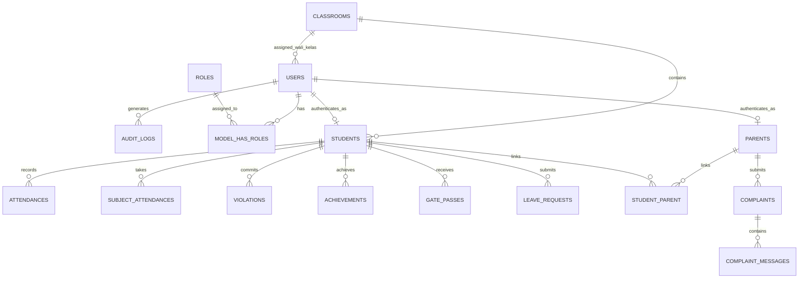
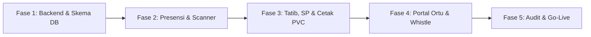

# Dokumen Tinjauan & Cetak Biru Produksi: EduTrack Pro
**Sistem Monitoring Terpadu Sekolah: Presensi Gerbang, Kedisiplinan Siswa, Bank Prestasi, Portal Wali Murid & Kepatuhan ISO/IEC 27001**

*Tanggal Review: 23 November 2026*  
*Versi Prototipe Mockup: v2.4-Production-Ready*  
*Target Implementasi: Production Enterprise Grade*

---

## Daftar Isi
1. [Ringkasan Eksekutif & Status Mockup](#1-ringkasan-eksekutif--status-mockup)
2. [Evaluasi Arsitektur Frontend & State Management Saat Ini](#2-evaluasi-arsitektur-frontend--state-management-saat-ini)
3. [Audit Fungsional & Logika Bisnis Modul](#3-audit-fungsional--logika-bisnis-modul)
   - 3.1 Presensi Gerbang & Presensi KBM Mapel
   - 3.2 Kedisiplinan, Poin Pelanggaran & Penerbitan SP
   - 3.3 Bank Prestasi & Poin Penghargaan
   - 3.4 Cetak Kartu Pelajar Digital (ISO CR-80)
   - 3.5 Digital Gate Pass (Satpam & Izin Keluar)
   - 3.6 Pengaduan & Whistleblowing Terisolasi
   - 3.7 Manajemen Siswa, Orang Tua & Pengguna
   - 3.8 Log Audit & Backup Terenkripsi ISO 27001
4. [Cetak Biru Arsitektur Backend & Database Produksi](#4-cetak-biru-arsitektur-backend--database-produksi)
   - 4.1 Rekomendasi Stack Teknologi Backend
   - 4.2 Diagram Hubungan Entitas (ERD)
   - 4.3 Spesifikasi Skema Database PostgreSQL / MySQL
5. [Integrasi Perangkat Keras & Gateway Eksternal](#5-integrasi-perangkat-keras--gateway-eksternal)
   - 5.1 Barcode & QR Code Scanner Gerbang
   - 5.2 Mesin Cetak Kartu PVC (Thermal Transfer / Retransfer)
   - 5.3 WhatsApp Business Gateway (Webhooks & Queue)
6. [Kepatuhan Keamanan, Privasi & Regulasi (ISO 27001 & UU PDP)](#6-kepatuhan-keamanan-privasi--regulasi-iso-27001--uu-pdp)
7. [Panduan & Roadmap Tahapan Menuju Produksi (Step-by-Step)](#7-panduan--roadmap-tahapan-menuju-produksi-step-by-step)
8. [Daftar Periksa Kesiapan Rilis (Production Readiness Checklist)](#8-daftar-periksa-kesiapan-rilis-production-readiness-checklist)

---

## 1. Ringkasan Eksekutif & Status Mockup

Prototipe EduTrack Pro telah berhasil mengimplementasikan seluruh skenario bisnis utama yang disyaratkan dalam sistem informasi kesiswaan modern. Mockup interaktif yang dibangun di atas file [index.html](file:///c:/scholl_app/index.html) tidak sekadar menampilkan visual statis, melainkan telah memiliki mesin simulasi reaktif (*in-memory state machine*) yang mencerminkan alur kerja nyata di lingkungan sekolah.

### Pencapaian Prototipe Saat Ini
- **Desain Bersih & Elegan**: Mengadopsi standar *Clean White Minimalist* (`bg-white`, kontras abu-abu lembut `border-slate-200`, aksen profesional `slate-950`).
- **Pemisahan Peran Tegas (RBAC & Data Scoping)**:
  - **Super Admin**: Pengendali sistem menyeluruh, log audit ISO 27001, manajemen user, backup snapshot terenkripsi.
  - **Guru BK (Bimbingan Konseling)**: Mengawasi akumulasi poin pelanggaran seluruh siswa sekolah, menerbitkan Surat Peringatan (SP), mencetak kartu pelajar, dan mengelola investigasi aduan.
  - **Wali Kelas**: Dibatasi hanya untuk memantau kehadiran, mengelola presensi mapel, menyetujui izin, dan membina siswa di rombel binaannya (X-RPL-1).
  - **Orang Tua / Wali Murid**: Hanya dapat mengakses profil diri, profil ananda, presensi anak, poin tatib/prestasi anak, mengajukan izin sakit mandiri, serta membuat aduan rahasia pribadi (*Pengaduan Saya*).
  - **Siswa**: Hak akses mandiri melihat status profil, buku saku tatib, poin prestasi, dan jadwal presensi tanpa akses menu cetak kartu atau aduan publik.
- **Kesiapan Modul CRUD Penuh**: Operasi *Create, Read, Update, Delete* telah disimulasikan lengkap pada data Pengguna, Siswa, Orang Tua, Catatan Pelanggaran, Bank Prestasi, dan Catatan Koreksi Presensi.

---

## 2. Evaluasi Arsitektur Frontend & State Management Saat Ini

```
+---------------------------------------------------------------------------------+
|                                 BROWSER CLIENT                                  |
|                                                                                 |
|  +--------------------+   +-----------------------+   +----------------------+  |
|  |     VUE 3 APP      |   |   COMPUTED SCOPES     |   |    REACTIVE REFS     |  |
|  | (Composition API)  |-->|  - filteredStudents   |-->| - students / parents |  |
|  | - visibleNavItems  |   |  - filteredAttendance |   | - attendanceList     |  |
|  | - roleDataScope    |   |  - filteredViolations |   | - violations/SP      |  |
|  +--------------------+   |  - filteredComplaints |   | - complaints/audit   |  |
|                           +-----------------------+   +----------------------+  |
+---------------------------------------------------------------------------------+
```

### Kelebihan Implementasi Mockup
1. **Reaktivitas Instan Tanpa Reload**: Pergantian peran via bilah atas (*Quick Role Switcher*) langsung memicu pembaruan navigasi sidebar (`visibleNavItems`), metrik KPI, dan pemfilteran data tabel secara *real-time*.
2. **Penyaringan Multi-Kriteria & Paginasi Terkalkulasi**: Setiap tabel dilengkapi filter pencarian teks, dropdown status, dropdown kelas, dan penomoran halaman dinamis (`paginationRangeText`).
3. **Pencegahan Data Leakage di Sisi Klien**: Data siswa dan orang tua yang bukan hak akses perannya tidak dirender ke DOM browser.

### Catatan Kritis untuk Produksi
> [!WARNING]
> Pada prototipe, seluruh data disimpan di memori JavaScript browser (*in-memory arrays*). Pada tahap produksi, isolasi data **wajib dipindahkan dan ditegakkan di sisi Backend (Server-Side Policy/Scopes)**, bukan hanya di computed property frontend, guna mencegah manipulasi API melalui *Inspect Element* atau *curl*.

---

## 3. Audit Fungsional & Logika Bisnis Modul

### 3.1 Presensi Gerbang & Presensi KBM Mapel
- **Alur Gerbang Pagi**:
  - Jam masuk standar: `07:00 WIB`.
  - Toleransi & Pembagian Kategori:
    - `06:30 - 07:00 WIB` = **Hadir Tepat Waktu** (0 Poin Tatib).
    - `07:01 - 07:15 WIB` = **Terlambat T-1** (-2 Poin Tatib, Peringatan Lisan).
    - `07:16 - 07:30 WIB` = **Terlambat T-2** (-5 Poin Tatib, Pembinaan Gerbang & Disposisi).
    - `> 07:30 WIB` = **Terlambat T-3** (-10 Poin Tatib, Panggilan Piket/BK & Notifikasi WA Otomatis).
  - Kecepatan pemindaian yang ditargetkan: `< 500 milidetik per siswa` untuk menghindari penumpukan antrean gerbang.
- **Presensi KBM Jam Pelajaran**:
  - Guru mata pelajaran mencatat kehadiran per sesi pelajaran.
  - Fitur deteksi silang: Jika siswa berstatus *Hadir Gerbang* tetapi *Tidak Ada di Kelas*, sistem memicu alert **"Siswa Membolos"** (+10 Poin Tatib) langsung ke guru BK.
- **Pengajuan Izin / Sakit Mandiri oleh Ortu**:
  - Formulir izin digital dengan upload bukti surat dokter (`.pdf` / `.jpg`).
  - Menunggu persetujuan Wali Kelas sebelum status presensi otomatis terkonversi menjadi Sakit/Izin (mencegah penalti Auto-Alpa).

### 3.2 Kedisiplinan, Poin Pelanggaran & Penerbitan SP
- **Katalog Pelanggaran Berjenjang**:
  - Ringan (5 - 15 Poin)
  - Sedang (20 - 45 Poin)
  - Berat (50 - 100 Poin)
- **Mekanisme Peringatan Otomatis**:
  - Akumulasi `-30 Poin`: Peringatan Tertulis I (SP-1).
  - Akumulasi `-60 Poin`: Peringatan Tertulis II (SP-2) & Pemanggilan Orang Tua ke Sekolah.
  - Akumulasi `-100 Poin`: Peringatan Terakhir (SP-3 / Skorsing / Sidang Pleno).
- **Integritas Dokumen SP**:
  - Surat Peringatan dilengkapi stempel kode verifikasi digital QR HMAC-SHA256 untuk memvalidasi keaslian surat jika dicetak fisik.

### 3.3 Bank Prestasi & Poin Penghargaan
- Mendukung pencatatan prestasi akademik dan non-akademik (Tingkat Sekolah, Kota/Kabupaten, Provinsi, Nasional, Internasional).
- Poin merit berfungsi sebagai penyeimbang (*point offset*) terhadap demerit poin tatib kesiswaan.

### 3.4 Cetak Kartu Pelajar Digital (ISO CR-80)
- **Dimensi Fisik**: Standar kartu kredit/ATM internasional $85.60 \times 53.98 \text{ mm}$ (ketebalan 0.76 mm).
- **Struktur Barcode & QR**:
  - Bagian Depan: Barcode 1D (Code 128) berisi nomor NISN siswa untuk kompatibilitas scanner optik gerbang standar.
  - Bagian Belakang: QR Code 2D memuat payload aman bertanda tangan digital:
    $$\text{Payload} = \text{NISN} + \text{ID} + \text{HMAC-SHA256}(\text{NISN}, \text{SecretKey})$$
  - Menolak kartu palsu atau hasil fotokopi siswa yang tidak memiliki tanda tangan digital valid.
- **Kewenangan Cetak**: Dibatasi hanya untuk Super Admin dan Guru BK.

### 3.5 Digital Gate Pass (Satpam & Izin Keluar)
- Menggantikan secarik kertas disposisi manual satpam.
- Siswa yang sakit atau memiliki urusan keluarga mendesak diterbitkan tiket Gate Pass ber-QR oleh Guru Piket/BK.
- Satpam di pos gerbang memindai token QR untuk memverifikasi nama penjemput dan membuka portal gerbang. Riwayat keluar tercatat otomatis di server.

### 3.6 Pengaduan & Whistleblowing Terisolasi
- Menjaga kerahasiaan pelapor kasus perundungan (*bullying*), pelecehan, atau pungutan liar.
- Opsi anonim menyamarkan identitas pelapor dari publik.
- Obrolan dua arah terenkripsi antara pelapor dan tim investigasi sekolah.
- Orang tua hanya dapat melihat tiket aduannya sendiri (`Pengaduan Saya`), Wali Kelas melihat aduan kelas binaan, Guru BK & Admin mengawasi seluruh aduan se-sekolah. Siswa tidak dibebani menu aduan publik demi perlindungan psikologis anak.

### 3.7 Manajemen Siswa, Orang Tua & Pengguna
- **Dropdown Scope Dinamis**: Pada modul Tambah/Edit Pengguna, kolom Cakupan Data otomatis terisolasi berdasarkan peran (Admin = Seluruh Sekolah; BK = Tingkat Kelas/Semua; Wali Kelas = Pilihan Kelas; Ortu/Siswa = Pilihan Siswa).
- **Akses Profil Mandiri**: Siswa memiliki menu **Data Diri Siswa**; Orang Tua memiliki menu **Data Siswa (Anak)** dan **Data Orang Tua / Wali**.

### 3.8 Log Audit & Backup Terenkripsi ISO 27001
- **Audit Trail 5W+1H**: Setiap penambahan pelanggaran, perubahan presensi, dan login pengguna tercatat dengan cap waktu mikrodetik dan alamat IP.
- **Strategi Backup 3-2-1**:
  - Salinan 1: Database lokal aktif.
  - Salinan 2: Snapshot lokal terenkripsi AES-256.
  - Salinan 3: Replikasi offsite ke S3-compatible cold storage dengan verifikasi *hash* SHA-256.

---

## 4. Cetak Biru Arsitektur Backend & Database Produksi

### 4.1 Rekomendasi Stack Teknologi Backend
Untuk lingkungan pendidikan di Indonesia dan integrasi jangka panjang dengan platform Dapodik/Kemendikbud, direkomendasikan arsitektur berikut:

- **Framework Backend**: **Laravel 11 (PHP 8.3+)**
  - Alasan: Ekosistem mature, bawaan otentikasi tangguh (*Sanctum / Passport*), ORM Eloquent ekspresif untuk relasi kompleks, antrean latar belakang bawaan (*Queue Worker Redis*), dan *Policy/Gate* untuk RBAC.
  - Opsi Alternatif: **NestJS (TypeScript)** atau **Go (Golang)** jika sekolah memiliki beban scanner gerbang lebih dari 5.000 pemindaian dalam 15 menit.
- **Database Mesin Utama**: **PostgreSQL 16** (atau **MariaDB / MySQL 8.0+**)
- **In-Memory Cache & Queue**: **Redis 7.2** (untuk antrean webhook WhatsApp dan caching sesi scanner gerbang).
- **Penyimpanan Berkas (Storage)**: **MinIO** (on-premise) atau **AWS S3 / Wasabi / Cloudflare R2** (surat dokter, foto kartu siswa, berkas backup terenkripsi).

---

### 4.2 Diagram Hubungan Entitas (ERD)



---

### 4.3 Spesifikasi Skema Database PostgreSQL / MySQL

Berikut adalah rancangan tabel DDL (*Data Definition Language*) utama yang siap diimplementasikan via migration Laravel:

#### Tabel `classrooms` (Rombel Belajar)
```sql
CREATE TABLE classrooms (
    id BIGSERIAL PRIMARY KEY,
    name VARCHAR(50) NOT NULL UNIQUE,       -- Contoh: 'X-RPL-1'
    grade_level INT NOT NULL,               -- 10, 11, 12
    major VARCHAR(50) NOT NULL,             -- Rekayasa Perangkat Lunak
    wali_kelas_id BIGINT REFERENCES users(id) ON DELETE SET NULL,
    created_at TIMESTAMP WITH TIME ZONE DEFAULT NOW(),
    updated_at TIMESTAMP WITH TIME ZONE DEFAULT NOW()
);
```

#### Tabel `students` (Master Pokok Siswa)
```sql
CREATE TABLE students (
    id BIGSERIAL PRIMARY KEY,
    nisn VARCHAR(10) NOT NULL UNIQUE,       -- 10 Digit NISN Resmi
    nis VARCHAR(20) UNIQUE,                 -- Nomor Induk Sekolah
    full_name VARCHAR(150) NOT NULL,
    gender VARCHAR(15) NOT NULL CHECK (gender IN ('Laki-laki', 'Perempuan')),
    classroom_id BIGINT NOT NULL REFERENCES classrooms(id) ON DELETE RESTRICT,
    birth_date DATE,
    address TEXT,
    phone_number VARCHAR(20),
    demerit_points INT DEFAULT 0,           -- Poin Pelanggaran Aktif
    merit_points INT DEFAULT 0,             -- Poin Prestasi Aktif
    status VARCHAR(20) DEFAULT 'Aktif' CHECK (status IN ('Aktif', 'Nonaktif', 'Mutasi', 'Lulus')),
    card_token_hash VARCHAR(64),            -- Hash QR Code Validasi Fisik
    created_at TIMESTAMP WITH TIME ZONE DEFAULT NOW(),
    updated_at TIMESTAMP WITH TIME ZONE DEFAULT NOW()
);
CREATE INDEX idx_students_nisn ON students(nisn);
CREATE INDEX idx_students_classroom ON students(classroom_id);
```

#### Tabel `parents` (Wali Murid) & Relasi Pivot
```sql
CREATE TABLE parents (
    id BIGSERIAL PRIMARY KEY,
    user_id BIGINT UNIQUE REFERENCES users(id) ON DELETE CASCADE,
    full_name VARCHAR(150) NOT NULL,
    relation VARCHAR(30) NOT NULL,          -- Ayah Kandung, Ibu Kandung, Wali
    whatsapp_number VARCHAR(25) NOT NULL,   -- Standar Format E.164: +62812...
    email VARCHAR(100),
    occupation VARCHAR(100),
    is_portal_active BOOLEAN DEFAULT TRUE,
    created_at TIMESTAMP WITH TIME ZONE DEFAULT NOW(),
    updated_at TIMESTAMP WITH TIME ZONE DEFAULT NOW()
);

CREATE TABLE student_parent (
    id BIGSERIAL PRIMARY KEY,
    student_id BIGINT NOT NULL REFERENCES students(id) ON DELETE CASCADE,
    parent_id BIGINT NOT NULL REFERENCES parents(id) ON DELETE CASCADE,
    is_emergency_contact BOOLEAN DEFAULT TRUE,
    UNIQUE(student_id, parent_id)
);
```

#### Tabel `attendances` (Presensi Gerbang Harian)
```sql
CREATE TABLE attendances (
    id BIGSERIAL PRIMARY KEY,
    student_id BIGINT NOT NULL REFERENCES students(id) ON DELETE CASCADE,
    attendance_date DATE NOT NULL,
    check_in_time TIME,
    check_out_time TIME,
    status VARCHAR(20) NOT NULL CHECK (status IN ('Hadir', 'Terlambat', 'Sakit', 'Izin', 'Alpa')),
    tardiness_level VARCHAR(10) CHECK (tardiness_level IN ('T-0', 'T-1', 'T-2', 'T-3')),
    late_minutes INT DEFAULT 0,
    scanner_device_id VARCHAR(50),
    wa_notification_sent BOOLEAN DEFAULT FALSE,
    notes TEXT,
    created_at TIMESTAMP WITH TIME ZONE DEFAULT NOW(),
    updated_at TIMESTAMP WITH TIME ZONE DEFAULT NOW(),
    UNIQUE(student_id, attendance_date)
);
CREATE INDEX idx_attendance_date_status ON attendances(attendance_date, status);
```

#### Tabel `violations` & `sanctions_sp`
```sql
CREATE TABLE violation_presets (
    id SERIAL PRIMARY KEY,
    title VARCHAR(150) NOT NULL,
    severity VARCHAR(20) NOT NULL CHECK (severity IN ('Ringan', 'Sedang', 'Berat')),
    demerit_points INT NOT NULL,
    action_notes TEXT
);

CREATE TABLE violations (
    id BIGSERIAL PRIMARY KEY,
    student_id BIGINT NOT NULL REFERENCES students(id) ON DELETE CASCADE,
    recorded_by BIGINT NOT NULL REFERENCES users(id),
    preset_id INT REFERENCES violation_presets(id),
    title VARCHAR(200) NOT NULL,
    severity VARCHAR(20) NOT NULL,
    demerit_points INT NOT NULL,
    incident_date DATE NOT NULL,
    status VARCHAR(20) DEFAULT 'Diproses' CHECK (status IN ('Diproses', 'SP-1', 'SP-2', 'SP-3', 'Selesai', 'Dibatalkan')),
    investigation_notes TEXT,
    sp_document_number VARCHAR(50),
    sp_verification_token VARCHAR(64),
    created_at TIMESTAMP WITH TIME ZONE DEFAULT NOW(),
    updated_at TIMESTAMP WITH TIME ZONE DEFAULT NOW()
);
```

#### Tabel `audit_logs` (Kepatuhan ISO/IEC 27001)
```sql
CREATE TABLE audit_logs (
    id BIGSERIAL PRIMARY KEY,
    user_id BIGINT REFERENCES users(id) ON DELETE SET NULL,
    user_email VARCHAR(100),
    user_role VARCHAR(50),
    action VARCHAR(100) NOT NULL,           -- CREATE_STUDENT, UPDATE_ATTENDANCE, etc.
    description TEXT NOT NULL,
    ip_address VARCHAR(45) NOT NULL,
    user_agent TEXT,
    prev_payload JSONB,                    -- Payload Sebelum Diubah (Differential)
    new_payload JSONB,                     -- Payload Sesudah Diubah
    hash_signature VARCHAR(64) NOT NULL,   -- SHA-256 HMAC (Pencegah Tampering Log)
    created_at TIMESTAMP WITH TIME ZONE DEFAULT NOW()
);
CREATE INDEX idx_audit_created ON audit_logs(created_at);
```

---

## 5. Integrasi Perangkat Keras & Gateway Eksternal

```
[KARTU PELAJAR (Barcode/QR)]
             |
             v
 [SCANNER 2D USB/ETHERNET] ---> [APP CLIENT / EDGE BROWSER]
                                          |
                                          | POST /api/v1/attendance/scan
                                          v
                               [LARAVEL BACKEND SERVER]
                                          |
                        +-----------------+-----------------+
                        |                                   |
                        v                                   v
             [POSTGRESQL DATABASE]                  [REDIS QUEUE WORKER]
                                                            |
                                                            v
                                                  [WHATSAPP API GATEWAY]
                                                            |
                                                            v
                                                 [NO. WA ORANG TUA SISWA]
```

### 5.1 Barcode & QR Code Scanner Gerbang
1. **Pemilihan Tipe Scanner**:
   - Gunakan **2D Omnidirectional Presentation Scanner** (misal: *Zebra DS9308* atau *Honeywell HF680*). Tipe ini membaca kode dari berbagai sudut dalam jarak 0 - 25 cm dalam kecepatan kurang dari 0.2 detik tanpa perlu siswa membidik posisi barcode.
2. **Mode Koneksi**:
   - **Mode USB HID (Keyboard Emulation)**: Scanner mengirim karakter barcode diikuti enter (`\n`). Dapat langsung ditangkap oleh listener event JavaScript di browser.
   - **Mode Web Serial API / WebSocket**: Direkomendasikan untuk produksi agar input barcode langsung masuk ke aplikasi tanpa memedulikan kursor sedang fokus pada kolom teks input atau tidak.

### 5.2 Mesin Cetak Kartu PVC (Thermal Transfer / Retransfer)
1. **Perangkat Cetak**:
   - Direct-to-Card Printer (misal: *Evolis Zenius / Primacy* atau *Zebra ZC300*).
   - Retransfer Printer (misal: *Fargo HDP5000*) jika menginginkan hasil cetak *over-the-edge* tahan gesek hingga 3 tahun.
2. **Generasi Berkas Cetak**:
   - Backend merender berkas cetak menggunakan library headless (*Puppeteer / Browsershot*) ke format PDF resolusi tinggi (300 DPI) dengan ukuran kanvas standar ISO CR-80 ($1012 \times 638 \text{ px}$).

### 5.3 WhatsApp Business Gateway (Webhooks & Queue)
1. **Provider Rekomendasi**:
   - **Tingkat Menengah**: Provider lokal berizin Kominfo seperti *Fonnte*, *Wablas*, atau *Watzap*.
   - **Tingkat Enterprise / Resmi**: *WhatsApp Cloud API Official (Meta Graph API)* melalui BSP (Business Solution Provider) seperti *Qiscus* atau *Mekari Chat*.
2. **Arsitektur Antrean (Asynchronous Queueing)**:
   - Pengiriman WA **tidak boleh** memblokir proses scanning gerbang.
   - Saat siswa melakukan tap kartu, server menyimpan presensi (< 50ms), lalu melemparkan event `AttendanceRecordedEvent` ke Redis Queue. Worker di latar belakang memproses HTTP dispatch ke gateway WhatsApp secara terpisah.

---

## 6. Kepatuhan Keamanan, Privasi & Regulasi (ISO 27001 & UU PDP)

Implementasi produksi wajib memenuhi klausul keamanan informasi dan perlindungan data pribadi siswa (UU PDP No. 27 Tahun 2022):

| Aspek Keamanan | Klausul Standar | Penerapan Teknis pada EduTrack Pro |
| :--- | :--- | :--- |
| **Kriptografi Data** | ISO 27001 Control A.10 | Enkripsi data sensitif (alamat rumah siswa, nomor WA ortu) menggunakan AES-256-GCM. Kata sandi di-hash menggunakan algoritma **Argon2id**. |
| **Otentikasi Berlapis** | ISO 27001 Control A.9.4 | Implementasi **Two-Factor Authentication (2FA TOTP)** wajib bagi akun Super Admin dan Guru BK. |
| **Prinsip Least Privilege** | ISO 27001 Control A.9.1 | Pemisahan tegas hak akses. Wali kelas hanya membaca kelasnya sendiri, ortu hanya membaca anaknya sendiri. Siswa tidak memiliki akses aduan publik. |
| **Integritas Audit Trail** | ISO 27001 Control A.12.4 | Log audit bersifat *immutable* (tidak dapat diubah/dihapus via UI). Setiap baris log diberi checksum hash berantai (*tamper-evident*). |
| **Pencadangan Data** | ISO 27001 Control A.12.3 | Snapshot cadangan terenkripsi otomatis harian pukul 02:00 WIB, diverifikasi dengan SHA-256 checksum dan direplikasi off-site. |

---

## 7. Panduan & Roadmap Tahapan Menuju Produksi (Step-by-Step)



### Tahap 1: Setup Backend & Inisialisasi Database (Minggu 1 - 2)
- Inisialisasi project Laravel 11 / PostgreSQL.
- Buat seluruh migrasi tabel sesuai bab 4.3.
- Pasang paket otentikasi (Laravel Sanctum / Breeze) dan paket RBAC (*Spatie Laravel-Permission*).
- Buat seeder data awal (kelas, admin, bk, wali kelas demo).

### Tahap 2: API Presensi Gerbang & Integrasi Scanner (Minggu 3 - 4)
- Bangun endpoint API `POST /api/v1/attendance/scan-gate`.
- Hubungkan scanner barcode USB/Serial di pos gerbang sekolah.
- Hubungkan antrean Redis worker untuk simulasi webhook WhatsApp.
- Lakukan stress test simulasi 500 siswa tap berturut-turut dalam 10 menit.

### Tahap 3: Modul Tatib, SP Digital & Cetak Kartu PVC (Minggu 5 - 6)
- Bangun kalkulator akumulasi poin pelanggaran dan poin prestasi.
- Integrasikan generator dokumen SP ber-QR Code dengan engine PDF 300 DPI.
- Cetak uji coba kartu fisik PVC pada printer kartu untuk memastikan barcode Code 128 dan QR terbaca optimal oleh scanner gerbang.

### Tahap 4: Portal Wali Murid & Kanal Whistleblower (Minggu 7 - 8)
- Buat dashboard responsif mobile untuk orang tua murid.
- Terapkan mekanisme isolasi data di backend (`StudentPolicy` & `AttendancePolicy`).
- Pasang enkripsi end-to-end pada tabel chat investigasi aduan kesiswaan.

### Tahap 5: Audit Kepatuhan, Pengujian Beban & Peluncuran Resmi (Minggu 9 - 10)
- Penetration Testing (uji kerentanan SQL Injection, XSS, IDOR / Privilege Escalation).
- Pelatihan operator piket sekolah, wali kelas, guru BK, dan satpam gerbang.
- Distribusi kartu pelajar ber-barcode kepada seluruh siswa.
- Peluncuran sistem secara resmi (*Cut-over Go-Live*).

---

## 8. Daftar Periksa Kesiapan Rilis (Production Readiness Checklist)

Gunakan daftar periksa berikut sebagai acuan verifikasi sebelum sistem dibuka untuk umum:

- [ ] **Validasi Backend RBAC**: Pastikan endpoint API mengembalikan status `403 Forbidden` jika Wali Kelas mencoba melihat data siswa kelas lain, atau jika Orang Tua mencoba melihat data anak orang lain.
- [ ] **Rate Limiting API**: Terapkan *Throttle Requests* (maksimal 60 request/menit per IP) pada endpoint publik untuk mencegah *brute-force* atau penyerangan DDOS.
- [ ] **Konektivitas Failover Scanner**: Siapkan laptop/tablet cadangan di pos satpam dengan scanner cadangan jika terjadi kegagalan hardware di gerbang utama.
- [ ] **SSL/TLS 1.3**: Pastikan seluruh domain sekolah memakai sertifikat HTTPS valid dengan nilai minimal Grade A pada tes SSL Labs.
- [ ] **Kebijakan Privasi Siswa**: Siapkan lembar persetujuan pemrosesan data pribadi (*Consent Form*) bagi wali murid sesuai amanat UU Perlindungan Data Pribadi (UU PDP).

---

> [!NOTE]
> Seluruh kode frontend prototipe, komponen kartu CR-80, logika kalkulasi keterlambatan T-1 s.d. T-3, dan pemfilteran peranan telah diarsipkan dan tersimpan aman di repositori GitHub:
> [https://github.com/benny-abdullah/school_app.git](https://github.com/benny-abdullah/school_app.git) (Branch `main`).
